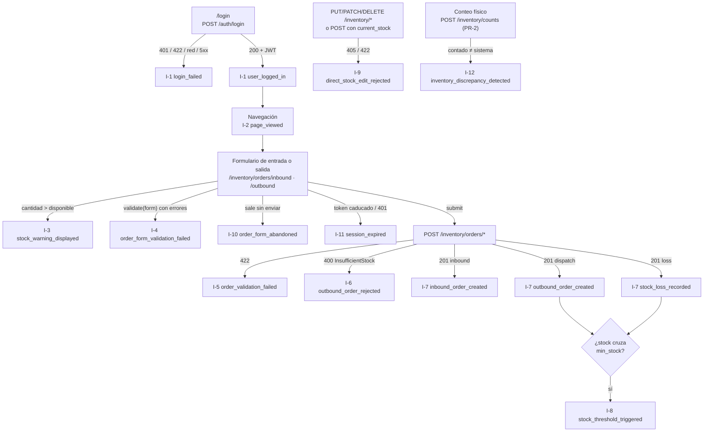
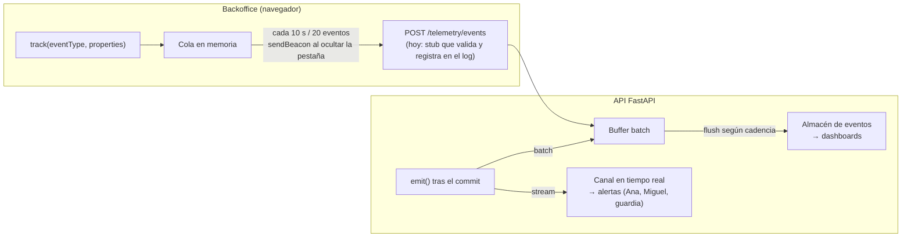

# Plan de Telemetría — TrackFlow · Sistema de inventario

| | |
|---|---|
| **Versión del plan** | 1.1.0 (catálogo `x-catalogVersion` 1.1.0) |
| **Fecha** | 2026-10-24 · revisado 2026-10-27 al implementar la captura (hito 15) |
| **Fuente de requisitos** | BRIEFING de telemetría CONTEXT-10 (`audit/CONTEXTS/CONTEXT-10-trackflow.es.md`, carpeta local fuera de git) y CONTEXT-9 (backend de inventario). Las tablas de la sección 2.1 lo reproducen literalmente. |
| **Esquemas exportables** | [`event-schemas.json`](event-schemas.json) — JSON Schema draft-07 |
| **Validación automática** | [`tests/telemetry/test_event_schemas.py`](tests/telemetry/test_event_schemas.py) (`uv run pytest tests/telemetry`) |
| **Alcance** | Plan (fase 1 de la serie Plan · Captura · Almacenamiento · Reporte). La captura de 14 eventos está implementada (hito 15) y se guarda en la tabla `telemetry_events` de Supabase (hito 16): ver la [sección 10](#10-estado-de-la-implementación-hitos-15-y-16). |

---

## Índice

1. [Resumen](#1-resumen)
2. [Fase 1 — Catálogo de oportunidades de datos](#2-fase-1--catálogo-de-oportunidades-de-datos)
3. [Brechas del sistema actual y prerrequisitos](#3-brechas-del-sistema-actual-y-prerrequisitos)
4. [Fase 2 — Event Envelope](#4-fase-2--event-envelope)
5. [Catálogo de eventos (esquema completo)](#5-catálogo-de-eventos-esquema-completo)
6. [Fase 3 — Estrategia de entrega](#6-fase-3--estrategia-de-entrega)
7. [Riesgos y exclusiones](#7-riesgos-y-exclusiones)
8. [Guía de instrumentación para el siguiente desarrollador](#8-guía-de-instrumentación-para-el-siguiente-desarrollador)
9. [Trazabilidad con el checklist](#9-trazabilidad-con-el-checklist)
10. [Estado de la implementación (hitos 15 y 16)](#10-estado-de-la-implementación-hitos-15-y-16)

---

## 1. Resumen

En TrackFlow el inventario **es** el negocio: cada unidad que entra o sale de Los Ángeles o Zaragoza es una obligación contractual con una marca cliente. Este plan define qué eventos se capturan del sistema de inventario (`/inventory`, CONTEXT-9) y del backoffice que lo usa, por qué, con qué forma exacta y cómo se entregan.

- **26 eventos**: los **5 obligatorios** del BRIEFING y **21 oportunidades identificadas** en cinco categorías (negocio/inventario, autenticación, rendimiento, errores y navegación).
- **Un único Event Envelope** para todos, con `eventId`, `timestamp` ISO 8601, `sessionId`, `userId`, `event_type`, `schemaVersion`, `requestId` y `properties`.
- **Allowlist estricta** por evento: `additionalProperties: false` en cada esquema. Lo que no está en la lista no se emite.
- **Stream solo donde una persona tiene que actuar en minutos** (quiebre de stock inminente, pedido parado en el muelle, ritmo de despachos, caída de la base de datos). El resto, batch.
- Los eventos se diseñan para agregarse por **almacén** (`warehouse`), **cliente** (`client_id`) y **país** (`country`): son la base del dashboard operativo de Ana y del ejecutivo de Thomas.

---

## 2. Fase 1 — Catálogo de oportunidades de datos

### 2.1 Métricas obligatorias del BRIEFING (el piso)

Copiadas literalmente de CONTEXT-10 §3. Los nombres de evento, entidades e identificadores coinciden exactamente con el BRIEFING.

| `event_type` | Se dispara cuando… | Hipótesis | Decisión | ¿Instrumentable hoy? |
|---|---|---|---|---|
| `inbound_order_created` | Un almacén registra la recepción de mercancía de un cliente | Cuánto volumen entra, por cliente y por almacén | Planificar capacidad de almacén y personal (Ana) | ✅ Sí — `POST /inventory/orders/inbound` |
| `outbound_order_created` | Un almacén completa el picking y despacho de un pedido | Cuántos pedidos se procesan, por cliente y almacén, y a qué ritmo | Detectar cuellos de botella antes de afectar el SLA (Ana) | ✅ Sí — `POST /inventory/orders/outbound` con `exit_type = dispatch` |
| `stock_threshold_triggered` | El stock de un SKU cae por debajo del mínimo configurado para ese cliente | Con qué frecuencia un cliente se queda sin stock de un SKU | Alertar al cliente y a comercial antes del quiebre (Miguel) | ⚠️ Requiere [PR-1](#3-brechas-del-sistema-actual-y-prerrequisitos): hoy no existe el umbral mínimo |
| `direct_stock_edit_rejected` | Un usuario intenta modificar el stock fuera de una orden y el sistema lo rechaza | Si el personal intenta saltarse la trazabilidad | Reforzar capacitación o permisos en ese almacén | ✅ Sí — el rechazo ya existe (405 / 422 `extra_forbidden`); falta emitir |
| `inventory_discrepancy_detected` | Un conteo físico detecta diferencia con el stock del sistema | En qué SKUs y almacenes hay más discrepancias | Priorizar auditorías en los SKUs con más discrepancia (Ana) | ⚠️ Requiere [PR-2](#3-brechas-del-sistema-actual-y-prerrequisitos): hoy no existe el registro de conteos |

**Campos mínimos** que llevan los eventos de inventario en `properties` (BRIEFING §3): `warehouse` (`los_angeles`/`zaragoza`), `client_id`, `product_id` (SKU), `product_category`, `quantity`. Se añade `country` (`US`/`ES`), derivado de `warehouse`, porque el BRIEFING pide agregación por país.

### 2.2 Mapa del flujo de gestión de inventario

Recorrido real de un operario en el código actual, desde que se autentica hasta que una orden queda registrada. Cada `I-n` es un punto de instrumentación.



| Punto | Momento del flujo | Evento(s) | Dónde está en el código | Tipo |
|---|---|---|---|---|
| I-1 | Autenticación | `user_logged_in`, `login_failed` | `services/api/routes/auth.py` (`_issue_token`); `login_failed` en `login()` de `uis/backoffice/app/lib/auth.ts` | Acceso |
| I-2 | Entrada a la sección de inventario | `page_viewed` | `uis/backoffice/app/ui/telemetry-listener.tsx` (layout raíz) | Navegación |
| I-3 | Operario teclea una cantidad mayor que el stock | `stock_warning_displayed` | `outbound-client.tsx:112` (`showWarning`) | Validación preventiva |
| I-4 | Envío bloqueado por validación del formulario | `order_form_validation_failed` | `inbound-client.tsx:96`, `outbound-client.tsx:136` | **Validación fallida** |
| I-5 | La API rechaza datos mal formados | `order_validation_failed` | `services/api/errors.py:46` | **Validación fallida** |
| I-6 | La API rechaza una salida sin stock | `outbound_order_rejected` | `InsufficientStock` en `register_exit`; se captura al recibir el 400 en `lib/inventory.ts` | **Rechazo de negocio** |
| I-7 | Orden confirmada en base de datos | `inbound_order_created`, `outbound_order_created`, `stock_loss_recorded` | Commit en `register_entry`/`register_exit`; se capturan al recibir el 201 en `lib/inventory.ts` | **Completar la orden** |
| I-8 | El stock cruza el mínimo | `stock_threshold_triggered` | `register_exit`, tras el commit, con el umbral de PR-1 | **Activación de umbral** |
| I-9 | Intento de fijar stock directamente | `direct_stock_edit_rejected` | `services/direct_stock_edit.py`, llamado desde el middleware de `main.py` y el manejador 422 de `errors.py` | **Intento directo rechazado** |
| I-10 | Formulario abandonado | `order_form_abandoned` | Hook `useFormAbandonment` en los formularios de entrada/salida | Fricción |
| I-11 | Caduca la sesión a mitad del flujo | `session_expired` | `uis/backoffice/app/lib/auth.ts` (`backofficeFetch`) | Sesión |
| I-12 | Conteo físico con diferencia | `inventory_discrepancy_detected` | `register_count`, tras `POST /inventory/counts` (PR-2) | Auditoría |

Son **12 puntos**, más del mínimo de 5, e incluyen los tres casos que pedía el enunciado: el intento directo de modificar stock (I-9), las validaciones fallidas (I-4, I-5, I-6) y la activación del umbral mínimo (I-8).

### 2.3 Exploración del resto del backoffice

Además del flujo de inventario se revisó todo el backoffice (`uis/backoffice`, app Next.js en el puerto 3001) y la API (`services/api`). Lo que se encontró y la oportunidad que abre:

| Área | Qué hay hoy en el código | Oportunidad | Evento(s) |
|---|---|---|---|
| **Autenticación** | Login JSON y OAuth2 (`/auth/login`, `/auth/token` para Swagger); mismo 401 para email inexistente y contraseña errónea; token de 30 min (`ACCESS_TOKEN_EXPIRE_MINUTES`); el frontend borra el token y redirige al detectar caducidad o 401 | Detectar fuerza bruta, medir adopción, comprobar si el token de 30 min corta el turno | `user_logged_in`, `login_failed`, `session_expired`, `user_logged_out` |
| **Recuperación de contraseña** | `forgot-password` en segundo plano; si Resend falla, hoy solo queda una línea en el log | Saber cuándo un usuario se queda sin acceso | `password_reset_requested`, `password_reset_email_failed` |
| **Rendimiento de la API** | El stock se calcula en cada consulta (suma de entradas − salidas) contra Supabase remoto | Vigilar la degradación al crecer los movimientos | `api_latency_recorded` |
| **Rendimiento del frontend** | El Hito 11 mejoró Lighthouse en laboratorio, pero no hay datos de usuarios reales | Medir Core Web Vitals reales por dispositivo | `page_load_recorded` |
| **Errores de backend** | `services/api/errors.py` ya centraliza 500 y 503, pero solo escribe en el log | Detectar bugs y caídas en minutos | `api_error_occurred`, `database_connection_failed` |
| **Errores de frontend** | `app/error.tsx` solo hace `console.error`: el equipo nunca se entera | Capturar errores no controlados | `frontend_error_captured`, `api_request_failed` |
| **Navegación** | Cabecera con 6 secciones (incidentes, gestor, registrar, proveedores, inventario, talent) | Saber qué secciones se usan y dónde se abandonan flujos | `page_viewed`, `order_form_abandoned` |
| **Catálogo de SKUs** | `POST /inventory/products` con código único global; el seed necesita `CLT-SNK-W-42-Z` para tener el mismo producto en Zaragoza | Medir altas y choques de códigos | `product_created`, `product_creation_rejected` |

Secciones revisadas que **no** generan eventos de negocio propios (sí se cubren con `page_viewed`, rendimiento y errores): gestor de incidencias, proveedores y Talent Pipeline. El motivo está en la [sección 7.1](#71-eventos-considerados-y-descartados).

### 2.4 Hipótesis y decisión de cada evento

Cada evento completa la frase *"Capturamos `[event_type]` porque necesitamos saber `[hipótesis]`, lo que nos permite tomar la decisión `[decisión]`"*. Los que no la completaban se descartaron ([sección 7.1](#71-eventos-considerados-y-descartados)).

| `event_type` | Grupo | Frase |
|---|---|---|
| `inbound_order_created` | Obligatorio | Capturamos `inbound_order_created` porque necesitamos saber cuánto volumen entra, por cliente y por almacén, lo que nos permite tomar la decisión de planificar capacidad de almacén y personal según el volumen entrante. |
| `outbound_order_created` | Obligatorio | Capturamos `outbound_order_created` porque necesitamos saber cuántos pedidos se procesan, por cliente y almacén, y a qué ritmo, lo que nos permite tomar la decisión de detectar cuellos de botella operativos antes de que afecten el SLA de entrega. |
| `stock_threshold_triggered` | Obligatorio | Capturamos `stock_threshold_triggered` porque necesitamos saber con qué frecuencia un cliente se queda sin stock disponible de un SKU, lo que nos permite tomar la decisión de alertar al cliente y al equipo comercial antes de un quiebre de stock. |
| `direct_stock_edit_rejected` | Obligatorio | Capturamos `direct_stock_edit_rejected` porque necesitamos saber si el personal de almacén intenta saltarse el control de trazabilidad, lo que nos permite tomar la decisión de reforzar capacitación o permisos en el almacén donde esto ocurre con más frecuencia. |
| `inventory_discrepancy_detected` | Obligatorio | Capturamos `inventory_discrepancy_detected` porque necesitamos saber en qué SKUs y almacenes ocurren más discrepancias, lo que nos permite tomar la decisión de priorizar auditorías de inventario en los SKUs con mayor tasa de discrepancia. |
| `stock_loss_recorded` | Oportunidad | Capturamos `stock_loss_recorded` porque necesitamos saber dónde se concentran las pérdidas (daño, extravío) por almacén, cliente y categoría, ya que cada unidad perdida es una responsabilidad contractual con la marca, lo que nos permite tomar la decisión de revisar procesos de manipulación y embalaje en el almacén/categoría con mayor tasa de pérdida, y ajustar con comercial las cláusulas de responsabilidad. |
| `outbound_order_rejected` | Oportunidad | Capturamos `outbound_order_rejected` porque necesitamos saber cuándo un operario intenta despachar más de lo que el sistema dice que hay: o la demanda real supera el stock (quiebre inminente) o el stock del sistema está mal (discrepancia física), lo que nos permite tomar la decisión de lanzar un conteo cíclico inmediato de ese SKU en ese almacén y, si se repite, avisar al cliente. |
| `order_validation_failed` | Oportunidad | Capturamos `order_validation_failed` porque necesitamos saber qué campos llegan inválidos a la API pese a la validación del frontend: o el formulario tiene huecos o hay integraciones (scripts, Swagger) usando mal la API, lo que nos permite tomar la decisión de corregir la validación del formulario o documentar el contrato para integradores, según `client_channel`. |
| `order_form_validation_failed` | Oportunidad | Capturamos `order_form_validation_failed` porque necesitamos saber en qué campos se equivocan más los operarios al registrar movimientos, lo que nos permite tomar la decisión de rediseñar el campo problemático (p. ej. lectura por escáner del número de seguimiento) o reforzar la formación en ese paso. |
| `order_form_abandoned` | Oportunidad | Capturamos `order_form_abandoned` porque necesitamos saber si hay movimientos físicos que no llegan a registrarse cuando el operario abandona el formulario, ya que cada movimiento sin registrar es una discrepancia futura, lo que nos permite tomar la decisión de identificar el paso donde se abandona y cruzar la tasa de abandono por almacén con `inventory_discrepancy_detected` para priorizar arreglos de UX. |
| `stock_warning_displayed` | Oportunidad | Capturamos `stock_warning_displayed` porque necesitamos saber si el aviso preventivo evita rechazos: si funciona, la mayoría de avisos NO deberían ir seguidos de un `outbound_order_rejected` en la misma sesión, lo que nos permite tomar la decisión de mantener el aviso, convertirlo en bloqueo del botón o retirarlo. |
| `product_created` | Oportunidad | Capturamos `product_created` porque necesitamos saber a qué ritmo se incorporan SKUs nuevos por cliente, categoría y almacén, ya que cada SKU nuevo necesita ubicación física, lo que nos permite tomar la decisión de reservar ubicaciones (slotting) en el almacén antes de que llegue la primera recepción y detectar clientes en crecimiento para comercial. |
| `product_creation_rejected` | Oportunidad | Capturamos `product_creation_rejected` porque necesitamos saber si los códigos SKU chocan entre clientes o entre almacenes (el propio seed necesita `CLT-SNK-W-42-Z` para tener el mismo producto en Zaragoza), lo que tensiona la regla de un SKU por cliente, lo que nos permite tomar la decisión de introducir un prefijo obligatorio por cliente en el código o rediseñar el modelo para que un SKU exista en varios almacenes. |
| `user_logged_in` | Oportunidad | Capturamos `user_logged_in` porque necesitamos saber si todo el personal está adoptando el backoffice unificado (antes cada almacén usaba un sistema distinto) y si alguien usa la API por Swagger (`/auth/token`) en lugar de la interfaz, lo que nos permite tomar la decisión de dirigir formación a los equipos con pocos inicios de sesión frente a su volumen de órdenes, y cerrar o restringir Swagger en producción si lo usa personal operativo. |
| `login_failed` | Oportunidad | Capturamos `login_failed` porque necesitamos saber cuántos operarios no consiguen entrar al backoffice y por qué (contraseña olvidada, formulario confuso o API/red caída en el almacén), lo que nos permite tomar la decisión de simplificar la recuperación de contraseña o el formulario si dominan `invalid_credentials`/`validation_error`, o tratar el acceso como incidencia de infraestructura si dominan `network_error`/`server_error`. |
| `session_expired` | Oportunidad | Capturamos `session_expired` porque necesitamos saber si el tiempo de vida del token (`ACCESS_TOKEN_EXPIRE_MINUTES = 30`) interrumpe a los operarios a mitad de turno y les hace perder formularios a medio rellenar, lo que nos permite tomar la decisión de ampliar la duración del token, implementar refresh token o guardar borradores de formulario. |
| `user_logged_out` | Oportunidad | Capturamos `user_logged_out` porque necesitamos saber cuánto dura una sesión real de trabajo comparada con el turno y con los 30 min del token, lo que nos permite tomar la decisión de fijar la duración del token y el refresco con datos reales (se usa junto con `session_expired`). |
| `password_reset_requested` | Oportunidad | Capturamos `password_reset_requested` porque necesitamos saber con qué frecuencia los usuarios olvidan la contraseña y si hay abuso del endpoint (muchas solicitudes de cuentas que no existen), lo que nos permite tomar la decisión de cambiar la política de contraseñas o pasar a SSO si es frecuente; añadir límite por origen si hay abuso. |
| `api_latency_recorded` | Oportunidad | Capturamos `api_latency_recorded` porque necesitamos saber si el cálculo de stock (suma de entradas − salidas en cada consulta, contra Supabase remoto) se degrada a medida que crecen los movimientos, lo que nos permite tomar la decisión de añadir índices, cachear o materializar el stock cuando el p95 de `/inventory/*` supere el SLO de 500 ms. |
| `page_load_recorded` | Oportunidad | Capturamos `page_load_recorded` porque necesitamos saber si los terminales y tablets del muelle, con Wi-Fi de almacén, cargan las pantallas de inventario mucho más lento que los puestos de oficina, y si las mejoras del Hito 11 se mantienen con usuarios reales, lo que nos permite tomar la decisión de priorizar trabajo de rendimiento en las rutas que incumplen umbrales (LCP > 2,5 s, INP > 200 ms, CLS > 0,1) y en el tipo de dispositivo afectado. |
| `database_connection_failed` | Oportunidad | Capturamos `database_connection_failed` porque necesitamos saber si Supabase está caído, en pausa o con credenciales caducadas, lo que para TODA la operación de inventario de los dos almacenes, lo que nos permite tomar la decisión de avisar a la guardia de inmediato para reactivar Supabase o rotar credenciales. |
| `api_error_occurred` | Oportunidad | Capturamos `api_error_occurred` porque necesitamos saber qué errores de código afectan a la operación y con qué frecuencia, lo que nos permite tomar la decisión de lanzar un hotfix para los errores con más ocurrencias, priorizando los de rutas de `/inventory`. |
| `frontend_error_captured` | Oportunidad | Capturamos `frontend_error_captured` porque necesitamos saber qué errores de frontend rompen pantallas sin que el equipo se entere (hoy solo van a la consola del navegador del operario), lo que nos permite tomar la decisión de priorizar correcciones por número de sesiones afectadas. |
| `api_request_failed` | Oportunidad | Capturamos `api_request_failed` porque necesitamos saber si los fallos que ven los operarios son de red del almacén (no aparecen en el servidor) o del backend (coinciden con `api_error_occurred`/`database_connection_failed`), lo que nos permite tomar la decisión de invertir en red/Wi-Fi o en una cola offline del formulario si son de red; o en el backend si son del servidor. |
| `password_reset_email_failed` | Oportunidad | Capturamos `password_reset_email_failed` porque necesitamos saber si el proveedor de email (Resend) está fallando, lo que deja a los usuarios sin forma de recuperar el acceso, lo que nos permite tomar la decisión de rotar la API key o cambiar de proveedor de inmediato y hacer el restablecimiento manual a los afectados. |
| `page_viewed` | Oportunidad | Capturamos `page_viewed` porque necesitamos saber qué secciones del backoffice usan realmente los operarios y en qué orden (p. ej. si consultan el listado de productos antes de cada salida), lo que nos permite tomar la decisión de priorizar el roadmap y la ubicación de los futuros dashboards de Ana en las secciones más usadas, y retirar las que nadie visita. |

### 2.5 Clasificación: obligatorio vs. oportunidad

| # | `event_type` | Clasificación | Categoría | Entrega | PII |
|---|---|---|---|---|---|
| # | `event_type` | Clasificación | Categoría | Emisor | Entrega | PII | Estado |
|---|---|---|---|---|---|---|---|
| 1 | [`inbound_order_created`](#1-inbound_order_created) | Obligatorio | Negocio / inventario | `backoffice_web` | batch | No | ✅ |
| 2 | [`outbound_order_created`](#2-outbound_order_created) | Obligatorio | Negocio / inventario | `backoffice_web` | stream | No | ✅ |
| 3 | [`stock_threshold_triggered`](#3-stock_threshold_triggered) | Obligatorio | Negocio / inventario | `api` | stream | No | ✅ |
| 4 | [`direct_stock_edit_rejected`](#4-direct_stock_edit_rejected) | Obligatorio | Negocio / inventario | `api` | batch | No | ✅ |
| 5 | [`inventory_discrepancy_detected`](#5-inventory_discrepancy_detected) | Obligatorio | Negocio / inventario | `api` | batch | No | ✅ |
| 6 | [`stock_loss_recorded`](#6-stock_loss_recorded) | Oportunidad | Negocio / inventario | `backoffice_web` | batch | No | ✅ |
| 7 | [`outbound_order_rejected`](#7-outbound_order_rejected) | Oportunidad | Negocio / inventario | `backoffice_web` | stream | No | ✅ |
| 8 | [`order_validation_failed`](#8-order_validation_failed) | Oportunidad | Negocio / inventario | `api` | batch | No | ⏳ |
| 9 | [`order_form_validation_failed`](#9-order_form_validation_failed) | Oportunidad | Negocio / inventario | `backoffice_web` | batch | No | ⏳ |
| 10 | [`order_form_abandoned`](#10-order_form_abandoned) | Oportunidad | Navegación | `backoffice_web` | batch | No | ✅ |
| 11 | [`stock_warning_displayed`](#11-stock_warning_displayed) | Oportunidad | Negocio / inventario | `backoffice_web` | batch | No | ⏳ |
| 12 | [`product_created`](#12-product_created) | Oportunidad | Negocio / inventario | `api` | batch | No | ⏳ |
| 13 | [`product_creation_rejected`](#13-product_creation_rejected) | Oportunidad | Negocio / inventario | `api` | batch | No | ⏳ |
| 14 | [`user_logged_in`](#14-user_logged_in) | Oportunidad | Autenticación | `api` | batch | No | ⏳ |
| 15 | [`login_failed`](#15-login_failed) | Oportunidad | Autenticación | `backoffice_web` | batch | No | ✅ |
| 16 | [`session_expired`](#16-session_expired) | Oportunidad | Autenticación | `backoffice_web` | batch | No | ✅ |
| 17 | [`user_logged_out`](#17-user_logged_out) | Oportunidad | Autenticación | `backoffice_web` | batch | No | ⏳ |
| 18 | [`password_reset_requested`](#18-password_reset_requested) | Oportunidad | Autenticación | `api` | batch | No | ⏳ |
| 19 | [`api_latency_recorded`](#19-api_latency_recorded) | Oportunidad | Rendimiento | `api` | batch | No | ⏳ |
| 20 | [`page_load_recorded`](#20-page_load_recorded) | Oportunidad | Rendimiento | `backoffice_web` | batch | No | ✅ |
| 21 | [`database_connection_failed`](#21-database_connection_failed) | Oportunidad | Errores | `api` | stream | No | ⏳ |
| 22 | [`api_error_occurred`](#22-api_error_occurred) | Oportunidad | Errores | `api` | stream | No | ⏳ |
| 23 | [`frontend_error_captured`](#23-frontend_error_captured) | Oportunidad | Errores | `backoffice_web` | batch | No | ✅ |
| 24 | [`api_request_failed`](#24-api_request_failed) | Oportunidad | Errores | `backoffice_web` | batch | No | ✅ |
| 25 | [`password_reset_email_failed`](#25-password_reset_email_failed) | Oportunidad | Errores | `api` | stream | No | ⏳ |
| 26 | [`page_viewed`](#26-page_viewed) | Oportunidad | Navegación | `backoffice_web` | batch | No | ✅ |

Por categoría: inventario/negocio (5 obligatorios + 7 oportunidades), autenticación (5), rendimiento (2), errores (5) y navegación (2).

---

## 3. Brechas del sistema actual y prerrequisitos

El plan se ha escrito contra el código real, y hay cosas que el BRIEFING pide medir y que el sistema todavía no tiene. Se documentan aquí para que la fase de captura no las descubra a mitad.

| Id | Brecha | Qué hay que construir | Bloquea |
|---|---|---|---|
| **PR-1** | No existe un stock mínimo por cliente/SKU. | Tabla `stock_threshold` (`sku_id` FK, `warehouse`, `min_stock > 0`, único por `sku_id` + `warehouse`) y `POST /inventory/thresholds` como upsert (solo `admin`/`manager`; POST porque la API de inventario solo admite GET y POST). ✅ Hecho en el hito 15. El umbral es configuración, no stock: no rompe la regla de "el stock nunca se fija". | `stock_threshold_triggered` |
| **PR-2** | No existe el registro de conteos físicos. | Tabla `stock_count` (`sku_id`, `warehouse`, `counted_quantity`, `system_quantity`, `count_type`, `user_uuid`, `created_at`) y `POST /inventory/counts`. El conteo **no corrige** el stock: la corrección sigue pasando por una salida `loss` o una entrada de ajuste. ✅ Hecho en el hito 15 (solo API; la pantalla de conteos del backoffice queda pendiente). | `inventory_discrepancy_detected` |
| **PR-3** | No hay identificadores de correlación. | El backoffice genera `sessionId` (UUID v4 en `sessionStorage` `trackflow.session_id`, nuevo en cada login/logout) y un `requestId` por llamada; los envía como `X-Session-Id` y `X-Request-Id` desde `request()` en `lib/auth.ts`. Un middleware de la API los lee (o genera `requestId`), los guarda en un `ContextVar` y devuelve `X-Request-Id`; en CORS hay que añadir `expose_headers=["X-Request-Id"]`. ✅ Hecho en el hito 15 (la clave de `sessionStorage` es `trackflow.telemetry.session_id`). | Todos (envelope) |
| **PR-4** | No existe un id de cliente, solo `SKU.client_name`. | Hasta que exista una entidad `Client`, `client_id` = slug determinista de `client_name` (sección 4.3). Cuando exista, `client_id` pasará a ser su id (cambio mayor de `schemaVersion`). | Todos los de inventario |
| **PR-5** | No hay punto de entrada para los eventos del navegador. | `POST /telemetry/events` (lotes de hasta 100) que valida cada evento contra `event-schemas.json`, **reemplaza `userId`** por el del JWT y descarta lo que no valide. 🟡 En el hito 15 fue un **stub** (`{"received": N}`, sin persistir). ✅ En el hito 16 es la ingesta real: valida **cada evento por separado** (envelope `TelemetryEvent` + allowlist), guarda los válidos en `telemetry_events` con un único INSERT por lote (idempotente por `eventId`) y responde `{"received", "stored", "rejected"}`. Sigue sin JWT, porque `sendBeacon` no puede enviar cabeceras: la verificación del `userId` queda pendiente (necesitaría que el frontend mandara el token en el cuerpo). | Eventos con `source = backoffice_web` |
| **PR-6** | El seed actual (6 SKUs, 4 clientes, 8 entradas, 4 salidas) no llega a los datos semilla del BRIEFING §5. | Ampliar `services/seed_inventory.py` a 8–10 SKUs de ≥ 2 clientes y 3 categorías, 15–20 entradas y 15–20 salidas repartidas entre los 2 almacenes, ≥ 2 cruces de umbral y ≥ 1 discrepancia. 🟡 Parcial en el hito 15: el seed crea 2 umbrales que cruzan y 1 conteo con discrepancia. | Pruebas de la captura |

---

## 4. Fase 2 — Event Envelope

### 4.1 Campos del envelope

Todos los eventos, sin excepción, tienen exactamente estas claves de primer nivel (`additionalProperties: false` en `definitions.envelope`).

| Campo | Tipo | Obligatorio | Formato | Quién lo rellena | Descripción |
|---|---|---|---|---|---|
| `eventId` | string | Sí | UUID v4 | Emisor | Identificador único. Clave de idempotencia: un reintento con el mismo `eventId` no se cuenta dos veces. |
| `timestamp` | string | Sí | ISO 8601 UTC con ms: `2026-10-24T09:15:02.481Z` | Emisor | Momento del hecho. En backend, el instante posterior al `commit`. |
| `sessionId` | string \| null | Sí (clave siempre presente) | UUID | Backoffice → cabecera `X-Session-Id` | Sesión de navegador. `null` en llamadas sin backoffice (Swagger, scripts) y en eventos agregados de sistema. |
| `userId` | string \| null | Sí (clave siempre presente) | UUID | API: desde el JWT. Navegador: el `sub` del JWT guardado; la ingesta definitiva lo sobrescribirá con el del token verificado | Id del usuario en TinyDB (el mismo `user_uuid` de los movimientos). `null` antes de autenticarse y en eventos agregados. |
| `event_type` | string | Sí | `^[a-z]+(_[a-z]+)+$` | Emisor | Taxonomía `entidad_acción` (4.4). |
| `schemaVersion` | string | Sí | SemVer `1.0.0` | Emisor | Versión del esquema de ese evento (4.5). |
| `requestId` | string | Sí | UUID | Backoffice → cabecera `X-Request-Id`; si falta, la API | Correlación entre el evento del navegador, la petición HTTP, el log del servidor y el evento de backend. |
| `source` | string | Sí | `api` \| `backoffice_web` | Emisor | Quién emitió. Cada esquema fija su valor. |
| `environment` | string | Sí | `development` \| `test` \| `production` | Emisor (variable de entorno) | Los análisis de negocio filtran `production`. |
| `properties` | object | Sí | Allowlist por evento | Emisor | Payload específico. |

### 4.2 Ejemplo completo

Despacho de 2 auriculares de SoundWave Electronics en Los Ángeles (datos del seed), capturado por el backoffice al recibir el 201. El `requestId` es el mismo `X-Request-Id` que la API devolvió y escribió en su log:

```json
{
  "eventId": "3f2b8c1e-7a4d-4e9b-9c2f-1d5e6a7b8c90",
  "timestamp": "2026-10-24T09:15:02.481Z",
  "sessionId": "9a1c3e5f-2b4d-4f6a-8c0e-1a3b5c7d9e2f",
  "userId": "5d0f7a52-8a0c-4b8e-9f3e-2c1d4b6a8e10",
  "event_type": "outbound_order_created",
  "schemaVersion": "1.0.0",
  "requestId": "c4e6a8b0-1d3f-4a5b-8c7d-9e0f1a2b3c4d",
  "source": "backoffice_web",
  "environment": "production",
  "properties": {
    "warehouse": "los_angeles",
    "country": "US",
    "client_id": "soundwave_electronics",
    "product_id": "TEC-EAR-001",
    "product_category": "electronics",
    "quantity": 2,
    "outbound_order_id": 41,
    "stock_after": 46
  }
}
```

Fíjate en lo que **no** está: ni `tracking_number` (última milla), ni nombre del producto, ni email del operario.

### 4.3 Identificadores y mapeos

| Identificador | Valor en telemetría | Origen en el sistema | Regla de transformación |
|---|---|---|---|
| `warehouse` | `los_angeles` \| `zaragoza` | `warehouse` = `LA` \| `ZGZ` | `LA → los_angeles`, `ZGZ → zaragoza`. Un solo diccionario compartido en el emisor. |
| `country` | `US` \| `ES` | Derivado | `los_angeles → US`, `zaragoza → ES`. |
| `client_id` | slug, p. ej. `purestep_footwear` | `SKU.client_name` | Minúsculas → quitar acentos (NFKD) → todo lo no alfanumérico pasa a `_` → colapsar `_` repetidos → recortar `_` en los extremos. `GlowLab Cosmetics → glowlab_cosmetics`. |
| `product_id` | código SKU, p. ej. `CLT-SNK-W-42` | `SKU.sku` (único) | Tal cual. Cada SKU pertenece a un único cliente (BRIEFING §6), así que `product_id` nunca mezcla clientes. |
| `product_category` | `fashion` \| `electronics` \| `cosmetics` | `SKU.category` | Tal cual (moda, electrónica, cosmética). |
| `userId` | UUID | `user["id"]` de TinyDB | Tal cual. Es un **seudónimo**: la tabla que lo une con email y nombre solo está en TinyDB. |
| `inbound_order_id` / `outbound_order_id` | entero | `StockEntry.id` / `StockExit.id` | Tal cual. |

### 4.4 Taxonomía `entidad_acción`

- Formato `snake_case`, **entidad primero, verbo al final y en participio**: `inbound_order_created`, nunca `create_inbound_order` ni `inboundOrderCreated`.
- Entidades usadas: `inbound_order`, `outbound_order`, `order`, `order_form`, `stock_threshold`, `direct_stock_edit`, `inventory_discrepancy`, `stock_loss`, `stock_warning`, `product`, `product_creation`, `user`, `login`, `session`, `password_reset`, `password_reset_email`, `api_latency`, `page_load`, `database_connection`, `api_error`, `frontend_error`, `api_request`, `page`.
- Verbos permitidos (cerrados; añadir uno nuevo exige revisar el plan):

| Verbo | Significado | Eventos |
|---|---|---|
| `created` | Un registro de negocio se confirma en base de datos | `inbound_order_created`, `outbound_order_created`, `product_created` |
| `rejected` | El sistema rechaza una acción del usuario por una regla de negocio | `direct_stock_edit_rejected`, `outbound_order_rejected`, `product_creation_rejected` |
| `failed` | Algo falla (validación, red, proveedor) | `order_validation_failed`, `order_form_validation_failed`, `login_failed`, `database_connection_failed`, `api_request_failed`, `password_reset_email_failed` |
| `triggered` | Una regla automática se activa | `stock_threshold_triggered` |
| `detected` | Se descubre una anomalía | `inventory_discrepancy_detected` |
| `recorded` | Se registra una medida o un hecho sin rechazo | `stock_loss_recorded`, `api_latency_recorded`, `page_load_recorded` |
| `displayed` / `viewed` | Algo se muestra al usuario / el usuario lo abre | `stock_warning_displayed`, `page_viewed` |
| `abandoned` | El usuario deja un flujo a medias | `order_form_abandoned` |
| `logged_in` / `logged_out` / `expired` | Ciclo de vida de la sesión | `user_logged_in`, `user_logged_out`, `session_expired` |
| `requested` | El usuario pide algo asíncrono | `password_reset_requested` |
| `occurred` / `captured` | Error no controlado en servidor / capturado en navegador | `api_error_occurred`, `frontend_error_captured` |

### 4.5 Versionado del esquema

- `schemaVersion` es **por evento** y sigue SemVer.
- **Menor** (`1.0.0 → 1.1.0`): añadir una propiedad **opcional**. Hay que añadirla a la allowlist antes de emitirla.
- **Mayor** (`1.x → 2.0.0`): renombrar, quitar, cambiar el tipo o hacer obligatoria una propiedad, o cambiar su significado (p. ej. `client_id` pasa de slug a id de `Client`, PR-4).
- Durante una transición mayor, la ingesta acepta las dos versiones 30 días y los informes leen las dos.
- `x-catalogVersion` en `event-schemas.json` sube cuando cambia cualquier evento.

### 4.6 Cómo se aplica la allowlist

1. Cada esquema de evento declara `properties.properties` con `additionalProperties: false` y la lista `required`.
2. El emisor de backend **construye** `properties` campo a campo desde el objeto ORM (nunca `model_dump()` del cuerpo de la petición) y valida contra `event-schemas.json` antes de enviar.
3. Si un evento no valida, **no se emite**: se descarta y se escribe `telemetry_schema_violation event_type=<tipo> field=<campo>` en el log (sin valores). Un test lo comprueba en CI.
4. La ingesta `POST /telemetry/events` valida otra vez los eventos del navegador (nunca se confía en el cliente). En el stub del hito 15 rechaza con 422 un envelope mal formado y registra `telemetry_schema_violation` (solo la ruta del campo, nunca el valor) si las `properties` no cumplen la allowlist. Sobrescribir `userId` con el del JWT queda para la ingesta definitiva.

### 4.7 Política de PII y datos sensibles

| Dato | ¿Se emite? | Tratamiento |
|---|---|---|
| Email, nombre, teléfono del operario | ❌ Nunca | Solo el `userId` seudónimo. |
| Email y contraseña tecleados en el login | ❌ Nunca | `login_failed` 2.0.0 solo lleva `failure_reason`. La versión 1.0.0 llevaba hashes HMAC del email y de la IP; se eliminaron al mover el evento al navegador, que no puede guardar la clave HMAC. |
| IP de origen | ❌ Nunca | No se emite en ningún evento. |
| Destinatario final, dirección, transportista, `tracking_number` | ❌ Nunca | Fuera de dominio (BRIEFING §3 y §6): pertenece a última milla. |
| Referencia de la orden del cliente (`reference`, p. ej. `PO-2024-0098`) | ❌ | Información comercial del cliente que no alimenta ninguna decisión del plan. |
| Mensajes de error, trazas, valores enviados en un 422 | ❌ | Solo clase de error y un fingerprint (hash); el detalle se queda en el log del servidor. |
| Rutas con ids o query string | ❌ | Se reducen a plantilla (`/talent/records/[id]`, `/inventory/products/{sku_id}`). |
| Datos de candidatos del Talent Pipeline | ❌ | Ningún evento lee datos de esa sección. |
| User agent completo | ❌ | Solo `device_class` (desktop/tablet/mobile) derivado del ancho de pantalla. |

Retención propuesta (se cierra en el proyecto de Almacenamiento): eventos de negocio de inventario, 25 meses (comparación interanual de Thomas); eventos de autenticación, 90 días; rendimiento y errores, 90 días. Zaragoza está en la UE: `userId` es dato personal seudonimizado según el RGPD, así que el acceso a la tabla de eventos se limita a los roles `admin` y `manager`.

---

## 5. Catálogo de eventos (esquema completo)

Cada evento indica: `event_type`, descripción, disparador exacto en el código, clasificación, entrega, throttle, PII y su **allowlist de propiedades** (nombre, tipo, obligatoriedad, valores y descripción). Todas las propiedades de la allowlist son obligatorias: cuando un dato puede no existir, la clave va presente con `null` (así los informes nunca tienen que distinguir entre "falta" y "vacío"). El envelope (sección 4) se omite en las tablas porque es idéntico para todos.

🔒 = propiedad sensible (seudonimizada).

### 5.1 Eventos obligatorios (BRIEFING §3)

#### 1. `inbound_order_created`

| | |
|---|---|
| **Clasificación** | 🟥 Obligatorio (BRIEFING §3) |
| **Estado** | ✅ Implementado (hito 15) · `schemaVersion` 1.0.0 |
| **Categoría** | Negocio / inventario |
| **Descripción** | Un almacén registra la recepción de mercancía de una marca cliente (una `StockEntry` / `InboundOrder` confirmada en base de datos). |
| **Se dispara cuando** | El backoffice recibe el 201 de `POST /inventory/orders/inbound` (la API ya hizo el `db.commit()` de `register_entry`). Se emite en `inventoryApi.registerEntry` (`uis/backoffice/app/lib/inventory.ts`) con la respuesta, que incluye el SKU, su categoría y cliente y el `stock_after` que calcula la API. El `requestId` es el `X-Request-Id` de esa llamada. |
| **Emisor (`source`)** | `backoffice_web` — Backoffice (navegador) |
| **Consumidor** | Ana (operaciones de almacén) |
| **Entrega** | **BATCH** · Lote del `TelemetryService` (cada 10 s o 20 eventos, `sendBeacon` al ocultar la pestaña); consolidación horaria. La planificación de capacidad y turnos se decide por turno/día: ninguna decisión cambia por conocer una recepción en segundos. El lote horario basta para el dashboard de Ana. |
| **Throttle / debounce** | No aplica (baja frecuencia: un evento por acción de negocio). |
| **PII / datos sensibles** | No — Sin datos personales en `properties`. El `userId` del envelope es un identificador seudónimo (ver sección 4.7). |

> Capturamos `inbound_order_created` porque necesitamos saber cuánto volumen entra, por cliente y por almacén, lo que nos permite tomar la decisión de planificar capacidad de almacén y personal según el volumen entrante.

**Allowlist de `properties`** (cualquier otra clave se rechaza):

| Propiedad | Tipo | Oblig. | Valores / restricciones | Descripción |
|---|---|---|---|---|
| `warehouse` | string | Sí | `los_angeles` · `zaragoza` | Almacén del movimiento. Se mapea desde el código interno: `LA` → `los_angeles`, `ZGZ` → `zaragoza`. |
| `country` | string | Sí | `US` · `ES` | País del almacén, derivado de `warehouse` (`los_angeles` → `US`, `zaragoza` → `ES`). Permite la comparación EE. UU./España de Thomas sin joins. |
| `client_id` | string | Sí | regex `^[a-z0-9]+(_[a-z0-9]+)*$` | Marca cliente dueña del SKU. Slug determinista de `SKU.client_name` (minúsculas, sin acentos, no alfanuméricos → `_`): `PureStep Footwear` → `purestep_footwear`. |
| `product_id` | string | Sí | 1–64 caracteres | Código SKU asignado por el cliente (`SKU.sku`, p. ej. `CLT-SNK-W-42`). Nunca el nombre del producto. |
| `product_category` | string | Sí | `fashion` · `electronics` · `cosmetics` | Categoría del SKU (`SKU.category`). |
| `quantity` | integer | Sí | ≥ 1 | Unidades recibidas (`StockEntry.quantity`). |
| `inbound_order_id` | integer | Sí | ≥ 1 | Id de la `StockEntry` creada. Permite deduplicar y cruzar con la base de datos. |
| `stock_after` | integer | Sí | ≥ 0 | Stock del SKU en ese almacén justo después de la entrada (entradas − salidas). |

#### 2. `outbound_order_created`

| | |
|---|---|
| **Clasificación** | 🟥 Obligatorio (BRIEFING §3) |
| **Estado** | ✅ Implementado (hito 15) · `schemaVersion` 1.0.0 |
| **Categoría** | Negocio / inventario |
| **Descripción** | Un almacén completa el picking y despacho de un pedido hacia el transportista (una `StockExit` con `exit_type = dispatch` confirmada). |
| **Se dispara cuando** | El backoffice recibe el 201 de `POST /inventory/orders/outbound` con `exit_type = dispatch` (la API ya hizo el `db.commit()` de `register_exit`). Se emite en `inventoryApi.registerExit` (`lib/inventory.ts`) con la respuesta y su `stock_after`. Las salidas `loss` NO emiten este evento (ver `stock_loss_recorded`). |
| **Emisor (`source`)** | `backoffice_web` — Backoffice (navegador) |
| **Consumidor** | Ana (operaciones de almacén); Thomas (SLA EE. UU. vs España) |
| **Entrega** | **STREAM** · Tiempo real (< 1 min): Lote del `TelemetryService` (cada 10 s o 20 eventos, `sendBeacon` al ocultar la pestaña). Un cuello de botella se detecta comparando el ritmo de despachos de la última media hora con el esperado; si llega en un lote horario, el SLA ya se ha incumplido cuando Ana lo ve. |
| **Throttle / debounce** | No aplica (baja frecuencia: un evento por acción de negocio). |
| **PII / datos sensibles** | No — El `tracking_number` del transportista se excluye a propósito (dominio de última milla, BRIEFING §6). No hay datos del destinatario en el sistema de inventario. |

> Capturamos `outbound_order_created` porque necesitamos saber cuántos pedidos se procesan, por cliente y almacén, y a qué ritmo, lo que nos permite tomar la decisión de detectar cuellos de botella operativos antes de que afecten el SLA de entrega.

**Allowlist de `properties`** (cualquier otra clave se rechaza):

| Propiedad | Tipo | Oblig. | Valores / restricciones | Descripción |
|---|---|---|---|---|
| `warehouse` | string | Sí | `los_angeles` · `zaragoza` | Almacén del movimiento. Se mapea desde el código interno: `LA` → `los_angeles`, `ZGZ` → `zaragoza`. |
| `country` | string | Sí | `US` · `ES` | País del almacén, derivado de `warehouse` (`los_angeles` → `US`, `zaragoza` → `ES`). Permite la comparación EE. UU./España de Thomas sin joins. |
| `client_id` | string | Sí | regex `^[a-z0-9]+(_[a-z0-9]+)*$` | Marca cliente dueña del SKU. Slug determinista de `SKU.client_name` (minúsculas, sin acentos, no alfanuméricos → `_`): `PureStep Footwear` → `purestep_footwear`. |
| `product_id` | string | Sí | 1–64 caracteres | Código SKU asignado por el cliente (`SKU.sku`, p. ej. `CLT-SNK-W-42`). Nunca el nombre del producto. |
| `product_category` | string | Sí | `fashion` · `electronics` · `cosmetics` | Categoría del SKU (`SKU.category`). |
| `quantity` | integer | Sí | ≥ 1 | Unidades despachadas (`StockExit.quantity`). |
| `outbound_order_id` | integer | Sí | ≥ 1 | Id de la `StockExit` creada. |
| `stock_after` | integer | Sí | ≥ 0 | Stock del SKU en ese almacén justo después del despacho. |

#### 3. `stock_threshold_triggered`

| | |
|---|---|
| **Clasificación** | 🟥 Obligatorio (BRIEFING §3) |
| **Estado** | ✅ Implementado (hito 15) · `schemaVersion` 1.0.0 |
| **Categoría** | Negocio / inventario |
| **Descripción** | El stock de un SKU en un almacén cruza hacia abajo el mínimo configurado para ese cliente/SKU/almacén. |
| **Se dispara cuando** | Tras el `db.commit()` de cualquier salida (`dispatch` o `loss`) en `register_exit` (`services/inventory_service.py`), si `stock_before >= min_stock` y `stock_after < min_stock`. Disparo por flanco: no se repite mientras el stock siga por debajo; se rearma cuando una entrada lo devuelve a `>= min_stock`. Lo emite la API (`telemetry.emit`) porque solo el servidor conoce el stock antes y después de la salida. Usa el prerrequisito PR-1 (tabla `stock_threshold`, `POST /inventory/thresholds`). |
| **Emisor (`source`)** | `api` — API (backend FastAPI) |
| **Consumidor** | Miguel (comercial) |
| **Entrega** | **STREAM** · Tiempo real (< 1 min). La decisión es avisar ANTES del quiebre: cada hora de retraso es una hora menos de margen para que el cliente reponga. Es la alerta con más urgencia de negocio del catálogo. |
| **Throttle / debounce** | Disparo por flanco (edge-triggered) con rearme: como máximo un evento por (SKU, almacén) por cada cruce. El bloqueo de fila de `register_exit` (`with_for_update`) serializa las salidas del mismo SKU, así que dos despachos simultáneos no pueden emitir el cruce dos veces. |
| **PII / datos sensibles** | No — Sin datos personales en `properties`. El `userId` del envelope es un identificador seudónimo (ver sección 4.7). |

> Capturamos `stock_threshold_triggered` porque necesitamos saber con qué frecuencia un cliente se queda sin stock disponible de un SKU, lo que nos permite tomar la decisión de alertar al cliente y al equipo comercial antes de un quiebre de stock.

**Allowlist de `properties`** (cualquier otra clave se rechaza):

| Propiedad | Tipo | Oblig. | Valores / restricciones | Descripción |
|---|---|---|---|---|
| `warehouse` | string | Sí | `los_angeles` · `zaragoza` | Almacén del movimiento. Se mapea desde el código interno: `LA` → `los_angeles`, `ZGZ` → `zaragoza`. |
| `country` | string | Sí | `US` · `ES` | País del almacén, derivado de `warehouse` (`los_angeles` → `US`, `zaragoza` → `ES`). Permite la comparación EE. UU./España de Thomas sin joins. |
| `client_id` | string | Sí | regex `^[a-z0-9]+(_[a-z0-9]+)*$` | Marca cliente dueña del SKU. Slug determinista de `SKU.client_name` (minúsculas, sin acentos, no alfanuméricos → `_`): `PureStep Footwear` → `purestep_footwear`. |
| `product_id` | string | Sí | 1–64 caracteres | Código SKU asignado por el cliente (`SKU.sku`, p. ej. `CLT-SNK-W-42`). Nunca el nombre del producto. |
| `product_category` | string | Sí | `fashion` · `electronics` · `cosmetics` | Categoría del SKU (`SKU.category`). |
| `quantity` | integer | Sí | ≥ 0 | Unidades disponibles tras el cruce (= `stock_after`). Puede ser 0. |
| `min_stock` | integer | Sí | ≥ 1 | Umbral mínimo configurado para ese SKU y almacén en el momento del cruce. |
| `stock_before` | integer | Sí | ≥ 0 | Stock antes del movimiento que provocó el cruce. |
| `trigger_order_type` | string | Sí | `dispatch` · `loss` | Tipo de salida que provocó el cruce. |
| `trigger_order_id` | integer | Sí | ≥ 1 | Id de la `StockExit` que provocó el cruce. |

#### 4. `direct_stock_edit_rejected`

| | |
|---|---|
| **Clasificación** | 🟥 Obligatorio (BRIEFING §3) |
| **Estado** | ✅ Implementado (hito 15) · `schemaVersion` 1.0.0 |
| **Categoría** | Negocio / inventario |
| **Descripción** | Un usuario intenta fijar el stock directamente (fuera de una entrada/salida) y la API lo rechaza. |
| **Se dispara cuando** | En la API (`services/direct_stock_edit.py`), dos casos: **(a)** `PUT`/`PATCH`/`DELETE` sobre `/inventory/products…` o `/inventory/orders…` (la API responde 405/404 porque esas rutas no existen a propósito; lo detecta `telemetry_middleware` en `services/api/main.py`); **(b)** un `POST` a `/inventory/…` cuyo cuerpo trae un campo de stock (`current_stock`, `stock`, `stock_by_warehouse`, `initial_stock`, o `quantity` en `/inventory/products`) y Pydantic lo rechaza con `extra_forbidden` (422; lo detecta el manejador de validación de `services/api/errors.py`). Solo usuarios autenticados. Si una petición es a la vez (b) y un error de validación normal, se emite SOLO este evento. |
| **Emisor (`source`)** | `api` — API (backend FastAPI) |
| **Consumidor** | Ana (operaciones); Andrés (CTO, permisos) |
| **Entrega** | **BATCH** · Lote diario. La decisión (capacitar o ajustar permisos) se toma en la revisión semanal de Ana: no hay nada que hacer en minutos, porque el sistema YA rechazó el cambio y el stock no se ha alterado. |
| **Throttle / debounce** | No aplica (baja frecuencia: un evento por acción de negocio). |
| **PII / datos sensibles** | No — Sin datos personales en `properties`. El `userId` del envelope es un identificador seudónimo (ver sección 4.7). |

> Capturamos `direct_stock_edit_rejected` porque necesitamos saber si el personal de almacén intenta saltarse el control de trazabilidad, lo que nos permite tomar la decisión de reforzar capacitación o permisos en el almacén donde esto ocurre con más frecuencia.

**Allowlist de `properties`** (cualquier otra clave se rechaza):

| Propiedad | Tipo | Oblig. | Valores / restricciones | Descripción |
|---|---|---|---|---|
| `warehouse` | string \| null | Sí | `los_angeles` · `zaragoza` | Almacén del movimiento. Se mapea desde el código interno: `LA` → `los_angeles`, `ZGZ` → `zaragoza`. `null` si no se puede resolver el SKU de la petición rechazada. |
| `country` | string \| null | Sí | `US` · `ES` | País del almacén, derivado de `warehouse` (`los_angeles` → `US`, `zaragoza` → `ES`). Permite la comparación EE. UU./España de Thomas sin joins. `null` si no se puede resolver el SKU de la petición rechazada. |
| `client_id` | string \| null | Sí | regex `^[a-z0-9]+(_[a-z0-9]+)*$` | Marca cliente dueña del SKU. Slug determinista de `SKU.client_name` (minúsculas, sin acentos, no alfanuméricos → `_`): `PureStep Footwear` → `purestep_footwear`. `null` si no se puede resolver el SKU de la petición rechazada. |
| `product_id` | string \| null | Sí | 1–64 caracteres | Código SKU asignado por el cliente (`SKU.sku`, p. ej. `CLT-SNK-W-42`). Nunca el nombre del producto. `null` si no se puede resolver el SKU de la petición rechazada. |
| `product_category` | string \| null | Sí | `fashion` · `electronics` · `cosmetics` | Categoría del SKU (`SKU.category`). `null` si no se puede resolver el SKU de la petición rechazada. |
| `quantity` | integer \| null | Sí | ≥ 0 | Valor de stock que se intentó fijar, si el cuerpo traía uno numérico; si no, `null`. |
| `rejection_type` | string | Sí | `method_not_allowed` · `forbidden_stock_field` | Caso (a) o (b) del disparador. |
| `http_method` | string | Sí | `POST` · `PUT` · `PATCH` · `DELETE` | Método HTTP de la petición rechazada. |
| `api_route` | string | Sí | regex `^/(([a-z0-9-]+\|\{[a-z_]+\})(/([a-z0-9-]+\|\{[a-z_]+\}))*)?$` | Ruta como plantilla, sin ids reales (p. ej. `/inventory/products/{sku_id}`). |
| `rejected_fields` | array[enum] | Sí | `current_stock` · `stock` · `stock_by_warehouse` · `initial_stock` · `quantity` | Campos de stock rechazados. Vacío en el caso (a). |
| `user_role` | string | Sí | `admin` · `manager` · `user` | Rol del usuario que lo intentó (TinyDB). |
| `client_channel` | string | Sí | `backoffice_web` · `direct_api` | `backoffice_web` si la petición trae `X-Session-Id` (la hizo el backoffice); `direct_api` si no (Swagger, curl, scripts). |

#### 5. `inventory_discrepancy_detected`

| | |
|---|---|
| **Clasificación** | 🟥 Obligatorio (BRIEFING §3) |
| **Estado** | ✅ Implementado (hito 15) · `schemaVersion` 1.0.0 |
| **Categoría** | Negocio / inventario |
| **Descripción** | Un conteo físico o una auditoría detecta diferencia entre el stock calculado por el sistema y el contado en el almacén. |
| **Se dispara cuando** | Al registrar un conteo con `POST /inventory/counts` (prerrequisito PR-2, `register_count` en `services/inventory_service.py`) cuando `counted_quantity != system_quantity` para ese SKU y almacén. Un conteo que cuadra no emite evento (queda en la tabla de conteos para calcular la tasa). Lo emite la API tras el commit: solo el servidor conoce el stock del sistema. |
| **Emisor (`source`)** | `api` — API (backend FastAPI) |
| **Consumidor** | Ana (operaciones de almacén) |
| **Entrega** | **BATCH** · Lote diario. La priorización de auditorías se planifica por semana. Además el sistema no corrige stock solo (regla: el stock no se fija), así que la acción siempre es humana y planificada. |
| **Throttle / debounce** | No aplica (baja frecuencia: un evento por acción de negocio). |
| **PII / datos sensibles** | No — Sin datos personales en `properties`. El `userId` del envelope es un identificador seudónimo (ver sección 4.7). |

> Capturamos `inventory_discrepancy_detected` porque necesitamos saber en qué SKUs y almacenes ocurren más discrepancias, lo que nos permite tomar la decisión de priorizar auditorías de inventario en los SKUs con mayor tasa de discrepancia.

**Allowlist de `properties`** (cualquier otra clave se rechaza):

| Propiedad | Tipo | Oblig. | Valores / restricciones | Descripción |
|---|---|---|---|---|
| `warehouse` | string | Sí | `los_angeles` · `zaragoza` | Almacén del movimiento. Se mapea desde el código interno: `LA` → `los_angeles`, `ZGZ` → `zaragoza`. |
| `country` | string | Sí | `US` · `ES` | País del almacén, derivado de `warehouse` (`los_angeles` → `US`, `zaragoza` → `ES`). Permite la comparación EE. UU./España de Thomas sin joins. |
| `client_id` | string | Sí | regex `^[a-z0-9]+(_[a-z0-9]+)*$` | Marca cliente dueña del SKU. Slug determinista de `SKU.client_name` (minúsculas, sin acentos, no alfanuméricos → `_`): `PureStep Footwear` → `purestep_footwear`. |
| `product_id` | string | Sí | 1–64 caracteres | Código SKU asignado por el cliente (`SKU.sku`, p. ej. `CLT-SNK-W-42`). Nunca el nombre del producto. |
| `product_category` | string | Sí | `fashion` · `electronics` · `cosmetics` | Categoría del SKU (`SKU.category`). |
| `quantity` | integer | Sí | ≥ 1 | Unidades de diferencia en valor absoluto (`|counted_quantity − system_quantity|`). |
| `system_quantity` | integer | Sí | ≥ 0 | Stock calculado por el sistema (entradas − salidas) en el momento del conteo. |
| `counted_quantity` | integer | Sí | ≥ 0 | Unidades contadas físicamente. |
| `difference` | integer | Sí | ≠ 0 | `counted_quantity − system_quantity`, con signo: negativo = faltan unidades, positivo = sobran. |
| `count_type` | string | Sí | `cycle_count` · `full_audit` | Conteo cíclico rutinario o auditoría completa. |
| `count_id` | integer | Sí | ≥ 1 | Id del registro de conteo. |

### 5.2 Oportunidades identificadas

#### 6. `stock_loss_recorded`

| | |
|---|---|
| **Clasificación** | 🟦 Oportunidad identificada |
| **Estado** | ✅ Implementado (hito 15) · `schemaVersion` 1.0.0 |
| **Categoría** | Negocio / inventario |
| **Descripción** | Se registra una baja por pérdida confirmada (`StockExit` con `exit_type = loss`). |
| **Se dispara cuando** | El backoffice recibe el 201 de `POST /inventory/orders/outbound` con `exit_type = loss`. Se emite en `inventoryApi.registerExit` (`lib/inventory.ts`) con la respuesta y su `stock_after`. |
| **Emisor (`source`)** | `backoffice_web` — Backoffice (navegador) |
| **Consumidor** | Ana (operaciones); Miguel (comercial) |
| **Entrega** | **BATCH** · Lote del `TelemetryService` (cada 10 s o 20 eventos, `sendBeacon` al ocultar la pestaña); consolidación diaria. La decisión es de proceso (revisión mensual de mermas), no operativa inmediata. Si la pérdida hace cruzar el umbral, la urgencia ya la cubre `stock_threshold_triggered` en stream. |
| **Throttle / debounce** | No aplica (baja frecuencia: un evento por acción de negocio). |
| **PII / datos sensibles** | No — Sin datos personales en `properties`. El `userId` del envelope es un identificador seudónimo (ver sección 4.7). |

> Capturamos `stock_loss_recorded` porque necesitamos saber dónde se concentran las pérdidas (daño, extravío) por almacén, cliente y categoría, ya que cada unidad perdida es una responsabilidad contractual con la marca, lo que nos permite tomar la decisión de revisar procesos de manipulación y embalaje en el almacén/categoría con mayor tasa de pérdida, y ajustar con comercial las cláusulas de responsabilidad.

**Allowlist de `properties`** (cualquier otra clave se rechaza):

| Propiedad | Tipo | Oblig. | Valores / restricciones | Descripción |
|---|---|---|---|---|
| `warehouse` | string | Sí | `los_angeles` · `zaragoza` | Almacén del movimiento. Se mapea desde el código interno: `LA` → `los_angeles`, `ZGZ` → `zaragoza`. |
| `country` | string | Sí | `US` · `ES` | País del almacén, derivado de `warehouse` (`los_angeles` → `US`, `zaragoza` → `ES`). Permite la comparación EE. UU./España de Thomas sin joins. |
| `client_id` | string | Sí | regex `^[a-z0-9]+(_[a-z0-9]+)*$` | Marca cliente dueña del SKU. Slug determinista de `SKU.client_name` (minúsculas, sin acentos, no alfanuméricos → `_`): `PureStep Footwear` → `purestep_footwear`. |
| `product_id` | string | Sí | 1–64 caracteres | Código SKU asignado por el cliente (`SKU.sku`, p. ej. `CLT-SNK-W-42`). Nunca el nombre del producto. |
| `product_category` | string | Sí | `fashion` · `electronics` · `cosmetics` | Categoría del SKU (`SKU.category`). |
| `quantity` | integer | Sí | ≥ 1 | Unidades dadas de baja. |
| `outbound_order_id` | integer | Sí | ≥ 1 | Id de la `StockExit` de tipo `loss`. |
| `stock_after` | integer | Sí | ≥ 0 | Stock tras la baja. |

#### 7. `outbound_order_rejected`

| | |
|---|---|
| **Clasificación** | 🟦 Oportunidad identificada |
| **Estado** | ✅ Implementado (hito 15) · `schemaVersion` 1.0.0 |
| **Categoría** | Negocio / inventario |
| **Descripción** | La API rechaza una salida porque pide más unidades de las disponibles en ese almacén. |
| **Se dispara cuando** | El backoffice recibe el 400 `Insufficient stock` de `POST /inventory/orders/outbound` (`register_exit` lanzó `InsufficientStock`). Se emite en `inventoryApi.registerExit` (`lib/inventory.ts`): `available_quantity` sale del mensaje de error y el cliente/categoría del SKU seleccionado en el formulario. |
| **Emisor (`source`)** | `backoffice_web` — Backoffice (navegador) |
| **Consumidor** | Ana (operaciones) |
| **Entrega** | **STREAM** · Tiempo real (< 1 min): Lote del `TelemetryService` (cada 10 s o 20 eventos, `sendBeacon` al ocultar la pestaña). Hay un pedido físico parado en el muelle: si es una discrepancia, el conteo tiene que hacerse mientras el operario sigue allí; si es un quiebre real, el pedido incumplirá SLA. |
| **Throttle / debounce** | No aplica (baja frecuencia: un evento por acción de negocio). |
| **PII / datos sensibles** | No — Sin datos personales en `properties`. El `userId` del envelope es un identificador seudónimo (ver sección 4.7). |

> Capturamos `outbound_order_rejected` porque necesitamos saber cuándo un operario intenta despachar más de lo que el sistema dice que hay: o la demanda real supera el stock (quiebre inminente) o el stock del sistema está mal (discrepancia física), lo que nos permite tomar la decisión de lanzar un conteo cíclico inmediato de ese SKU en ese almacén y, si se repite, avisar al cliente.

**Allowlist de `properties`** (cualquier otra clave se rechaza):

| Propiedad | Tipo | Oblig. | Valores / restricciones | Descripción |
|---|---|---|---|---|
| `warehouse` | string | Sí | `los_angeles` · `zaragoza` | Almacén del movimiento. Se mapea desde el código interno: `LA` → `los_angeles`, `ZGZ` → `zaragoza`. |
| `country` | string | Sí | `US` · `ES` | País del almacén, derivado de `warehouse` (`los_angeles` → `US`, `zaragoza` → `ES`). Permite la comparación EE. UU./España de Thomas sin joins. |
| `client_id` | string | Sí | regex `^[a-z0-9]+(_[a-z0-9]+)*$` | Marca cliente dueña del SKU. Slug determinista de `SKU.client_name` (minúsculas, sin acentos, no alfanuméricos → `_`): `PureStep Footwear` → `purestep_footwear`. |
| `product_id` | string | Sí | 1–64 caracteres | Código SKU asignado por el cliente (`SKU.sku`, p. ej. `CLT-SNK-W-42`). Nunca el nombre del producto. |
| `product_category` | string | Sí | `fashion` · `electronics` · `cosmetics` | Categoría del SKU (`SKU.category`). |
| `quantity` | integer | Sí | ≥ 1 | Unidades solicitadas en la salida rechazada. |
| `available_quantity` | integer | Sí | ≥ 0 | Stock disponible en ese momento (el `Available` del error). |
| `exit_type` | string | Sí | `dispatch` · `loss` | Tipo de salida que se intentó. |

#### 8. `order_validation_failed`

| | |
|---|---|
| **Clasificación** | 🟦 Oportunidad identificada |
| **Estado** | ⏳ Pendiente · `schemaVersion` 1.0.0 |
| **Categoría** | Negocio / inventario |
| **Descripción** | La API rechaza con 422 una entrada o salida por datos mal formados (no por falta de stock). |
| **Se dispara cuando** | Manejador `_handle_request_validation` (`services/api/errors.py:46`) cuando la ruta es `POST /inventory/orders/inbound` u `…/outbound`. Excluye los 422 que ya cuentan como `direct_stock_edit_rejected`. |
| **Emisor (`source`)** | `api` — API (backend FastAPI) |
| **Consumidor** | Andrés (CTO) / equipo de desarrollo |
| **Entrega** | **BATCH** · Lote diario. Alimenta mejoras de producto que se priorizan por sprint; el operario ya recibió el error en pantalla. |
| **Throttle / debounce** | No aplica (baja frecuencia: un evento por acción de negocio). |
| **PII / datos sensibles** | No — Solo nombres de campo y códigos de error; el valor enviado (`input`) se descarta igual que ya hace la API en sus respuestas 422. |

> Capturamos `order_validation_failed` porque necesitamos saber qué campos llegan inválidos a la API pese a la validación del frontend: o el formulario tiene huecos o hay integraciones (scripts, Swagger) usando mal la API, lo que nos permite tomar la decisión de corregir la validación del formulario o documentar el contrato para integradores, según `client_channel`.

**Allowlist de `properties`** (cualquier otra clave se rechaza):

| Propiedad | Tipo | Oblig. | Valores / restricciones | Descripción |
|---|---|---|---|---|
| `order_type` | string | Sí | `inbound` · `outbound` | Tipo de orden rechazada. |
| `warehouse` | string \| null | Sí | `los_angeles` · `zaragoza` | Almacén del cuerpo, si era válido; si no, `null`. |
| `failed_fields` | array[enum] | Sí | `sku_id` · `quantity` · `reference` · `warehouse` · `exit_type` · `tracking_number` · `body` | Campos con error (último elemento de `loc` de Pydantic). |
| `error_codes` | array[enum] | Sí | `missing` · `string_too_short` · `string_too_long` · `greater_than` · `less_than_equal` · `int_type` · `int_parsing` · `int_from_float` · `literal_error` · `extra_forbidden` · `value_error` · `other` | Tipos de error de Pydantic. Nunca el valor enviado (`input`). |
| `client_channel` | string | Sí | `backoffice_web` · `direct_api` | Igual que en `direct_stock_edit_rejected`. |

#### 9. `order_form_validation_failed`

| | |
|---|---|
| **Clasificación** | 🟦 Oportunidad identificada |
| **Estado** | ⏳ Pendiente · `schemaVersion` 1.0.0 |
| **Categoría** | Negocio / inventario |
| **Descripción** | El formulario de entrada o salida del backoffice bloquea el envío por errores de validación en cliente. |
| **Se dispara cuando** | En `onSubmit`, cuando `validate(form)` devuelve errores: `inbound-client.tsx:96` y `outbound-client.tsx:136` (`uis/backoffice/app/(protected)/inventory/orders/…`). |
| **Emisor (`source`)** | `backoffice_web` — Backoffice (navegador) |
| **Consumidor** | Ana (operaciones); equipo de desarrollo |
| **Entrega** | **BATCH** · Lote cada 5 min desde el navegador; consolidación diaria. Decisión de diseño/formación, sin urgencia operativa. |
| **Throttle / debounce** | Como máximo un evento por envío fallido (no por tecla). Si el mismo formulario falla con el mismo conjunto de campos varias veces seguidas, se envía uno con los mismos campos cada vez (cada intento es una fricción real). |
| **PII / datos sensibles** | No — Solo nombres de campo, nunca los valores tecleados. |

> Capturamos `order_form_validation_failed` porque necesitamos saber en qué campos se equivocan más los operarios al registrar movimientos, lo que nos permite tomar la decisión de rediseñar el campo problemático (p. ej. lectura por escáner del número de seguimiento) o reforzar la formación en ese paso.

**Allowlist de `properties`** (cualquier otra clave se rechaza):

| Propiedad | Tipo | Oblig. | Valores / restricciones | Descripción |
|---|---|---|---|---|
| `form` | string | Sí | `inbound` · `outbound` | Formulario en el que ocurre. |
| `failed_fields` | array[enum] | Sí | `sku_id` · `warehouse` · `quantity` · `reference` · `exit_type` · `tracking_number` | Campos marcados con error. |
| `warehouse` | string \| null | Sí | `los_angeles` · `zaragoza` | Almacén seleccionado, o `null` si aún no se eligió. |

#### 10. `order_form_abandoned`

| | |
|---|---|
| **Clasificación** | 🟦 Oportunidad identificada |
| **Estado** | ✅ Implementado (hito 15) · `schemaVersion` 1.0.0 |
| **Categoría** | Navegación |
| **Descripción** | Un operario empieza a rellenar un formulario de entrada/salida y lo abandona sin registrar el movimiento. |
| **Se dispara cuando** | Hook `useFormAbandonment` (`uis/backoffice/app/lib/form-abandonment.ts`) en `inbound-client.tsx` y `outbound-client.tsx`: el formulario pasa a 'sucio' (primer cambio) y el componente se desmonta o la pestaña se oculta/cierra sin un envío correcto posterior al último cambio. Al cerrar, sale por `navigator.sendBeacon`. |
| **Emisor (`source`)** | `backoffice_web` — Backoffice (navegador) |
| **Consumidor** | Ana (operaciones); equipo de desarrollo |
| **Entrega** | **BATCH** · Lote del `TelemetryService` (cada 10 s o 20 eventos, `sendBeacon` al ocultar la pestaña); consolidación diaria. Decisión de producto. El cruce con discrepancias es semanal. |
| **Throttle / debounce** | Un evento como máximo por instancia de formulario. Un formulario que se envía bien no emite nada. |
| **PII / datos sensibles** | No — Solo qué campos tenían valor, nunca el valor. |

> Capturamos `order_form_abandoned` porque necesitamos saber si hay movimientos físicos que no llegan a registrarse cuando el operario abandona el formulario, ya que cada movimiento sin registrar es una discrepancia futura, lo que nos permite tomar la decisión de identificar el paso donde se abandona y cruzar la tasa de abandono por almacén con `inventory_discrepancy_detected` para priorizar arreglos de UX.

**Allowlist de `properties`** (cualquier otra clave se rechaza):

| Propiedad | Tipo | Oblig. | Valores / restricciones | Descripción |
|---|---|---|---|---|
| `form` | string | Sí | `inbound` · `outbound` | Formulario abandonado. |
| `fields_filled` | array[enum] | Sí | `sku_id` · `warehouse` · `quantity` · `reference` · `exit_type` · `tracking_number` | Campos con valor en el momento del abandono. |
| `warehouse` | string \| null | Sí | `los_angeles` · `zaragoza` | Almacén seleccionado, o `null`. |
| `last_error_type` | string | Sí | `none` · `client_validation` · `api_validation` · `insufficient_stock` · `network` · `server` | Último error mostrado antes de abandonar. |
| `time_on_form_ms` | integer | Sí | ≥ 0 | Milisegundos desde el primer cambio hasta el abandono. |

#### 11. `stock_warning_displayed`

| | |
|---|---|
| **Clasificación** | 🟦 Oportunidad identificada |
| **Estado** | ⏳ Pendiente · `schemaVersion` 1.0.0 |
| **Categoría** | Negocio / inventario |
| **Descripción** | El formulario de salida muestra el aviso preventivo de que la cantidad supera el stock disponible, antes de enviar. |
| **Se dispara cuando** | `showWarning` pasa de `false` a `true` en `outbound-client.tsx:112`. |
| **Emisor (`source`)** | `backoffice_web` — Backoffice (navegador) |
| **Consumidor** | Equipo de desarrollo; Ana |
| **Entrega** | **BATCH** · Lote cada 5 min; análisis semanal. Mide la eficacia de una pieza de UI; ninguna acción inmediata depende de él. |
| **Throttle / debounce** | Debounce de 800 ms sobre el campo cantidad (el aviso parpadea mientras se teclea) y como máximo un evento por (instancia de formulario, `product_id`, `warehouse`). |
| **PII / datos sensibles** | No — Sin datos personales en `properties`. El `userId` del envelope es un identificador seudónimo (ver sección 4.7). |

> Capturamos `stock_warning_displayed` porque necesitamos saber si el aviso preventivo evita rechazos: si funciona, la mayoría de avisos NO deberían ir seguidos de un `outbound_order_rejected` en la misma sesión, lo que nos permite tomar la decisión de mantener el aviso, convertirlo en bloqueo del botón o retirarlo.

**Allowlist de `properties`** (cualquier otra clave se rechaza):

| Propiedad | Tipo | Oblig. | Valores / restricciones | Descripción |
|---|---|---|---|---|
| `warehouse` | string | Sí | `los_angeles` · `zaragoza` | Almacén del movimiento. Se mapea desde el código interno: `LA` → `los_angeles`, `ZGZ` → `zaragoza`. |
| `country` | string | Sí | `US` · `ES` | País del almacén, derivado de `warehouse` (`los_angeles` → `US`, `zaragoza` → `ES`). Permite la comparación EE. UU./España de Thomas sin joins. |
| `client_id` | string | Sí | regex `^[a-z0-9]+(_[a-z0-9]+)*$` | Marca cliente dueña del SKU. Slug determinista de `SKU.client_name` (minúsculas, sin acentos, no alfanuméricos → `_`): `PureStep Footwear` → `purestep_footwear`. |
| `product_id` | string | Sí | 1–64 caracteres | Código SKU asignado por el cliente (`SKU.sku`, p. ej. `CLT-SNK-W-42`). Nunca el nombre del producto. |
| `product_category` | string | Sí | `fashion` · `electronics` · `cosmetics` | Categoría del SKU (`SKU.category`). |
| `quantity` | integer | Sí | ≥ 1 | Unidades que el operario está intentando sacar. |
| `available_quantity` | integer | Sí | ≥ 0 | Stock mostrado en pantalla para ese SKU y almacén. |

#### 12. `product_created`

| | |
|---|---|
| **Clasificación** | 🟦 Oportunidad identificada |
| **Estado** | ⏳ Pendiente · `schemaVersion` 1.0.0 |
| **Categoría** | Negocio / inventario |
| **Descripción** | Se da de alta un SKU nuevo de una marca cliente. |
| **Se dispara cuando** | `POST /inventory/products` responde 201, tras el `db.commit()` de `create_sku` (`services/inventory_service.py:121`). |
| **Emisor (`source`)** | `api` — API (backend FastAPI) |
| **Consumidor** | Ana (operaciones); Miguel (comercial) |
| **Entrega** | **BATCH** · Lote diario. La reserva de ubicaciones se planifica con días de antelación. |
| **Throttle / debounce** | No aplica (baja frecuencia: un evento por acción de negocio). |
| **PII / datos sensibles** | No — Sin datos personales en `properties`. El `userId` del envelope es un identificador seudónimo (ver sección 4.7). |

> Capturamos `product_created` porque necesitamos saber a qué ritmo se incorporan SKUs nuevos por cliente, categoría y almacén, ya que cada SKU nuevo necesita ubicación física, lo que nos permite tomar la decisión de reservar ubicaciones (slotting) en el almacén antes de que llegue la primera recepción y detectar clientes en crecimiento para comercial.

**Allowlist de `properties`** (cualquier otra clave se rechaza):

| Propiedad | Tipo | Oblig. | Valores / restricciones | Descripción |
|---|---|---|---|---|
| `warehouse` | string | Sí | `los_angeles` · `zaragoza` | Almacén del movimiento. Se mapea desde el código interno: `LA` → `los_angeles`, `ZGZ` → `zaragoza`. |
| `country` | string | Sí | `US` · `ES` | País del almacén, derivado de `warehouse` (`los_angeles` → `US`, `zaragoza` → `ES`). Permite la comparación EE. UU./España de Thomas sin joins. |
| `client_id` | string | Sí | regex `^[a-z0-9]+(_[a-z0-9]+)*$` | Marca cliente dueña del SKU. Slug determinista de `SKU.client_name` (minúsculas, sin acentos, no alfanuméricos → `_`): `PureStep Footwear` → `purestep_footwear`. |
| `product_id` | string | Sí | 1–64 caracteres | Código SKU asignado por el cliente (`SKU.sku`, p. ej. `CLT-SNK-W-42`). Nunca el nombre del producto. |
| `product_category` | string | Sí | `fashion` · `electronics` · `cosmetics` | Categoría del SKU (`SKU.category`). |

#### 13. `product_creation_rejected`

| | |
|---|---|
| **Clasificación** | 🟦 Oportunidad identificada |
| **Estado** | ⏳ Pendiente · `schemaVersion` 1.0.0 |
| **Categoría** | Negocio / inventario |
| **Descripción** | La API rechaza el alta de un SKU: código duplicado (409) o datos inválidos (422). |
| **Se dispara cuando** | `create_product` responde 409 (`SKUAlreadyExists` o `IntegrityError`) o 422 en `POST /inventory/products`. Excluye los 422 que son `direct_stock_edit_rejected`. |
| **Emisor (`source`)** | `api` — API (backend FastAPI) |
| **Consumidor** | Andrés (CTO) |
| **Entrega** | **BATCH** · Lote diario. Alimenta una decisión de modelo de datos que se toma por trimestre. |
| **Throttle / debounce** | No aplica (baja frecuencia: un evento por acción de negocio). |
| **PII / datos sensibles** | No — Sin datos personales en `properties`. El `userId` del envelope es un identificador seudónimo (ver sección 4.7). |

> Capturamos `product_creation_rejected` porque necesitamos saber si los códigos SKU chocan entre clientes o entre almacenes (el propio seed necesita `CLT-SNK-W-42-Z` para tener el mismo producto en Zaragoza), lo que tensiona la regla de un SKU por cliente, lo que nos permite tomar la decisión de introducir un prefijo obligatorio por cliente en el código o rediseñar el modelo para que un SKU exista en varios almacenes.

**Allowlist de `properties`** (cualquier otra clave se rechaza):

| Propiedad | Tipo | Oblig. | Valores / restricciones | Descripción |
|---|---|---|---|---|
| `rejection_reason` | string | Sí | `duplicate_sku` · `validation_error` | 409 → `duplicate_sku`; 422 → `validation_error`. |
| `warehouse` | string \| null | Sí | `los_angeles` · `zaragoza` | Almacén del cuerpo, si era válido. |
| `client_id` | string \| null | Sí | regex `^[a-z0-9]+(_[a-z0-9]+)*$` | Cliente del cuerpo, si era válido. |
| `product_id` | string \| null | Sí | 1–64 caracteres | Código SKU que se intentó dar de alta, si era válido. |
| `product_category` | string \| null | Sí | `fashion` · `electronics` · `cosmetics` | Categoría del cuerpo, si era válida. |
| `existing_client_id` | string \| null | Sí | regex `^[a-z0-9]+(_[a-z0-9]+)*$` | En `duplicate_sku`, cliente dueño del SKU que ya existía; permite distinguir choque entre clientes del mismo cliente en otro almacén. `null` en `validation_error`. |
| `failed_fields` | array[enum] | Sí | `name` · `sku` · `client_name` · `category` · `warehouse` · `body` | Campos inválidos (solo en `validation_error`; vacío en `duplicate_sku`). |

#### 14. `user_logged_in`

| | |
|---|---|
| **Clasificación** | 🟦 Oportunidad identificada |
| **Estado** | ⏳ Pendiente · `schemaVersion` 1.0.0 |
| **Categoría** | Autenticación |
| **Descripción** | Un usuario inicia sesión correctamente. |
| **Se dispara cuando** | `_issue_token` emite un token (`services/api/routes/auth.py`), tanto en `/auth/login` como en `/auth/token`. |
| **Emisor (`source`)** | `api` — API (backend FastAPI) |
| **Consumidor** | Andrés (CTO); Ana |
| **Entrega** | **BATCH** · Lote diario. Métrica de adopción, revisada semanalmente. |
| **Throttle / debounce** | No aplica (baja frecuencia: un evento por acción de negocio). |
| **PII / datos sensibles** | No — Sin datos personales en `properties`. El `userId` del envelope es un identificador seudónimo (ver sección 4.7). |

> Capturamos `user_logged_in` porque necesitamos saber si todo el personal está adoptando el backoffice unificado (antes cada almacén usaba un sistema distinto) y si alguien usa la API por Swagger (`/auth/token`) en lugar de la interfaz, lo que nos permite tomar la decisión de dirigir formación a los equipos con pocos inicios de sesión frente a su volumen de órdenes, y cerrar o restringir Swagger en producción si lo usa personal operativo.

**Allowlist de `properties`** (cualquier otra clave se rechaza):

| Propiedad | Tipo | Oblig. | Valores / restricciones | Descripción |
|---|---|---|---|---|
| `auth_method` | string | Sí | `password_json` · `oauth2_form` | `/auth/login` → `password_json`; `/auth/token` (Swagger) → `oauth2_form`. |
| `user_role` | string | Sí | `admin` · `manager` · `user` | Rol del usuario. |

#### 15. `login_failed`

| | |
|---|---|
| **Clasificación** | 🟦 Oportunidad identificada |
| **Estado** | ✅ Implementado (hito 15) · `schemaVersion` 2.0.0 |
| **Categoría** | Autenticación |
| **Descripción** | Un intento de inicio de sesión desde el backoffice falla: credenciales incorrectas, datos mal formados, sin red o error del servidor. |
| **Se dispara cuando** | `login()` en `uis/backoffice/app/lib/auth.ts`, cuando la llamada a `POST /auth/login` falla: 401 → `invalid_credentials`, 422 → `validation_error`, sin respuesta → `network_error`, 5xx → `server_error`. Se captura en la capa de autenticación, no en la página de login. |
| **Emisor (`source`)** | `backoffice_web` — Backoffice (navegador) |
| **Consumidor** | Andrés (CTO) / seguridad |
| **Entrega** | **BATCH** · Lote del `TelemetryService` (cada 10 s o 20 eventos, `sendBeacon` al ocultar la pestaña); análisis semanal. Desde el navegador no se puede detectar un ataque (el atacante no usa el backoffice y el evento no lleva cuenta ni origen): la decisión es de usabilidad o de infraestructura y se revisa por sprint. |
| **Throttle / debounce** | Sin muestreo: cada intento es un humano pulsando «Entrar», un volumen bajo por naturaleza. |
| **PII / datos sensibles** | No — **Versión 2.0.0 (cambio mayor)**: se eliminan `auth_method`, `account_key_hash` e `ip_hash` porque el evento pasa al navegador, que no tiene la clave HMAC. Nunca se envían el email ni la contraseña tecleados, ni el mensaje de error. `userId` es `null` (aún no hay sesión). |

> Capturamos `login_failed` porque necesitamos saber cuántos operarios no consiguen entrar al backoffice y por qué (contraseña olvidada, formulario confuso o API/red caída en el almacén), lo que nos permite tomar la decisión de simplificar la recuperación de contraseña o el formulario si dominan `invalid_credentials`/`validation_error`, o tratar el acceso como incidencia de infraestructura si dominan `network_error`/`server_error`.

**Allowlist de `properties`** (cualquier otra clave se rechaza):

| Propiedad | Tipo | Oblig. | Valores / restricciones | Descripción |
|---|---|---|---|---|
| `failure_reason` | string | Sí | `invalid_credentials` · `validation_error` · `network_error` · `server_error` | 401 → `invalid_credentials` (incluye email inexistente, contraseña errónea y usuario inactivo: la API no los distingue); 422 → `validation_error`; sin respuesta o tiempo agotado → `network_error`; 5xx → `server_error`. |

#### 16. `session_expired`

| | |
|---|---|
| **Clasificación** | 🟦 Oportunidad identificada |
| **Estado** | ✅ Implementado (hito 15) · `schemaVersion` 1.0.0 |
| **Categoría** | Autenticación |
| **Descripción** | El backoffice detecta que la sesión del usuario ha caducado y lo devuelve al login. |
| **Se dispara cuando** | `lib/auth.ts`: en `backofficeFetch` y `authFetch` cuando había token y está caducado (`client_token_check`) o la API responde 401 (`api_401`); y en `auth-guard.tsx` al cargar una pantalla con token caducado. Nunca cuando simplemente no hay sesión. |
| **Emisor (`source`)** | `backoffice_web` — Backoffice (navegador) |
| **Consumidor** | Andrés (CTO) |
| **Entrega** | **BATCH** · Lote del `TelemetryService` (cada 10 s o 20 eventos, `sendBeacon` al ocultar la pestaña); análisis semanal. La decisión (cambiar la política de sesión) es de configuración y se revisa por sprint. |
| **Throttle / debounce** | Un evento por `sessionId`: tras la primera detección el token se borra y el resto de llamadas en vuelo no vuelven a emitir. |
| **PII / datos sensibles** | No — Sin datos personales en `properties`. El `userId` es el `sub` del token caducado, leído antes de borrarlo. En la fase del stub lo pone el navegador; cuando la ingesta persista eventos, verificará la firma del token (ignorando solo `exp`) y lo sobrescribirá. |

> Capturamos `session_expired` porque necesitamos saber si el tiempo de vida del token (`ACCESS_TOKEN_EXPIRE_MINUTES = 30`) interrumpe a los operarios a mitad de turno y les hace perder formularios a medio rellenar, lo que nos permite tomar la decisión de ampliar la duración del token, implementar refresh token o guardar borradores de formulario.

**Allowlist de `properties`** (cualquier otra clave se rechaza):

| Propiedad | Tipo | Oblig. | Valores / restricciones | Descripción |
|---|---|---|---|---|
| `detection` | string | Sí | `client_token_check` · `api_401` | Cómo se detectó la caducidad. |
| `page_route` | string | Sí | regex `^/(([a-z0-9-]+\|\[[a-z_]+\])(/([a-z0-9-]+\|\[[a-z_]+\]))*)?$` | Pantalla en la que estaba, como plantilla (`/inventory/orders/outbound`). |
| `session_age_ms` | integer | Sí | ≥ 0 | Milisegundos desde el último inicio de sesión. |
| `had_unsaved_form` | boolean | Sí | — | `true` si había un formulario de inventario 'sucio' sin enviar. |

#### 17. `user_logged_out`

| | |
|---|---|
| **Clasificación** | 🟦 Oportunidad identificada |
| **Estado** | ⏳ Pendiente · `schemaVersion` 1.0.0 |
| **Categoría** | Autenticación |
| **Descripción** | El usuario cierra sesión voluntariamente. |
| **Se dispara cuando** | `logout` en `uis/backoffice/app/ui/auth-guard.tsx:71`, antes de `clearToken()`. |
| **Emisor (`source`)** | `backoffice_web` — Backoffice (navegador) |
| **Consumidor** | Andrés (CTO) |
| **Entrega** | **BATCH** · Lote diario. Se usa en la misma decisión de configuración que `session_expired`. |
| **Throttle / debounce** | No aplica (baja frecuencia: un evento por acción de negocio). |
| **PII / datos sensibles** | No — Sin datos personales en `properties`. El `userId` del envelope es un identificador seudónimo (ver sección 4.7). |

> Capturamos `user_logged_out` porque necesitamos saber cuánto dura una sesión real de trabajo comparada con el turno y con los 30 min del token, lo que nos permite tomar la decisión de fijar la duración del token y el refresco con datos reales (se usa junto con `session_expired`).

**Allowlist de `properties`** (cualquier otra clave se rechaza):

| Propiedad | Tipo | Oblig. | Valores / restricciones | Descripción |
|---|---|---|---|---|
| `session_duration_ms` | integer | Sí | ≥ 0 | Milisegundos desde el inicio de sesión. |

#### 18. `password_reset_requested`

| | |
|---|---|
| **Clasificación** | 🟦 Oportunidad identificada |
| **Estado** | ⏳ Pendiente · `schemaVersion` 1.0.0 |
| **Categoría** | Autenticación |
| **Descripción** | Alguien solicita restablecer la contraseña. |
| **Se dispara cuando** | Tarea en segundo plano `_send_reset_link` (`services/api/routes/auth.py`), tras buscar el email. |
| **Emisor (`source`)** | `api` — API (backend FastAPI) |
| **Consumidor** | Andrés (CTO) |
| **Entrega** | **BATCH** · Lote diario. Decisión de política, sin urgencia. |
| **Throttle / debounce** | No aplica (baja frecuencia: un evento por acción de negocio). |
| **PII / datos sensibles** | No — El email nunca se emite. `userId` es el del usuario si existe, `null` si no. |

> Capturamos `password_reset_requested` porque necesitamos saber con qué frecuencia los usuarios olvidan la contraseña y si hay abuso del endpoint (muchas solicitudes de cuentas que no existen), lo que nos permite tomar la decisión de cambiar la política de contraseñas o pasar a SSO si es frecuente; añadir límite por origen si hay abuso.

**Allowlist de `properties`** (cualquier otra clave se rechaza):

| Propiedad | Tipo | Oblig. | Valores / restricciones | Descripción |
|---|---|---|---|---|
| `account_found` | boolean | Sí | — | Si el email corresponde a un usuario. La API pública responde siempre igual; este dato solo vive en telemetría interna. |

#### 19. `api_latency_recorded`

| | |
|---|---|
| **Clasificación** | 🟦 Oportunidad identificada |
| **Estado** | ⏳ Pendiente · `schemaVersion` 1.0.0 |
| **Categoría** | Rendimiento |
| **Descripción** | Resumen de latencia de la API por ruta, método y clase de estado en una ventana de 60 s. |
| **Se dispara cuando** | Middleware HTTP de la API: mide cada petición y, al cerrar cada ventana de 60 s, emite un evento por combinación (ruta, método, clase de estado) con tráfico. |
| **Emisor (`source`)** | `api` — API (backend FastAPI) |
| **Consumidor** | Andrés (CTO) |
| **Entrega** | **BATCH** · Agregado cada 60 s, enviado en lotes de 5 min. El SLO se evalúa por hora/día; los fallos graves (5xx, base de datos caída) tienen sus propios eventos en stream. |
| **Throttle / debounce** | Agregación en proceso: en vez de un evento por petición, uno por (ruta, método, clase de estado) y minuto. Con ~20 rutas, el volumen máximo es ~80 eventos/min independientemente del tráfico. |
| **PII / datos sensibles** | No — Evento de sistema agregado: `userId` y `sessionId` van a `null`. Las rutas son plantillas, sin ids ni query string. |

> Capturamos `api_latency_recorded` porque necesitamos saber si el cálculo de stock (suma de entradas − salidas en cada consulta, contra Supabase remoto) se degrada a medida que crecen los movimientos, lo que nos permite tomar la decisión de añadir índices, cachear o materializar el stock cuando el p95 de `/inventory/*` supere el SLO de 500 ms.

**Allowlist de `properties`** (cualquier otra clave se rechaza):

| Propiedad | Tipo | Oblig. | Valores / restricciones | Descripción |
|---|---|---|---|---|
| `api_route` | string | Sí | regex `^/(([a-z0-9-]+\|\{[a-z_]+\})(/([a-z0-9-]+\|\{[a-z_]+\}))*)?$` | Ruta como plantilla FastAPI (`/inventory/products/{sku_id}`). |
| `http_method` | string | Sí | `GET` · `POST` · `PUT` · `PATCH` · `DELETE` | Método HTTP. |
| `status_class` | string | Sí | `2xx` · `3xx` · `4xx` · `5xx` | Clase del código de estado. |
| `request_count` | integer | Sí | ≥ 1 | Peticiones en la ventana. |
| `p50_ms` | integer | Sí | ≥ 0 | Mediana de duración. |
| `p95_ms` | integer | Sí | ≥ 0 | Percentil 95. |
| `max_ms` | integer | Sí | ≥ 0 | Máximo. |
| `window_seconds` | integer | Sí | = `60` | Tamaño de la ventana de agregación. |

#### 20. `page_load_recorded`

| | |
|---|---|
| **Clasificación** | 🟦 Oportunidad identificada |
| **Estado** | ✅ Implementado (hito 15) · `schemaVersion` 1.0.0 |
| **Categoría** | Rendimiento |
| **Descripción** | Métricas de carga real (Core Web Vitals) de una pantalla del backoffice. |
| **Se dispara cuando** | `useReportWebVitals` de `next/web-vitals` en el componente cliente `app/ui/telemetry-listener.tsx` (montado en el layout raíz): acumula TTFB, FCP, LCP, INP y CLS de la carga completa y emite un único evento cuando la pestaña se oculta o se cierra (hook `onHide` del `TelemetryService`, que lo envía con `sendBeacon`). Si faltan TTFB o FCP (pestaña cerrada antes de pintar), no se emite. |
| **Emisor (`source`)** | `backoffice_web` — Backoffice (navegador) |
| **Consumidor** | Equipo de desarrollo |
| **Entrega** | **BATCH** · Lote del `TelemetryService` (cada 10 s o 20 eventos, `sendBeacon` al ocultar la pestaña); análisis semanal. El trabajo de rendimiento se planifica por sprint. |
| **Throttle / debounce** | Uno por carga completa de página (las navegaciones internas de Next.js no lo emiten). Muestreo al 100 % mientras el número de operarios sea pequeño; si supera 1.000 cargas/día, se baja al 25 % y se documenta la tasa en `sample_rate` (cambio menor de esquema). |
| **PII / datos sensibles** | No — Sin datos personales en `properties`. El `userId` del envelope es un identificador seudónimo (ver sección 4.7). |

> Capturamos `page_load_recorded` porque necesitamos saber si los terminales y tablets del muelle, con Wi-Fi de almacén, cargan las pantallas de inventario mucho más lento que los puestos de oficina, y si las mejoras del Hito 11 se mantienen con usuarios reales, lo que nos permite tomar la decisión de priorizar trabajo de rendimiento en las rutas que incumplen umbrales (LCP > 2,5 s, INP > 200 ms, CLS > 0,1) y en el tipo de dispositivo afectado.

**Allowlist de `properties`** (cualquier otra clave se rechaza):

| Propiedad | Tipo | Oblig. | Valores / restricciones | Descripción |
|---|---|---|---|---|
| `page_route` | string | Sí | regex `^/(([a-z0-9-]+\|\[[a-z_]+\])(/([a-z0-9-]+\|\[[a-z_]+\]))*)?$` | Pantalla como plantilla. |
| `device_class` | string | Sí | `desktop` · `tablet` · `mobile` | Derivado del ancho de la ventana (≥ 1024 desktop, ≥ 640 tablet). Nunca el user agent completo. |
| `navigation_type` | string | Sí | `navigate` · `reload` · `back_forward` | De `navigationType` de Web Vitals: `reload` → `reload`; `back-forward` y `back-forward-cache` → `back_forward`; el resto (`navigate`, `prerender`, `restore`) → `navigate`. |
| `ttfb_ms` | integer | Sí | ≥ 0 | Time to First Byte. |
| `fcp_ms` | integer | Sí | ≥ 0 | First Contentful Paint. |
| `lcp_ms` | integer \| null | Sí | ≥ 0 | Largest Contentful Paint; `null` si el navegador no lo soporta. |
| `inp_ms` | integer \| null | Sí | ≥ 0 | Interaction to Next Paint; `null` si no hubo interacción. |
| `cls` | number | Sí | ≥ 0 | Cumulative Layout Shift. |

#### 21. `database_connection_failed`

| | |
|---|---|
| **Clasificación** | 🟦 Oportunidad identificada |
| **Estado** | ⏳ Pendiente · `schemaVersion` 1.0.0 |
| **Categoría** | Errores |
| **Descripción** | La API no puede conectar con la base de datos de inventario (Supabase) y responde 503. |
| **Se dispara cuando** | `_handle_database_unavailable` (`services/api/errors.py:66`). |
| **Emisor (`source`)** | `api` — API (backend FastAPI) |
| **Consumidor** | Andrés (CTO) / guardia |
| **Entrega** | **STREAM** · Tiempo real (< 1 min). Con la base de datos caída no se puede registrar ninguna recepción ni despacho: cada minuto son pedidos parados en los dos almacenes. |
| **Throttle / debounce** | El primer fallo se emite al instante (`occurrences = 1`, `window_seconds = 0`); los siguientes se acumulan y se emite un resumen cada 30 s mientras dure la caída. |
| **PII / datos sensibles** | No — Nunca se incluye el mensaje de la excepción (contiene host y usuario de la base de datos); ese detalle solo va al log del servidor. |

> Capturamos `database_connection_failed` porque necesitamos saber si Supabase está caído, en pausa o con credenciales caducadas, lo que para TODA la operación de inventario de los dos almacenes, lo que nos permite tomar la decisión de avisar a la guardia de inmediato para reactivar Supabase o rotar credenciales.

**Allowlist de `properties`** (cualquier otra clave se rechaza):

| Propiedad | Tipo | Oblig. | Valores / restricciones | Descripción |
|---|---|---|---|---|
| `api_route` | string | Sí | regex `^/(([a-z0-9-]+\|\{[a-z_]+\})(/([a-z0-9-]+\|\{[a-z_]+\}))*)?$` | Ruta de la primera petición afectada en la ventana. |
| `http_method` | string | Sí | `GET` · `POST` · `PUT` · `PATCH` · `DELETE` | Método de esa petición. |
| `occurrences` | integer | Sí | ≥ 1 | Peticiones fallidas resumidas en este evento. |
| `window_seconds` | integer | Sí | 0–30 | Segundos cubiertos por el resumen (0 en el primer evento). |

#### 22. `api_error_occurred`

| | |
|---|---|
| **Clasificación** | 🟦 Oportunidad identificada |
| **Estado** | ⏳ Pendiente · `schemaVersion` 1.0.0 |
| **Categoría** | Errores |
| **Descripción** | La API sufre una excepción no controlada y responde 500. |
| **Se dispara cuando** | `_handle_unexpected` (`services/api/errors.py:75`). |
| **Emisor (`source`)** | `api` — API (backend FastAPI) |
| **Consumidor** | Equipo de desarrollo |
| **Entrega** | **STREAM** · Tiempo real (< 1 min). Un 500 en una ruta de inventario impide registrar movimientos; un bug nuevo tras un despliegue debe detectarse en minutos para revertirlo. |
| **Throttle / debounce** | Un evento por fingerprint cada 60 s por instancia, con el resto contado en el siguiente (se añadirá `occurrences` si el volumen lo exige). |
| **PII / datos sensibles** | No — Ni el mensaje ni la traza (pueden contener datos de la petición); quedan en el log del servidor. |

> Capturamos `api_error_occurred` porque necesitamos saber qué errores de código afectan a la operación y con qué frecuencia, lo que nos permite tomar la decisión de lanzar un hotfix para los errores con más ocurrencias, priorizando los de rutas de `/inventory`.

**Allowlist de `properties`** (cualquier otra clave se rechaza):

| Propiedad | Tipo | Oblig. | Valores / restricciones | Descripción |
|---|---|---|---|---|
| `api_route` | string | Sí | regex `^/(([a-z0-9-]+\|\{[a-z_]+\})(/([a-z0-9-]+\|\{[a-z_]+\}))*)?$` | Ruta como plantilla. |
| `http_method` | string | Sí | `GET` · `POST` · `PUT` · `PATCH` · `DELETE` | Método. |
| `error_class` | string | Sí | regex `^[A-Za-z_][A-Za-z0-9_.]*$` | Nombre de la clase de la excepción (`KeyError`). |
| `error_fingerprint` | string | Sí | regex `^[0-9a-f]{16}$` | SHA-256 de `error_class` + archivo:línea del frame más profundo del código propio, primeros 16 hex. Agrupa el mismo bug sin enviar el mensaje. |

#### 23. `frontend_error_captured`

| | |
|---|---|
| **Clasificación** | 🟦 Oportunidad identificada |
| **Estado** | ✅ Implementado (hito 15) · `schemaVersion` 1.0.0 |
| **Categoría** | Errores |
| **Descripción** | Error de JavaScript no capturado en el backoffice. |
| **Se dispara cuando** | Listeners globales `error` y `unhandledrejection` registrados en `uis/backoffice/instrumentation-client.ts` (se ejecuta antes de la hidratación), y el límite de error `app/error.tsx` (dentro de su `useEffect`). |
| **Emisor (`source`)** | `backoffice_web` — Backoffice (navegador) |
| **Consumidor** | Equipo de desarrollo |
| **Entrega** | **BATCH** · Lote del `TelemetryService` (cada 10 s o 20 eventos, `sendBeacon` al ocultar la pestaña). La decisión es priorizar el backlog; un error masivo de backend ya se detecta en stream con `api_error_occurred`. |
| **Throttle / debounce** | Deduplicación por fingerprint: uno por fingerprint y sesión cada 60 s (las repeticiones suman `occurrences`) y tope de 20 eventos por sesión, para que un bucle de render no inunde la ingesta. |
| **PII / datos sensibles** | No — El mensaje de error no se envía (puede contener datos de la pantalla, p. ej. nombres de candidatos del Talent Pipeline); solo el nombre del tipo y un hash. |

> Capturamos `frontend_error_captured` porque necesitamos saber qué errores de frontend rompen pantallas sin que el equipo se entere (hoy solo van a la consola del navegador del operario), lo que nos permite tomar la decisión de priorizar correcciones por número de sesiones afectadas.

**Allowlist de `properties`** (cualquier otra clave se rechaza):

| Propiedad | Tipo | Oblig. | Valores / restricciones | Descripción |
|---|---|---|---|---|
| `page_route` | string | Sí | regex `^/(([a-z0-9-]+\|\[[a-z_]+\])(/([a-z0-9-]+\|\[[a-z_]+\]))*)?$` | Pantalla como plantilla. |
| `error_source` | string | Sí | `window_error` · `unhandled_rejection` · `error_boundary` | Mecanismo que lo capturó. |
| `error_name` | string | Sí | regex `^[A-Za-z_][A-Za-z0-9_]*$` | Nombre del tipo de error (`TypeError`). |
| `error_fingerprint` | string | Sí | regex `^[0-9a-f]{16}$` | FNV-1a de 64 bits (16 hex) de `error_name` + primera línea de la pila, sin query string ni hash. Es una función de agrupación, no criptográfica: `crypto.subtle` es asíncrono y no existe fuera de https. |
| `occurrences` | integer | Sí | ≥ 1 | Repeticiones del mismo fingerprint resumidas en el evento. |

#### 24. `api_request_failed`

| | |
|---|---|
| **Clasificación** | 🟦 Oportunidad identificada |
| **Estado** | ✅ Implementado (hito 15) · `schemaVersion` 1.0.0 |
| **Categoría** | Errores |
| **Descripción** | Una llamada del backoffice a la API falla por red, tiempo de espera o error 5xx. |
| **Se dispara cuando** | Funciones `request()` de `lib/auth.ts` (por la que pasan también `lib/inventory.ts` y el resto de módulos vía `backofficeFetch`) y de `lib/api.ts`, cuando `fetch` lanza (red/CORS), se agota el tiempo de espera o la respuesta es 5xx. Las llamadas al propio endpoint de telemetría no pasan por ahí. |
| **Emisor (`source`)** | `backoffice_web` — Backoffice (navegador) |
| **Consumidor** | Andrés (CTO) |
| **Entrega** | **BATCH** · Lote del `TelemetryService` (cada 10 s o 20 eventos, `sendBeacon` al ocultar la pestaña); hasta 3 reintentos si no hay red. La comparación cliente/servidor es un análisis semanal; las caídas del servidor ya tienen eventos en stream. |
| **Throttle / debounce** | Como máximo un evento por (ruta, `failure_kind`) cada 30 s por sesión: sin red, todas las llamadas fallan a la vez. |
| **PII / datos sensibles** | No — Sin datos personales en `properties`. El `userId` del envelope es un identificador seudónimo (ver sección 4.7). |

> Capturamos `api_request_failed` porque necesitamos saber si los fallos que ven los operarios son de red del almacén (no aparecen en el servidor) o del backend (coinciden con `api_error_occurred`/`database_connection_failed`), lo que nos permite tomar la decisión de invertir en red/Wi-Fi o en una cola offline del formulario si son de red; o en el backend si son del servidor.

**Allowlist de `properties`** (cualquier otra clave se rechaza):

| Propiedad | Tipo | Oblig. | Valores / restricciones | Descripción |
|---|---|---|---|---|
| `api_route` | string | Sí | regex `^/(([a-z0-9-]+\|\{[a-z_]+\})(/([a-z0-9-]+\|\{[a-z_]+\}))*)?$` | Ruta llamada, como plantilla (los ids se sustituyen antes de emitir). |
| `http_method` | string | Sí | `GET` · `POST` · `PUT` · `PATCH` · `DELETE` | Método. |
| `failure_kind` | string | Sí | `network` · `timeout` · `server_error` | Tipo de fallo. |
| `status_code` | integer \| null | Sí | 500–599 | Código 5xx; `null` en `network`/`timeout`. |

#### 25. `password_reset_email_failed`

| | |
|---|---|
| **Clasificación** | 🟦 Oportunidad identificada |
| **Estado** | ⏳ Pendiente · `schemaVersion` 1.0.0 |
| **Categoría** | Errores |
| **Descripción** | El email de restablecimiento de contraseña no ha podido enviarse. |
| **Se dispara cuando** | `_send_reset_link` cuando `send_password_reset_email` devuelve `False` (`services/api/routes/auth.py`), en el mismo punto donde hoy se escribe `password_reset_email_failed` en el log. |
| **Emisor (`source`)** | `api` — API (backend FastAPI) |
| **Consumidor** | Andrés (CTO) / guardia |
| **Entrega** | **STREAM** · Tiempo real (< 1 min). Un operario sin acceso no puede registrar movimientos en su turno; cada fallo es un usuario bloqueado ahora. |
| **Throttle / debounce** | No aplica (baja frecuencia: un evento por acción de negocio). |
| **PII / datos sensibles** | No — Nunca el email ni el token de restablecimiento; solo el `userId` en el envelope (igual que el log actual). |

> Capturamos `password_reset_email_failed` porque necesitamos saber si el proveedor de email (Resend) está fallando, lo que deja a los usuarios sin forma de recuperar el acceso, lo que nos permite tomar la decisión de rotar la API key o cambiar de proveedor de inmediato y hacer el restablecimiento manual a los afectados.

**Allowlist de `properties`** (cualquier otra clave se rechaza):

| Propiedad | Tipo | Oblig. | Valores / restricciones | Descripción |
|---|---|---|---|---|
| `email_provider` | string | Sí | `resend` | Proveedor usado para el envío. |

#### 26. `page_viewed`

| | |
|---|---|
| **Clasificación** | 🟦 Oportunidad identificada |
| **Estado** | ✅ Implementado (hito 15) · `schemaVersion` 1.0.0 |
| **Categoría** | Navegación |
| **Descripción** | El usuario abre una pantalla del backoffice. |
| **Se dispara cuando** | Cambio de `usePathname()` en el componente cliente `app/ui/telemetry-listener.tsx`, montado en el layout raíz (cubre las pantallas protegidas y las de autenticación). |
| **Emisor (`source`)** | `backoffice_web` — Backoffice (navegador) |
| **Consumidor** | Equipo de producto |
| **Entrega** | **BATCH** · Lote del `TelemetryService` (cada 10 s o 20 eventos, `sendBeacon` al ocultar la pestaña); análisis semanal. Decisión de roadmap. |
| **Throttle / debounce** | Se ignora una segunda vista de la misma ruta en menos de 2 s (re-renders y redirecciones del guard). |
| **PII / datos sensibles** | No — Las rutas se reducen a plantilla: nunca ids de candidatos, de incidencias ni la query string (puede contener búsquedas con nombres). |

> Capturamos `page_viewed` porque necesitamos saber qué secciones del backoffice usan realmente los operarios y en qué orden (p. ej. si consultan el listado de productos antes de cada salida), lo que nos permite tomar la decisión de priorizar el roadmap y la ubicación de los futuros dashboards de Ana en las secciones más usadas, y retirar las que nadie visita.

**Allowlist de `properties`** (cualquier otra clave se rechaza):

| Propiedad | Tipo | Oblig. | Valores / restricciones | Descripción |
|---|---|---|---|---|
| `page_route` | string | Sí | regex `^/(([a-z0-9-]+\|\[[a-z_]+\])(/([a-z0-9-]+\|\[[a-z_]+\]))*)?$` | Pantalla como plantilla de Next.js (`/talent/records/[id]`), sin ids ni query string. |
| `section` | string | Sí | `home` · `incidents` · `suppliers` · `inventory` · `talent` · `account` · `auth` | Sección de la navegación (`backoffice-header.tsx`). |
| `previous_route` | string \| null | Sí | regex `^/(([a-z0-9-]+\|\[[a-z_]+\])(/([a-z0-9-]+\|\[[a-z_]+\]))*)?$` | Pantalla anterior en la misma sesión, o `null` si es la primera. |


---

## 6. Fase 3 — Estrategia de entrega

### 6.1 Criterio

La pregunta no es "¿qué es técnicamente más elegante?" sino **"¿hay alguien que tenga que actuar antes de que llegue el siguiente lote?"**:

- **Stream** (< 1 min de extremo a extremo): la decisión pierde valor en minutos — un pedido parado, un quiebre inminente, la operación caída o un ataque en curso.
- **Batch**: la decisión se toma en una reunión, un sprint o un turno. Cadencias: **horaria** o **diaria** (consolidación para dashboards).

Todo evento del navegador viaja en los lotes del `TelemetryService` (cada 10 s o 20 eventos, `sendBeacon` al ocultar la pestaña). Un lote de 10 s **sigue siendo stream** según este criterio, porque llega en menos de un minuto. Lo que decide stream o batch es cómo se consume después (alerta inmediata o dashboard consolidado), no cómo viaja desde el navegador.

Resultado: **6 eventos en stream**. `outbound_order_created` y `outbound_order_rejected` los captura el navegador al recibir la respuesta de la API (decisión del hito 15); el resto los emite la API. `login_failed` pasa a batch: en el navegador ya no puede detectar ataques (sección 4.7) y su decisión es de usabilidad.

### 6.2 Decisión por evento

| `event_type` | Modo | Cadencia | Justificación (urgencia de la decisión) |
|---|---|---|---|
| `inbound_order_created` | **batch** | Lote del `TelemetryService` (cada 10 s o 20 eventos, `sendBeacon` al ocultar la pestaña); consolidación horaria. | La planificación de capacidad y turnos se decide por turno/día: ninguna decisión cambia por conocer una recepción en segundos. El lote horario basta para el dashboard de Ana. |
| `outbound_order_created` | **stream** | Tiempo real (< 1 min): Lote del `TelemetryService` (cada 10 s o 20 eventos, `sendBeacon` al ocultar la pestaña). | Un cuello de botella se detecta comparando el ritmo de despachos de la última media hora con el esperado; si llega en un lote horario, el SLA ya se ha incumplido cuando Ana lo ve. |
| `stock_threshold_triggered` | **stream** | Tiempo real (< 1 min). | La decisión es avisar ANTES del quiebre: cada hora de retraso es una hora menos de margen para que el cliente reponga. Es la alerta con más urgencia de negocio del catálogo. |
| `direct_stock_edit_rejected` | **batch** | Lote diario. | La decisión (capacitar o ajustar permisos) se toma en la revisión semanal de Ana: no hay nada que hacer en minutos, porque el sistema YA rechazó el cambio y el stock no se ha alterado. |
| `inventory_discrepancy_detected` | **batch** | Lote diario. | La priorización de auditorías se planifica por semana. Además el sistema no corrige stock solo (regla: el stock no se fija), así que la acción siempre es humana y planificada. |
| `stock_loss_recorded` | **batch** | Lote del `TelemetryService` (cada 10 s o 20 eventos, `sendBeacon` al ocultar la pestaña); consolidación diaria. | La decisión es de proceso (revisión mensual de mermas), no operativa inmediata. Si la pérdida hace cruzar el umbral, la urgencia ya la cubre `stock_threshold_triggered` en stream. |
| `outbound_order_rejected` | **stream** | Tiempo real (< 1 min): Lote del `TelemetryService` (cada 10 s o 20 eventos, `sendBeacon` al ocultar la pestaña). | Hay un pedido físico parado en el muelle: si es una discrepancia, el conteo tiene que hacerse mientras el operario sigue allí; si es un quiebre real, el pedido incumplirá SLA. |
| `order_validation_failed` | **batch** | Lote diario. | Alimenta mejoras de producto que se priorizan por sprint; el operario ya recibió el error en pantalla. |
| `order_form_validation_failed` | **batch** | Lote cada 5 min desde el navegador; consolidación diaria. | Decisión de diseño/formación, sin urgencia operativa. |
| `order_form_abandoned` | **batch** | Lote del `TelemetryService` (cada 10 s o 20 eventos, `sendBeacon` al ocultar la pestaña); consolidación diaria. | Decisión de producto. El cruce con discrepancias es semanal. |
| `stock_warning_displayed` | **batch** | Lote cada 5 min; análisis semanal. | Mide la eficacia de una pieza de UI; ninguna acción inmediata depende de él. |
| `product_created` | **batch** | Lote diario. | La reserva de ubicaciones se planifica con días de antelación. |
| `product_creation_rejected` | **batch** | Lote diario. | Alimenta una decisión de modelo de datos que se toma por trimestre. |
| `user_logged_in` | **batch** | Lote diario. | Métrica de adopción, revisada semanalmente. |
| `login_failed` | **batch** | Lote del `TelemetryService` (cada 10 s o 20 eventos, `sendBeacon` al ocultar la pestaña); análisis semanal. | Desde el navegador no se puede detectar un ataque (el atacante no usa el backoffice y el evento no lleva cuenta ni origen): la decisión es de usabilidad o de infraestructura y se revisa por sprint. |
| `session_expired` | **batch** | Lote del `TelemetryService` (cada 10 s o 20 eventos, `sendBeacon` al ocultar la pestaña); análisis semanal. | La decisión (cambiar la política de sesión) es de configuración y se revisa por sprint. |
| `user_logged_out` | **batch** | Lote diario. | Se usa en la misma decisión de configuración que `session_expired`. |
| `password_reset_requested` | **batch** | Lote diario. | Decisión de política, sin urgencia. |
| `api_latency_recorded` | **batch** | Agregado cada 60 s, enviado en lotes de 5 min. | El SLO se evalúa por hora/día; los fallos graves (5xx, base de datos caída) tienen sus propios eventos en stream. |
| `page_load_recorded` | **batch** | Lote del `TelemetryService` (cada 10 s o 20 eventos, `sendBeacon` al ocultar la pestaña); análisis semanal. | El trabajo de rendimiento se planifica por sprint. |
| `database_connection_failed` | **stream** | Tiempo real (< 1 min). | Con la base de datos caída no se puede registrar ninguna recepción ni despacho: cada minuto son pedidos parados en los dos almacenes. |
| `api_error_occurred` | **stream** | Tiempo real (< 1 min). | Un 500 en una ruta de inventario impide registrar movimientos; un bug nuevo tras un despliegue debe detectarse en minutos para revertirlo. |
| `frontend_error_captured` | **batch** | Lote del `TelemetryService` (cada 10 s o 20 eventos, `sendBeacon` al ocultar la pestaña). | La decisión es priorizar el backlog; un error masivo de backend ya se detecta en stream con `api_error_occurred`. |
| `api_request_failed` | **batch** | Lote del `TelemetryService` (cada 10 s o 20 eventos, `sendBeacon` al ocultar la pestaña); hasta 3 reintentos si no hay red. | La comparación cliente/servidor es un análisis semanal; las caídas del servidor ya tienen eventos en stream. |
| `password_reset_email_failed` | **stream** | Tiempo real (< 1 min). | Un operario sin acceso no puede registrar movimientos en su turno; cada fallo es un usuario bloqueado ahora. |
| `page_viewed` | **batch** | Lote del `TelemetryService` (cada 10 s o 20 eventos, `sendBeacon` al ocultar la pestaña); análisis semanal. | Decisión de roadmap. |

### 6.3 Throttle y debounce de eventos de alta frecuencia

| Evento | Riesgo de volumen | Estrategia |
|---|---|---|
| `api_latency_recorded` | Una medida por cada petición HTTP | **Agregación** en ventanas de 60 s por (ruta, método, clase de estado): p50, p95, máx. y número de peticiones. Volumen acotado (~80 eventos/min) sea cual sea el tráfico. |
| `stock_warning_displayed` | El aviso aparece y desaparece mientras se teclea | **Debounce de 800 ms** sobre el campo cantidad y como máximo uno por (formulario, `product_id`, `warehouse`). |
| `frontend_error_captured` | Un error en un bucle de render se repite cientos de veces | **Deduplicación** por fingerprint (FNV-1a) cada 60 s con contador `occurrences`, y **tope de 20** por sesión. |
| `api_request_failed` | Sin red, todas las llamadas fallan a la vez | **Throttle**: uno por (ruta, tipo de fallo) cada 30 s por sesión. |
| `database_connection_failed` | Con Supabase caído, cada petición falla | **Primero inmediato** y luego **resumen cada 30 s** con `occurrences` mientras dure. |
| `api_error_occurred` | Un bug en una ruta caliente | **Throttle** por fingerprint: uno cada 60 s por instancia. |
| `page_viewed` | Re-renders y redirecciones del guard | **Deduplicación**: se ignora la misma ruta repetida en < 2 s. |
| `stock_threshold_triggered` | Cada salida por debajo del mínimo | **Disparo por flanco** con rearme: un evento por cruce, no por salida. |
| Todos los del navegador | Muchos eventos seguidos en una pantalla activa | **Batch + debounce** en el `TelemetryService`: un envío cada 10 s o al llegar a 20 eventos, nunca uno por evento. Hasta 3 reintentos con espera exponencial (1 s, 2 s, 4 s) y después se descarta el lote. |
| `page_load_recorded` | Una carga por navegación completa | 100 % mientras haya pocos operarios; **muestreo al 25 %** si se superan 1.000 cargas/día. |

### 6.4 Arquitectura de transporte



- **Los eventos de negocio se emiten después del `commit`**: si la transacción hace rollback (p. ej. `InsufficientStock`), no hay `*_created`. Así telemetría y base de datos nunca se contradicen.
- **La telemetría nunca rompe la operación**: `emit()` no lanza excepciones; si el destino no responde, el evento se reintenta con backoff y, como último recurso, se escribe en el log.
- Los destinos concretos (tabla, cola, herramienta de alertas) se deciden en el proyecto de **Almacenamiento**; este plan fija qué llega y con qué urgencia.

---

## 7. Riesgos y exclusiones

### 7.1 Eventos considerados y descartados

| Evento candidato | Por qué se descarta |
|---|---|
| `product_viewed` / consulta de stock de un SKU (`GET /inventory/products/{id}`) | No completa la frase: ninguna decisión cambia por saber cuántas veces se consulta un SKU. Lo útil (consultar antes de despachar) ya sale de `page_viewed` + `stock_warning_displayed`. |
| `order_history_viewed` (`GET /inventory/orders`) | Mismo motivo; queda cubierto por `page_viewed` con `page_route = /inventory/orders`. |
| `stock_threshold_cleared` (el stock vuelve sobre el mínimo) | Útil para medir el tiempo de reposición, pero se puede **derivar** de `inbound_order_created.stock_after` + el umbral de PR-1. Emitirlo duplicaría la señal. Se reconsiderará si el cálculo resulta costoso. |
| `outbound_order_created` también para pérdidas | Mezclaría pedidos despachados con mermas y falsearía el ritmo de despacho y el SLA de Ana. Por eso las pérdidas son `stock_loss_recorded`. |
| Eventos por tecla o foco de campo | Coste y ruido enormes; la fricción se mide con `order_form_validation_failed` y `order_form_abandoned`. |
| Mapas de calor, clics y scroll | Sin hipótesis concreta y con riesgo de capturar datos de pantalla. |
| `user_registered` | Volumen ínfimo (altas puntuales de personal); no alimenta ninguna decisión del plan. |
| Eventos de negocio de incidencias, proveedores y Talent Pipeline | El BRIEFING de telemetría gira en torno al inventario. Además, el Talent Pipeline maneja datos personales de candidatos: se cubre solo con rendimiento, errores y `page_viewed` (rutas como plantilla). |
| Un evento de latencia por petición | Coste: con agregación por minuto se responde a la misma pregunta (p95 por ruta) con un volumen acotado. |
| Motivo de la pérdida (`loss_reason`) en `stock_loss_recorded` | El modelo `StockExit` no lo recoge. Sería muy valioso (daño vs. extravío) y se propone como cambio menor (`1.1.0`) cuando el formulario lo pida. |
| Almacén del usuario en eventos de sesión | Los usuarios de TinyDB no tienen almacén asignado; inventarlo sería un dato falso. La atribución por almacén se hace a través de las órdenes. |

### 7.2 Datos que no se capturan por privacidad o coste

- **Privacidad**: datos del destinatario final y del transportista (incluido `tracking_number`), emails, IPs en claro, nombres de producto en texto libre, mensajes de error, valores de formularios, query strings y cualquier dato del Talent Pipeline (detalle en 4.7).
- **Coste**: latencia por petición individual (se agrega), muestreo completo de Core Web Vitals a gran escala (se muestrea al superar 1.000 cargas/día) y eventos de interacción fina (teclas, foco, scroll).

### 7.3 Riesgos y mitigación

| Riesgo | Impacto | Mitigación |
|---|---|---|
| El slug de `client_id` cambia si se renombra `client_name` | Series de un cliente partidas en dos | PR-4: migrar a id de `Client`; mientras tanto, tabla de alias en el reporte. |
| Duplicados por reintentos | Volúmenes inflados | `eventId` como clave de idempotencia en la ingesta. |
| Pérdida de eventos al cerrar la pestaña | Infra-registro de abandonos y Web Vitals | `sendBeacon` en `visibilitychange` (hidden) y `pagehide`, incluidos los lotes que esperaban reintento. |
| Relojes de navegador desajustados | Orden incorrecto de eventos de cliente | La ingesta guarda también la hora de recepción del servidor; los informes de negocio usan eventos de API (reloj del servidor). |
| Evento emitido y transacción revertida | Telemetría que contradice el stock | Emisión siempre **después** del `commit`. |
| Doble disparo del umbral con salidas simultáneas | Alertas duplicadas al cliente | El bloqueo de fila de `register_exit` serializa las salidas del mismo SKU; disparo por flanco. |
| La telemetría cae y arrastra a la API | Pedidos sin registrar | `emit()` asíncrono y sin excepciones; la operación nunca espera a la telemetría. |
| Fuga de datos por propiedades nuevas no revisadas | Incumplimiento RGPD / contractual | Allowlist con `additionalProperties: false` validada en el emisor, en la ingesta y en CI. |
| Fatiga de alertas en stream | Se ignoran las alertas reales | Solo 6 eventos en stream y cada uno con throttle o disparo por flanco. |
| `userId` falsificado desde el navegador | Atribución falsa a otro operario | La ingesta definitiva sobrescribirá `userId` con el del JWT. Mientras el endpoint es un stub no hay nada que proteger: no guarda eventos. |
| Eventos de negocio capturados en el navegador | Si el navegador se cierra entre el 201 y el envío, el evento se pierde aunque el movimiento exista | `sendBeacon` al ocultar la pestaña. La base de datos sigue siendo la fuente de verdad del stock; la telemetría mide ritmo y patrones, no hace contabilidad. |

---

## 8. Guía de instrumentación para el siguiente desarrollador

Orden recomendado (cada paso es desplegable por separado):

1. **Correlación (PR-3)**: middleware de `X-Request-Id`/`X-Session-Id` en la API y cabeceras en `request()` de `uis/backoffice/app/lib/auth.ts`.
2. **Emisor de backend** `services/telemetry/emitter.py`:
   - `emit(event_type: str, properties: dict) -> None` construye el envelope (`eventId`, `timestamp`, `sessionId`/`requestId`/`userId` desde el `ContextVar`, `schemaVersion` y `source` desde el esquema).
   - Valida con `jsonschema.Draft7Validator` contra `event-schemas.json` (cargado una vez al arrancar).
   - Encola en stream o batch según `x-delivery.mode` del propio esquema: **no hay que duplicar esa decisión en el código**.
   - Helper `inventory_properties(sku: SKU, warehouse: str, quantity: int) -> dict` con los mapeos de la sección 4.3.
3. **Eventos de inventario existentes** (I-5 a I-7, I-9): en `services/routers/inventory.py` tras cada respuesta 201/400, en `errors.py` para los 422 y en el middleware para los 405.
4. **PR-1 y PR-2** (umbrales y conteos) → I-8 e I-12.
5. **Autenticación y errores de backend**: `routes/auth.py`, `errors.py`.
6. **Ingesta (PR-5)** y **emisor de navegador** `uis/backoffice/app/lib/telemetry.ts` con `track()`, cola, throttle/debounce de la sección 6.3 y `sendBeacon`.
7. **Eventos de navegador**: formularios, `auth.ts`, `auth-guard.tsx`, `error.tsx`, layout protegido.
8. **Seed (PR-6)** para generar los casos del BRIEFING §5.

**Criterios de aceptación por evento**: un test que provoque el disparador (p. ej. una salida con más cantidad que stock) y compruebe que se emite **exactamente un** evento, que valida contra `event-schemas.json` y que no contiene claves fuera de la allowlist. Los tests de `tests/inventory/` ya provocan casi todos los disparadores de inventario y se pueden reutilizar.

**Contrato con el JSON**: `event-schemas.json` es la fuente de verdad ejecutable. `tests/telemetry/test_event_schemas.py` comprueba que es un JSON Schema draft-07 válido, que cumple las reglas de este plan (envelope, taxonomía, allowlists, metadatos) y que la lista de eventos coincide con la de este documento.

---

## 9. Trazabilidad con el checklist

| Requisito | Dónde se cumple |
|---|---|
| Métricas obligatorias del BRIEFING en el plan, con nombres exactos | [2.1](#21-métricas-obligatorias-del-briefing-el-piso) y [5.1](#51-eventos-obligatorios-briefing-3) |
| Flujo de inventario con ≥ 5 puntos (intento directo rechazado, validaciones fallidas, umbral) | [2.2](#22-mapa-del-flujo-de-gestión-de-inventario): 12 puntos |
| Exploración de autenticación, rendimiento, errores y navegación | [2.3](#23-exploración-del-resto-del-backoffice) |
| Frase "Capturamos… porque… lo que nos permite…" para cada evento | [2.4](#24-hipótesis-y-decisión-de-cada-evento) y en cada ficha de la sección 5 |
| Clasificación obligatorio / oportunidad | [2.5](#25-clasificación-obligatorio-vs-oportunidad) y `x-classification` en el JSON |
| Event Envelope con `eventId`, `timestamp` ISO 8601, `sessionId`, `userId`, `event_type`, `schemaVersion`, `requestId`, `properties` | [4.1](#41-campos-del-envelope) y `definitions.envelope` |
| Obligatorios + ≥ 8 adicionales en ≥ 3 categorías, taxonomía `entidad_acción` | 5 + 21 en 5 categorías; [4.4](#44-taxonomía-entidad_acción) |
| Allowlist de propiedades por evento | Sección 5 y `additionalProperties: false` en cada esquema |
| Por evento: descripción, propiedades (nombre, tipo, obligatoriedad, descripción), PII y tratamiento | Sección 5; [4.7](#47-política-de-pii-y-datos-sensibles) |
| `event-schemas.json` validable | [`event-schemas.json`](event-schemas.json) (draft-07) + test |
| Stream/batch justificado por urgencia de negocio | [6.1](#61-criterio) y [6.2](#62-decisión-por-evento) |
| Throttle/debounce para alta frecuencia | [6.3](#63-throttle-y-debounce-de-eventos-de-alta-frecuencia) |
| Riesgos y exclusiones con razones | [7](#7-riesgos-y-exclusiones) |
| Precisión suficiente para instrumentar sin preguntar | Disparadores con archivo y línea en la sección 5, prerrequisitos en la [3](#3-brechas-del-sistema-actual-y-prerrequisitos) y guía en la [8](#8-guía-de-instrumentación-para-el-siguiente-desarrollador) |

---

## 10. Estado de la implementación (hitos 15 y 16)

La captura cubre los **5 eventos obligatorios** y **9 oportunidades** priorizadas. La columna «Estado» de la [tabla resumen](#5-catálogo-de-eventos-esquema-completo) y `x-implemented` en el JSON lo reflejan.

| Evento | Emisor | Dónde se captura |
|---|---|---|
| `inbound_order_created` | navegador | `inventoryApi.registerEntry` (`uis/backoffice/app/lib/inventory.ts`) |
| `outbound_order_created` | navegador | `inventoryApi.registerExit` |
| `stock_loss_recorded` | navegador | `inventoryApi.registerExit` |
| `outbound_order_rejected` | navegador | `inventoryApi.registerExit` (400 `Insufficient stock`) |
| `stock_threshold_triggered` | API | `register_exit` en `services/inventory_service.py` |
| `inventory_discrepancy_detected` | API | `register_count` en `services/inventory_service.py` |
| `direct_stock_edit_rejected` | API | `services/direct_stock_edit.py` (middleware y manejador 422) |
| `login_failed` (2.0.0) | navegador | `login()` en `lib/auth.ts` |
| `session_expired` | navegador | `lib/auth.ts` y `ui/auth-guard.tsx` |
| `api_request_failed` | navegador | `request()` en `lib/auth.ts` y `lib/api.ts` |
| `page_viewed` | navegador | `ui/telemetry-listener.tsx` |
| `page_load_recorded` | navegador | `ui/telemetry-listener.tsx` (`useReportWebVitals`) |
| `frontend_error_captured` | navegador | `instrumentation-client.ts`, `app/error.tsx` |
| `order_form_abandoned` | navegador | `lib/form-abandonment.ts` en los formularios de entrada y salida |

Decisiones tomadas al implementar:

1. **Cuatro eventos de inventario pasan al navegador** (`inbound_order_created`, `outbound_order_created`, `stock_loss_recorded`, `outbound_order_rejected`). Se capturan con la respuesta de la API, que ahora incluye `stock_after`, y llevan el `X-Request-Id` de la llamada para cruzarlos con el log del servidor.
2. **`stock_threshold_triggered`, `inventory_discrepancy_detected` y `direct_stock_edit_rejected` siguen en la API**: solo el servidor conoce el stock antes y después de un movimiento, y un intento directo casi nunca viene del backoffice. Los tres pasan por `services/telemetry.py`, que construye el mismo envelope que el navegador y lo entrega a `record_events`, la misma función que usa el stub.
3. **`login_failed` 2.0.0** se captura en el navegador, sin hashes (sección 4.7).
4. **Transporte**: lotes de 10 s / 20 eventos, `sendBeacon` con cuerpo `text/plain` (evita la petición previa de CORS) y stub sin JWT. El destino sale de `NEXT_PUBLIC_TELEMETRY_ENDPOINT` en el navegador y de `TELEMETRY_ENDPOINT` en la API.

### 10.1 Almacenamiento (hito 16)

Todo evento aceptado, del navegador o de la API, se guarda en la tabla `telemetry_events` de Supabase (`services/telemetry_models.py`, DDL equivalente en `infra/supabase/telemetry_events.sql`):

| Columna | Tipo | Viene de |
|---|---|---|
| `id` | `uuid` PK | `eventId` (idempotencia: un reintento no duplica) |
| `event_type` | `text` | `event_type` |
| `timestamp` | `timestamptz` | `timestamp` (captura) |
| `session_id` | `text` nullable | `sessionId` |
| `user_id` | `text` nullable | `userId` |
| `source` | `text` | `source` |
| `tags` | `jsonb` | `properties` tal cual + `environment`, `schema_version`, `request_id` |
| `created_at` | `timestamptz` `DEFAULT now()` | momento de la ingesta |

- Índices: `timestamp`, `event_type` y GIN sobre `tags`. Las dimensiones del BRIEFING (`warehouse`, `country`, `client_id`, `product_id`, `product_category`, `quantity`) se consultan con `tags @> '{"warehouse": "zaragoza"}'`, que usa el índice GIN.
- Inmutable: la API solo inserta, y un trigger rechaza `UPDATE`, `DELETE` y `TRUNCATE`. RLS activado sin políticas: la API REST de Supabase no la ve.
- Un evento que no cumple el envelope o su allowlist **no se guarda** y se cuenta en `rejected`; el resto del lote se guarda igual.
- La retención propuesta en la sección 4.7 (25 meses / 90 días) queda sin aplicar: con el trigger, purgar exigirá un proceso explícito que lo desactive.

Pendiente: los 12 eventos restantes del catálogo, las pantallas de umbrales y conteos del backoffice (hoy solo por API), la verificación del `userId` contra el JWT y un límite de ritmo en la ingesta, la política de retención y el resto del seed de PR-6.
