# PIPELINE_DESIGN — Desempeño semanal por almacén y cliente

> **Estado:** implementado (hito 19) sobre el diseño del hito 18. Este documento es el contrato
> del pipeline; las diferencias con el diseño original están en la sección 16.
>
> **Pipeline:** `weekly_warehouse_client_performance`
> **Entregable de negocio:** «Reporte Semanal de Desempeño por Almacén y Cliente»
> **Audiencia:** Thomas (CEO) y Ana (Head of Warehouse Operations)
> **Fuente:** `telemetry_events` (solo lectura) · **Destino:** esquema `reporting`
> **Fuente de requisitos:** BRIEFING del pipeline de desempeño de negocio de TrackFlow (entregable,
> KPIs, datos de origen, agregación, tabla de destino, endpoints y restricciones) y BRIEFING de
> telemetría (métricas obligatorias y campos mínimos de `properties`).

## Índice

1. [Estado actual](#1-estado-actual)
2. [La brecha de negocio](#2-la-brecha-de-negocio)
3. [Propósito](#3-propósito)
4. [Formato de extracción](#4-formato-de-extracción)
5. [Flujo de datos](#5-flujo-de-datos)
6. [Registros que cambian y llegadas tardías](#6-registros-que-cambian-y-llegadas-tardías)
7. [Destino: tablas y endpoints](#7-destino-tablas-y-endpoints)
8. [Idempotencia](#8-idempotencia)
9. [Log de ejecución](#9-log-de-ejecución)
10. [Mapeo a Prefect](#10-mapeo-a-prefect)
11. [Integración con la aplicación (solo diseño)](#11-integración-con-la-aplicación-solo-diseño)
12. [Riesgos y decisiones discutibles](#12-riesgos-y-decisiones-discutibles)
13. [Plan de pruebas (para la implementación)](#13-plan-de-pruebas-para-la-implementación)
14. [Trazabilidad con los criterios de evaluación](#14-trazabilidad-con-los-criterios-de-evaluación)
15. [Ejecución y frecuencia (hito 19)](#15-ejecución-y-frecuencia-hito-19)
16. [Cambios respecto al diseño (hito 19)](#16-cambios-respecto-al-diseño-hito-19)
17. [Subflows, tests y dashboard (hito 20)](#17-subflows-tests-y-dashboard-hito-20)

---

## 1. Estado actual

### 1.1 Qué eventos se capturan

La telemetría de TrackFlow se planificó en `TELEMETRY_PLAN.md` (hito 14), se instrumentó en el hito 15,
se persiste desde el hito 16 y se analiza desde el hito 17. El contrato de cada evento está en
[`event-schemas.json`](../../event-schemas.json) (allowlist de `properties`, una por tipo).

Eventos que **se emiten hoy**:

| Categoría | `event_type` | Clasificación | Origen (`source`) | Dónde se emite |
|---|---|---|---|---|
| inventory | `inbound_order_created` | **obligatoria** | `backoffice_web` | `inventoryApi.registerEntry` (`uis/backoffice/app/lib/inventory.ts`), al recibir el 201 de `POST /inventory/orders/inbound` |
| inventory | `outbound_order_created` | **obligatoria** | `backoffice_web` | `inventoryApi.registerExit`, al recibir el 201 de `POST /inventory/orders/outbound` con `exit_type = dispatch` |
| inventory | `stock_threshold_triggered` | **obligatoria** | `api` | `register_exit` (`services/inventory_service.py`), tras el commit, cuando `stock_before >= min_stock` y `stock_after < min_stock` (disparo por flanco) |
| inventory | `inventory_discrepancy_detected` | **obligatoria** | `api` | `register_count`, tras el commit, cuando `counted_quantity != system_quantity` |
| inventory | `direct_stock_edit_rejected` | **obligatoria** | `api` | `services/direct_stock_edit.py` |
| inventory | `stock_loss_recorded`, `outbound_order_rejected` | oportunidad | `backoffice_web` | formularios de salida |
| navigation | `page_viewed`, `order_form_abandoned` | oportunidad | `backoffice_web` | `TelemetryService` del backoffice |
| performance | `page_load_recorded` | oportunidad | `backoffice_web` | `TelemetryService` (Navigation Timing + LCP) |
| errors | `frontend_error_captured`, `api_request_failed` | oportunidad | `backoffice_web` | `TelemetryService` |
| authentication | `login_failed`, `session_expired` | oportunidad | `backoffice_web` | formulario de login / cliente HTTP |
| authentication | `user_logged_in` | oportunidad | `api` | `_issue_token()` (`services/api/routes/auth.py`, hito 17) |

Los cuatro eventos de inventario que usa este pipeline llevan **todos** los campos mínimos que exige
el BRIEFING de telemetría (`warehouse`, `client_id`, `product_id`, `product_category`, `quantity`) más
un identificador del registro de dominio que los originó:

| `event_type` | Campos relevantes en `properties` (schema `1.0.0`) | Id de dominio |
|---|---|---|
| `inbound_order_created` | `warehouse`, `country`, `client_id`, `product_id`, `product_category`, `quantity` (unidades recibidas), `stock_after` | `inbound_order_id` (= `stock_entry.id`) |
| `outbound_order_created` | ídem, `quantity` = unidades despachadas, `stock_after` | `outbound_order_id` (= `stock_exit.id`, `exit_type = dispatch`) |
| `stock_threshold_triggered` | ídem, `quantity` = stock tras el cruce, `min_stock`, `stock_before`, `trigger_order_type` (`dispatch`/`loss`) | `trigger_order_id` (= `stock_exit.id`) |
| `inventory_discrepancy_detected` | ídem, `quantity` = \|diferencia\|, `system_quantity`, `counted_quantity`, `difference`, `count_type` (`cycle_count`/`full_audit`) | `count_id` (= `stock_count.id`) |

Valores de dominio: `warehouse ∈ {los_angeles, zaragoza}` (mapeados desde los códigos internos `LA` /
`ZGZ` de `sku.warehouse`, `stock_entry.warehouse`…), `country ∈ {US, ES}`, `client_id` = slug
determinista de `sku.client_name` (`PureStep Footwear` → `purestep_footwear`), `product_id` = código
SKU del cliente (`sku.sku`, p. ej. `CLT-SNK-W-42`), `product_category ∈ {fashion, electronics, cosmetics}`.

> **Campos aditivos de payload:** ninguno. Todo lo que necesitan los cuatro KPIs ya está en los
> esquemas `1.0.0`, así que este diseño **no cambia** `event-schemas.json` ni la emisión.

### 1.2 Dónde se almacenan

Una sola tabla en Supabase (PostgreSQL), `public.telemetry_events`, definida en
[`services/telemetry_models.py`](../../services/telemetry_models.py) y en
[`infra/supabase/telemetry_events.sql`](../../infra/supabase/telemetry_events.sql):

| Columna | Tipo | Significado |
|---|---|---|
| `id` | `uuid` PK | `eventId` del emisor: un reintento del mismo lote no duplica filas (`ON CONFLICT DO NOTHING`) |
| `event_type` | `text` | Tipo del catálogo |
| `timestamp` | `timestamptz` | **Momento de la captura** (cuándo ocurrió el hecho) |
| `session_id`, `user_id` | `text` null | Sesión y usuario seudónimo |
| `source` | `text` | `api` \| `backoffice_web` |
| `tags` | `jsonb` | `properties` tal cual + `environment`, `schema_version`, `request_id` |
| `created_at` | `timestamptz` | **Momento de la ingesta** (lo pone la base de datos) |

Propiedades que condicionan el diseño:

- **Inmutable.** La API solo hace `INSERT`; un trigger rechaza `UPDATE`, `DELETE` y `TRUNCATE`. Un
  evento nunca cambia después de guardarse.
- **Índices** sobre `timestamp`, `event_type` y GIN sobre `tags`: una consulta por ventana de fechas
  y tipos de evento no recorre la tabla entera.
- **RLS activado sin políticas:** la API REST pública de Supabase no la lee; solo se accede por
  conexión directa a PostgreSQL.
- **`timestamp` ≠ `created_at`.** El backoffice envía en lotes (cada 10 s o 20 eventos, `sendBeacon`
  al ocultar la pestaña) y reintenta si la API responde 503: un evento del domingo a las 23:58 puede
  ingerirse el lunes, o días después si el navegador estuvo sin conexión. Es la base de la estrategia
  de llegadas tardías (sección 6).

### 1.3 Qué responde ya el reporte técnico

`GET /telemetry/report` (hito 17) llama a `services/telemetry/analysis.build_report(start, end)` y
devuelve, para una ventana `[start_date, end_date)` (por defecto los últimos 7 días, máximo 90), cinco
métricas operacionales calculadas al vuelo con Pandas y cacheadas 60 s en memoria:

| Métrica | Pregunta técnica que responde | Dimensión |
|---|---|---|
| `events_per_day` | ¿Llega telemetría de la API y del backoffice cada día? | día × `source` |
| `events_by_type` | ¿Qué tipos de evento dominan? ¿Cambió de golpe la mezcla? | día × `event_type` |
| `error_rate_by_type` | ¿Qué se está rompiendo y cuánto pesa? | día × tipo de error |
| `page_load_latency` | ¿Qué pantallas van lentas (TTFB/LCP p50 y p95)? | día × `page_route` |
| `auth_failure_rate` | ¿Cuántos intentos de login fallan? | día |

Lo consume el equipo de ingeniería en el dashboard `/telemetry` del backoffice. Responde a **«¿qué tan
sano está el sistema?»** y nada más: ninguna métrica lee `warehouse`, `client_id` ni `quantity`.

---

## 2. La brecha de negocio

El BRIEFING de la compañía describe el problema: Thomas gestiona TrackFlow con un **informe semanal
consolidado** que cada director arma a mano el domingo por la noche, con horas de trabajo y datos que
ya llegan con uno o dos días de retraso. La pregunta que ese informe intenta responder, y que **sigue
sin respuesta**, es:

> **«¿Cómo ha funcionado cada almacén para cada cliente esta semana: cuánto ha recibido, cuánto ha
> despachado, cuántas veces ha estado a punto de quedarse sin stock y cuán fiable es su inventario?»**

Contrastada KPI por KPI con lo que ya existe:

| KPI del BRIEFING | ¿Lo responde `GET /telemetry/report`? | Por qué no |
|---|---|---|
| **Volumen de entrada** | No | `events_by_type` cuenta cuántos `inbound_order_created` hubo al día en total, pero no **suma `quantity`** (unidades) ni separa por `warehouse` y `client_id` |
| **Throughput de salida** | No | El conteo existe solo como total diario del sistema; Ana necesita pedidos por almacén **y** cliente |
| **Frecuencia de quiebre de stock** | No | `stock_threshold_triggered` aparece como un tipo más en la mezcla; nadie lo atribuye al cliente dueño del SKU |
| **Tasa de discrepancia** | No | Ninguna métrica cruza dos tipos de evento de negocio en una razón (`inventory_discrepancy_detected / outbound_order_created`) por almacén y cliente |

Y aunque se añadieran esas métricas a `analysis.py`, el reporte técnico **seguiría sin servir** para
este entregable, por razones estructurales:

1. **No hay grano semanal.** Agrupa por día UTC; el liderazgo razona por semana ISO (lunes a domingo).
2. **No hay historia.** Se recalcula en cada petición sobre una ventana máxima de 90 días y no guarda
   nada: el número que Thomas vea el martes podría no coincidir con el del lunes, y no se puede
   comparar con hace seis meses.
3. **No hay trazabilidad de corrida.** Nadie puede decir «estas cifras se calcularon el lunes a las
   06:00 con los eventos ingeridos hasta las 05:59».
4. **No es para esta audiencia.** Es un endpoint técnico, con métricas de salud del sistema, y su
   contrato (`period` + `metrics`) ya lo consume el dashboard de ingeniería; cambiarlo rompería ese
   uso. El BRIEFING lo deja fuera de alcance.

Conclusión: el «Reporte Semanal de Desempeño por Almacén y Cliente» requiere un **pipeline dedicado**
que lea `telemetry_events` en solo lectura, agregue por `warehouse × client_id × week_start`, **persista**
el resultado en una tabla propia del esquema `reporting` y lo exponga por un módulo nuevo,
`services/reporting/`. `services/telemetry/analysis.py` y `GET /telemetry/report` no se tocan.

---

## 3. Propósito

> **Producir cada lunes a las 06:00 UTC, en `reporting.weekly_warehouse_client_performance`, el
> consolidado que alimenta el «Reporte Semanal de Desempeño por Almacén y Cliente» de Thomas (CEO) y
> Ana (Head of Warehouse Operations), con una fila por `warehouse`, `client_id` y semana ISO que
> calcula los cuatro KPIs del BRIEFING —Volumen de entrada, Throughput de salida, Frecuencia de
> quiebre de stock y Tasa de discrepancia— a partir de las métricas obligatorias de telemetría
> `inbound_order_created`, `outbound_order_created`, `stock_threshold_triggered` e
> `inventory_discrepancy_detected`.**

Trazabilidad de cada columna calculada hasta su KPI y su evento de origen:

| KPI (BRIEFING) | Columna de destino | Cálculo por `warehouse × client_id × week_start` | Evento de origen |
|---|---|---|---|
| Volumen de entrada | `inbound_units_count` | `sum(quantity)` | `inbound_order_created` |
| Throughput de salida | `outbound_orders_count` | `count(*)` | `outbound_order_created` |
| Frecuencia de quiebre de stock | `stockout_events_count` | `count(*)` | `stock_threshold_triggered` |
| Tasa de discrepancia (numerador) | `discrepancy_events_count` | `count(*)` | `inventory_discrepancy_detected` |
| **Tasa de discrepancia** | `discrepancy_rate` | `discrepancy_events_count / outbound_orders_count`, `0` si `outbound_orders_count = 0`, redondeado a 4 decimales | los dos anteriores |

Por qué **lunes 06:00 UTC**: la semana ISO cierra el domingo a las 23:59:59 UTC. Seis horas de margen
dejan que se ingieran los lotes rezagados del domingo, y el reporte está fresco a las 07:00 (08:00 en
verano) en Zaragoza, al inicio de la jornada de Ana, y listo desde el domingo por la noche en Los
Ángeles, donde está Thomas: justo la franja en la que hoy los directores lo arman a mano.

Fuera del alcance de la v1 (BRIEFING §3 y §4): moneda o coste, otros eventos del catálogo
(`stock_loss_recorded`, `direct_stock_edit_rejected`…), agregados por país (se derivan de `warehouse`:
`los_angeles` → US, `zaragoza` → ES) y cualquier fila que mezcle clientes.

---

## 4. Formato de extracción

### 4.1 Tablas de origen

| Tabla | Uso | Modo |
|---|---|---|
| `public.telemetry_events` | Única fuente de los cuatro KPIs | **Solo lectura**, con un rol de base de datos sin permisos de escritura (sección 10.5) |
| `reporting.pipeline_runs` | Marca de agua (`source_watermark`) de la última corrida correcta, para detectar llegadas tardías | Lectura y escritura (es la tabla de control del propio pipeline) |

**No se leen tablas de dominio** (`sku`, `stock_entry`, `stock_exit`, `stock_threshold`,
`stock_count`) para calcular los KPIs: cada evento ya trae la foto de los datos en el momento del
hecho (`client_id`, `min_stock`…), y unirlo con tablas que cambian reescribiría la historia (sección 6.3).

### 4.2 Forma del dato que llega

Cada fila de `telemetry_events` llega con este aspecto (ejemplo de `inbound_order_created`):

```json
{
  "id": "6f0c2a7e-4b7d-4a63-9a43-2f5b1c9e0d11",
  "event_type": "inbound_order_created",
  "timestamp": "2026-11-04T09:12:31.204Z",
  "created_at": "2026-11-04T09:12:39.871Z",
  "source": "backoffice_web",
  "tags": {
    "warehouse": "zaragoza",
    "country": "ES",
    "client_id": "purestep_footwear",
    "product_id": "CLT-SNK-W-42",
    "product_category": "fashion",
    "quantity": 240,
    "inbound_order_id": 57,
    "stock_after": 312,
    "environment": "production",
    "schema_version": "1.0.0",
    "request_id": "b1e7…"
  }
}
```

Los otros tres tipos comparten `warehouse`, `country`, `client_id`, `product_id`, `product_category` y
`quantity`, y cambian el id de dominio (`outbound_order_id`, `trigger_order_id`, `count_id`) y los
campos propios de la tabla de la sección 1.1.

La extracción **no trae `tags` entero**: proyecta en SQL solo lo que usa (el mismo *push-down* que
`error_rate_by_type` en el hito 17). El DataFrame que sale de la extracción tiene estas columnas:

| Columna | Tipo | De dónde |
|---|---|---|
| `event_id` | `uuid` | `id` |
| `event_type` | `text` | `event_type` |
| `timestamp` | `timestamptz` | `timestamp` |
| `created_at` | `timestamptz` | `created_at` |
| `warehouse` | `text` | `tags->>'warehouse'` |
| `client_id` | `text` | `tags->>'client_id'` |
| `quantity` | `integer` | `(tags->>'quantity')::int` |
| `business_key` | `text` | `coalesce(tags->>'inbound_order_id', tags->>'outbound_order_id', tags->>'trigger_order_id', tags->>'count_id')` |

### 4.3 La consulta

Una sola consulta por corrida, con las semanas a procesar ya resueltas como una ventana semiabierta
`[window_start, window_end)` en UTC:

```sql
SELECT id                                AS event_id,
       event_type,
       "timestamp",
       created_at,
       tags->>'warehouse'                AS warehouse,
       tags->>'client_id'                AS client_id,
       (tags->>'quantity')::int          AS quantity,
       coalesce(tags->>'inbound_order_id', tags->>'outbound_order_id',
                tags->>'trigger_order_id', tags->>'count_id') AS business_key
FROM   public.telemetry_events
WHERE  event_type IN ('inbound_order_created', 'outbound_order_created',
                      'stock_threshold_triggered', 'inventory_discrepancy_detected')
  AND  "timestamp" >= :window_start          -- lunes 00:00 UTC de la semana más antigua
  AND  "timestamp" <  :window_end            -- lunes 00:00 UTC siguiente a la más reciente
  AND  tags->>'environment' = :environment   -- 'production' (Prefect Variable, sección 10.5)
  AND  created_at <= :extracted_until;       -- instante fijo de la corrida (sección 8)
```

- Usa `ix_telemetry_events_event_type` e `ix_telemetry_events_timestamp`; nunca lee la tabla entera.
- Si las semanas a procesar no son contiguas (p. ej. la recién cerrada y una de hace dos meses con un
  evento tardío), la ventana va de la más antigua a la más reciente y la transformación se queda solo
  con las semanas pedidas. Para huecos grandes se hace una consulta por semana.
- `:extracted_until` se fija **una vez** al inicio de la corrida: los eventos que se ingieran mientras
  corre no entran a medias; entran enteros en la siguiente. Se guarda como `source_watermark` en el log.
- El filtro de `environment` evita que los eventos de `development` y `test` se mezclen con los de
  producción en el reporte del CEO.

### 4.4 Cadencia de actualización

| Qué | Cadencia |
|---|---|
| **La fuente** se actualiza… | De forma continua. Los eventos del backoffice (`inbound_order_created`, `outbound_order_created`) llegan en lotes cada 10 s o 20 eventos; los de la API (`stock_threshold_triggered`, `inventory_discrepancy_detected`) se insertan en el momento, tras el commit del movimiento. El catálogo declara entrega `batch` con consolidación horaria para entradas, `stream` para salidas y quiebres y `batch` diario para discrepancias: todo eso cabe de sobra en una cadencia semanal. |
| **El pipeline** extrae… | **Semanalmente**, cada lunes a las 06:00 UTC (deployment programado), procesando la semana recién cerrada más la anterior (`lookback_weeks = 1`) y cualquier semana con llegadas tardías; **bajo demanda** con `POST /reporting/pipeline-runs`; y por **backfill** para reconstruir un rango histórico. |
| **El destino** cambia… | Solo cuando termina una corrida correcta (una transacción por corrida). Entre corridas es estable: el número que Thomas ve el lunes es el que ve el jueves, salvo que llegue un evento tardío y una corrida posterior lo incorpore. |

---

## 5. Flujo de datos

```mermaid
flowchart LR
    subgraph SRC["Fuente · solo lectura"]
        TE[("public.telemetry_events<br/>inbound_order_created<br/>outbound_order_created<br/>stock_threshold_triggered<br/>inventory_discrepancy_detected")]
    end

    subgraph CTRL["Control"]
        PR[("reporting.pipeline_runs")]
    end

    subgraph E["1 · EXTRACCIÓN"]
        E1["resolve_weeks_to_process<br/>semana cerrada + lookback<br/>+ semanas con created_at &gt; watermark"]
        E2["extract_inventory_events<br/>event_type IN (4) · timestamp en [window_start, window_end)<br/>environment = production · created_at ≤ extracted_until"]
    end

    subgraph T["2 · TRANSFORMACIÓN · compute_weekly_warehouse_client_kpis"]
        T1["validar warehouse ∈ {los_angeles, zaragoza}<br/>client_id no nulo · quantity numérica"]
        T2["deduplicar por<br/>(event_type, warehouse, business_key)"]
        T3["to_datetime(utc=True)<br/>week_start = lunes UTC"]
        T4["groupby(warehouse, client_id, week_start)<br/>sum(quantity) · count por tipo"]
        T5["discrepancy_rate =<br/>discrepancy_events_count / outbound_orders_count"]
    end

    subgraph L["3 · CARGA · load_weekly_warehouse_client_performance"]
        L1["BEGIN · pg_advisory_xact_lock"]
        L2["INSERT … ON CONFLICT<br/>(warehouse, client_id, week_start)<br/>DO UPDATE"]
        L3["DELETE huérfanas<br/>de las semanas procesadas"]
        L4["COMMIT"]
    end

    DEST[("reporting.weekly_warehouse_client_performance")]

    subgraph API["services/reporting/"]
        A1["GET /reporting/weekly-warehouse-client-performance"]
        A2["GET /reporting/pipeline-runs/latest"]
        A3["POST /reporting/pipeline-runs"]
    end

    PR -- "último source_watermark" --> E1
    E1 --> E2
    TE -- "filas proyectadas" --> E2
    E2 -- "DataFrame de eventos" --> T1 --> T2 --> T3 --> T4 --> T5
    T5 -- "DataFrame semanal" --> L1 --> L2 --> L3 --> L4 --> DEST
    L4 -. "status · contadores · watermark" .-> PR
    DEST --> A1
    PR --> A2
    A3 -. "run_deployment (Prefect)" .-> E1
```



La misma secuencia en texto, para lectores sin Mermaid:

```
public.telemetry_events (solo lectura)          reporting.pipeline_runs (watermark)
        │                                                   │
        ▼                                                   ▼
┌────────────────────── 1. EXTRACCIÓN ───────────────────────────────┐
│ resolve_weeks_to_process → [window_start, window_end)              │
│ extract_inventory_events → SELECT de 4 event_type, solo producción │
└────────────────────────────────┬───────────────────────────────────┘
                                 │ DataFrame: event_id, event_type, timestamp,
                                 │ created_at, warehouse, client_id, quantity, business_key
                                 ▼
┌────────────────────── 2. TRANSFORMACIÓN ───────────────────────────┐
│ validar → deduplicar → week_start (lunes UTC) → groupby → agg      │
│ → discrepancy_rate                                                 │
└────────────────────────────────┬───────────────────────────────────┘
                                 │ DataFrame: warehouse, client_id, week_start,
                                 │ inbound_units_count, outbound_orders_count,
                                 │ stockout_events_count, discrepancy_events_count,
                                 │ discrepancy_rate
                                 ▼
┌────────────────────── 3. CARGA ────────────────────────────────────┐
│ una transacción: lock → UPSERT por (warehouse, client_id,          │
│ week_start) → borrar huérfanas de esas semanas → COMMIT            │
└────────────────────────────────┬───────────────────────────────────┘
                                 ▼
          reporting.weekly_warehouse_client_performance
                                 │
                                 ▼
     services/reporting/  →  dashboard ejecutivo (Parte 3)
```

### 5.1 Detalle de la transformación

Mismo orden de pasos que el pipeline del hito 17 (cargar → refinar → convertir tipos → agrupar →
agregar), sin bucles:

1. **Validar.** Se descartan, y se cuentan en `events_discarded`, las filas con `warehouse` fuera de
   `{los_angeles, zaragoza}`, `client_id` nulo o `quantity` no numérica. No debería haber ninguna (la
   ingesta valida la allowlist), pero el pipeline no confía en ello.
2. **Deduplicar** por `(event_type, warehouse, business_key)`, conservando el `timestamp` más antiguo.
   `telemetry_events.id` ya impide que un reintento del mismo lote duplique filas; esta segunda
   barrera cubre un mismo movimiento emitido con dos `eventId` distintos (p. ej. un doble render del
   navegador). Se cuentan en `events_deduplicated`.
3. **Convertir tipos.** `pd.to_datetime(df["timestamp"], utc=True, format="ISO8601")` y
   `week_start = (ts - pd.to_timedelta(ts.dt.weekday, unit="D")).dt.normalize().dt.date`: el lunes
   UTC de la semana ISO. Nunca se agrupa por el texto del timestamp.
4. **Agrupar y agregar.** Una columna indicador por tipo (`is_outbound`, `is_stockout`,
   `is_discrepancy`, `inbound_units`) y un único
   `groupby(["warehouse", "client_id", "week_start"]).agg(...)` con `sum` de cada una.
5. **Tasa.** `discrepancy_rate = (discrepancy_events_count / outbound_orders_count)`, `0` donde
   `outbound_orders_count == 0`, `.round(4)`.

Cada fila agrupa **un único** `client_id`: la restricción «nunca agregues entre clientes» se cumple
por construcción, porque `client_id` forma parte de la clave de agrupación.

Solo aparecen combinaciones con al menos un evento en la semana; una combinación sin actividad no
genera una fila de ceros (decisión discutida en la sección 12).

---

## 6. Registros que cambian y llegadas tardías

El pipeline trata con tres situaciones en las que «un registro que ya existe» cambia, y cada una tiene
un mecanismo concreto.

### 6.1 El destino: la fila semanal se revisa → UPSERT por clave natural

Una fila de `reporting.weekly_warehouse_client_performance` **se actualiza, no se reinserta**, cuando
una corrida vuelve a calcular su semana. La clave natural es el constraint
`unique (warehouse, client_id, week_start)` del BRIEFING:

```sql
INSERT INTO reporting.weekly_warehouse_client_performance
       (warehouse, client_id, week_start, inbound_units_count, outbound_orders_count,
        stockout_events_count, discrepancy_events_count, discrepancy_rate, computed_at)
VALUES (:warehouse, :client_id, :week_start, :inbound, :outbound, :stockouts, :discrepancies, :rate, now())
ON CONFLICT (warehouse, client_id, week_start) DO UPDATE SET
       inbound_units_count      = EXCLUDED.inbound_units_count,
       outbound_orders_count    = EXCLUDED.outbound_orders_count,
       stockout_events_count    = EXCLUDED.stockout_events_count,
       discrepancy_events_count = EXCLUDED.discrepancy_events_count,
       discrepancy_rate         = EXCLUDED.discrepancy_rate,
       computed_at              = now();
```

- Los valores son **totales absolutos recalculados** de la semana completa, nunca incrementos
  (`count = count + nuevos`). Repetir el UPSERT con los mismos eventos deja la fila exactamente igual.
- El `id` (uuid) no cambia en un UPDATE: es estable para quien lo referencie.
- `computed_at` dice cuándo se recalculó la fila por última vez.

### 6.2 La fuente: eventos inmutables que llegan tarde → marca de agua sobre `created_at`

`telemetry_events` nunca actualiza una fila, pero **sí puede recibir hoy un evento de la semana
pasada** (lote retrasado, navegador sin conexión, reintento tras un 503). Filtrar solo por el
`timestamp` de la semana recién cerrada lo perdería para siempre.

Mecanismo, con `reporting.pipeline_runs` como tabla de control:

1. Cada corrida correcta guarda `source_watermark` = el `extracted_until` con el que leyó.
2. La siguiente corrida, en `resolve_weeks_to_process`, busca las semanas afectadas por eventos
   ingeridos después de esa marca:

   ```sql
   SELECT DISTINCT date_trunc('week', "timestamp" AT TIME ZONE 'UTC')::date AS week_start
   FROM   public.telemetry_events
   WHERE  event_type IN ('inbound_order_created', 'outbound_order_created',
                         'stock_threshold_triggered', 'inventory_discrepancy_detected')
     AND  tags->>'environment' = :environment
     AND  created_at >  :last_successful_watermark
     AND  created_at <= :extracted_until;
   ```

   (`date_trunc('week', …)` devuelve en PostgreSQL el lunes ISO.)
3. Las semanas a procesar son la unión de: la semana recién cerrada, `lookback_weeks` semanas
   anteriores (por defecto 1) y las semanas del paso 2.
4. Cada una de esas semanas se **recalcula entera** desde la fuente y se carga con el UPSERT de 6.1.

Ejemplo: un `outbound_order_created` del domingo 1 de noviembre de 2026 a las 23:58 UTC (semana
`2026-10-26`) que se ingiere el martes 10 entra en la corrida del lunes 16, que recalcula la semana
`2026-10-26` completa y actualiza su fila. Ninguna semana queda cerrada para siempre.

### 6.3 Tablas de dominio mutables → se usa la foto del evento, no la tabla

`stock_threshold` **sí se actualiza en sitio** (fijar de nuevo el mínimo de un SKU sustituye la fila
y cambia `updated_at`), y `sku.client_name` podría corregirse. Si el pipeline calculara los quiebres
uniendo con el `stock_threshold` actual, cambiar hoy un mínimo reescribiría cuántos quiebres hubo
hace tres meses.

Por eso el diseño usa los valores **congelados en el evento** en el momento del hecho (`min_stock`,
`stock_before`, `client_id`) y no une con tablas de dominio. Si en el futuro hiciera falta un atributo
que solo vive en una tabla mutable, el mecanismo sería el mismo que en 6.2: leer solo las filas con
`updated_at > :last_successful_watermark` y recalcular las semanas a las que afecten.

### 6.4 Combinaciones que desaparecen → reemplazo por semana

Como la fuente es inmutable, una combinación `warehouse × client_id` no puede desaparecer de una
semana con los mismos datos. Sí puede hacerlo si cambia la lógica (un bug corregido en la validación
o en el filtro de `environment`) y se lanza un backfill. Para que el destino sea siempre «lo que da el
cálculo actual», la carga borra, **en la misma transacción** y solo en las semanas procesadas, las
filas cuyo par `(warehouse, client_id)` no está en el nuevo resultado (sección 8).

---

## 7. Destino: tablas y endpoints

### 7.1 Tablas nuevas en el esquema `reporting`

Las dos viven en un esquema **dedicado** `reporting`; ninguna escritura va a `public.telemetry_events`.
Se crean con `data/pipelines/weekly_warehouse_client_performance/sql/001_reporting_schema.sql`.

**`reporting.weekly_warehouse_client_performance`**: la tabla del entregable, con el nombre y el DDL
exactos de la sección «Tabla de destino» del BRIEFING:

```sql
create schema if not exists reporting;

create table reporting.weekly_warehouse_client_performance (
  id uuid primary key default gen_random_uuid(),
  warehouse text not null,
  client_id text not null,
  week_start date not null,
  inbound_units_count integer not null default 0,
  outbound_orders_count integer not null default 0,
  stockout_events_count integer not null default 0,
  discrepancy_events_count integer not null default 0,
  discrepancy_rate numeric not null default 0,
  computed_at timestamptz not null default now(),
  unique (warehouse, client_id, week_start)
);
```

Guardas adicionales recomendadas (aditivas: no cambian columnas ni el constraint `unique`):

```sql
alter table reporting.weekly_warehouse_client_performance
  add constraint ck_wwcp_warehouse  check (warehouse in ('los_angeles', 'zaragoza')),
  add constraint ck_wwcp_week_start check (extract(isodow from week_start) = 1),  -- siempre lunes
  add constraint ck_wwcp_rate       check (discrepancy_rate >= 0);

create index ix_wwcp_week_start on reporting.weekly_warehouse_client_performance (week_start);
```

**`reporting.pipeline_runs`**: el log de ejecución y la tabla de control de la marca de agua. Sus
columnas se especifican en la sección 9.

### 7.2 Endpoints nuevos en `services/reporting/`

Módulo **nuevo** `services/reporting/` (router con `prefix="/reporting"`), separado de
`services/telemetry/` y de `services/routers/telemetry.py`:

| Método y ruta | Para qué |
|---|---|
| `GET /reporting/weekly-warehouse-client-performance` | **Consulta de KPIs**: todas las combinaciones almacén/cliente de una semana (`week_start` opcional; por defecto, la más reciente calculada). Es el feed del dashboard ejecutivo de la Parte 3. |
| `GET /reporting/pipeline-runs/latest` | **Consulta de estado**: estado y metadata de la última corrida. |
| `POST /reporting/pipeline-runs` | **Disparo manual** de una corrida. |

Separación explícita de lo que ya existe:

| | Hito 17 (ingeniería) | Este pipeline (negocio) |
|---|---|---|
| Tablas | lee `public.telemetry_events` | lee `public.telemetry_events`; **escribe** solo en `reporting.*` |
| Cálculo | al vuelo, en cada petición (caché 60 s) | una vez por corrida, persistido |
| Código | `services/telemetry/analysis.py` | `data/pipelines/weekly_warehouse_client_performance/` |
| Endpoint | `GET /telemetry/report` | `GET`/`POST /reporting/...` |
| Audiencia | equipo técnico | Thomas y Ana |

Ni `services/telemetry/analysis.py` ni `GET /telemetry/report` cambian. El contrato de los tres
endpoints y la función de `data/pipelines/` que llama cada uno están en la sección 11.

---

## 8. Idempotencia

**Regla:** correr el pipeline una, dos o diez veces sobre las mismas semanas deja
`reporting.weekly_warehouse_client_performance` exactamente igual que una sola corrida correcta
(salvo `computed_at`). Se apoya en cuatro piezas:

| Pieza | Qué garantiza |
|---|---|
| **Fuente inmutable + `extracted_until`** | Con el mismo `extracted_until`, la extracción devuelve siempre las mismas filas. Con uno posterior, solo puede añadir eventos, nunca quitarlos ni cambiarlos. |
| **Recalcular semanas completas** | La transformación produce totales absolutos de la semana, no deltas. No depende de lo que ya haya en el destino. |
| **UPSERT por `unique (warehouse, client_id, week_start)`** | Una segunda escritura de la misma fila la sobrescribe con el mismo valor; nunca crea una segunda fila. |
| **Una transacción por carga** | O se aplican todas las filas de la corrida o ninguna. No existe un estado «medio cargado» visible. |

### 8.1 La carga, paso a paso

```sql
BEGIN;
-- 1. Una sola carga a la vez de este pipeline (además del límite de concurrencia de Prefect).
SELECT pg_advisory_xact_lock(hashtext('reporting.weekly_warehouse_client_performance'));

-- 2. UPSERT de todas las filas del DataFrame semanal (sección 6.1), en un único executemany.
INSERT INTO reporting.weekly_warehouse_client_performance (...) VALUES (...), (...), ...
ON CONFLICT (warehouse, client_id, week_start) DO UPDATE SET ...;

-- 3. Reemplazo por semana: fuera las combinaciones de esas semanas que el cálculo ya no produce.
DELETE FROM reporting.weekly_warehouse_client_performance t
WHERE  t.week_start = ANY(:processed_weeks)
  AND  NOT EXISTS (SELECT 1 FROM unnest(:warehouses, :client_ids, :week_starts) AS n(warehouse, client_id, week_start)
                   WHERE n.warehouse = t.warehouse AND n.client_id = t.client_id AND n.week_start = t.week_start);
COMMIT;
```

El lock es «de transacción»: se libera solo con el `COMMIT` o el `ROLLBACK`, también si el proceso
muere (PostgreSQL cierra la conexión y deshace).

### 8.2 Qué pasa si la carga falla y se vuelve a correr

Escenario concreto. Lunes 16 de noviembre de 2026, corrida programada `run_id = A`:

1. `start_pipeline_run` inserta en `reporting.pipeline_runs` la fila de A con `status = 'running'`,
   `extracted_until = 2026-11-16T06:00:00Z` y las semanas a procesar `['2026-11-02', '2026-11-09']`.
2. Extracción y transformación terminan: 14 filas (2 almacenes × 7 clientes con actividad).
3. `load_weekly_performance` abre la transacción, toma el lock y ha hecho el UPSERT de 9 de las 14
   filas cuando **se corta la conexión con Supabase**.

**Estado del destino tras el fallo:** PostgreSQL hace `ROLLBACK` de la transacción entera. Las 9
filas no se ven nunca; la tabla queda **exactamente como estaba antes de A**: la semana `2026-11-02`
con los valores de la corrida del lunes 9 y la semana `2026-11-09` sin filas. Nada corrupto, nada a
medias.

**Reintento automático (misma corrida A):** la task de carga tiene `retries = 2`. Prefect la repite
con el mismo DataFrame de entrada (el resultado de la transformación sigue en memoria de la corrida),
así que vuelve a ejecutar la transacción completa desde el principio. Si la conexión vuelve: 14 filas
escritas, `COMMIT`, y la corrida termina `completed`.

**Si los reintentos también fallan:** la task acaba en `Failed`, la flow en `Failed`, y el hook
flow (que invoca la carga con `return_state=True`) marca la fila de A con `status = 'failed'`, `error_stage = 'load'` y el mensaje. **No
se avanza la marca de agua**: `last_successful_watermark` sigue siendo la del lunes 9.

**Segunda corrida (B, manual con `POST /reporting/pipeline-runs` o la del lunes siguiente):**

1. `start_pipeline_run` comprueba que no hay otra corrida `running` (índice único parcial, sección 9.2).
   Si la fila de A se quedó en `running` porque el proceso murió sin ejecutar el hook, la marca como
   `failed` con `error_stage = 'crashed'` cuando lleva más de `stale_after` (1 h) sin terminar.
2. `resolve_weeks_to_process` parte de la marca de agua de la **última corrida correcta** (la del
   lunes 9, no la de A): las semanas de A vuelven a entrar, más cualquiera con llegadas tardías.
3. Extrae con un `extracted_until` nuevo. Como la fuente es inmutable, ve **los mismos eventos que A
   más, quizá, algunos ingeridos después**: nunca menos.
4. Recalcula los totales absolutos de cada semana y hace el UPSERT: las 14 filas se insertan (o se
   actualizan si existieran). El constraint `unique` hace imposible una fila duplicada aunque A
   hubiera llegado a hacer `COMMIT`.
5. Termina `completed` y su `source_watermark` pasa a ser la nueva marca de agua.

**El caso límite:** la transacción de A hace `COMMIT`, pero el proceso muere antes de actualizar su
fila en `pipeline_runs`. Los datos son correctos y el log dice `running` (luego `failed / crashed`).
B recalcula las mismas semanas y escribe **los mismos valores** (más los tardíos, si los hay): solo
cambia `computed_at`. La discrepancia del log se ve en la auditoría y no tiene efecto en los números.

**Lo que no puede pasar en ningún caso:** que una fila aparezca dos veces (constraint `unique`), que
un total se sume dos veces (no hay incrementos), que se escriba en `telemetry_events` (rol sin
permisos + trigger de inmutabilidad) o que dos cargas se pisen (lock + límite de concurrencia).

---

## 9. Log de ejecución

### 9.1 `reporting.pipeline_runs`

Una fila por corrida, de cualquier pipeline del esquema `reporting` (el patrón se reutiliza):

| Campo | Tipo | Por qué hace falta para auditar en producción |
|---|---|---|
| `run_id` | `uuid` PK | Identifica la corrida y es **el mismo id que el flow run de Prefect**: desde una fila del log se llega a sus logs y estados en la UI de Prefect, y al revés. |
| `pipeline_name` | `text not null` | `weekly_warehouse_client_performance`. Permite que la tabla sirva a pipelines futuros y que `GET /reporting/pipeline-runs/latest` filtre por pipeline. |
| `trigger` | `text not null` (`scheduled` \| `manual` \| `backfill`) | Distingue la corrida programada del lunes de un disparo a mano o una reconstrucción. Sin esto no se sabe por qué cambiaron unos números un miércoles. |
| `triggered_by` | `text null` | id del usuario autenticado (el `sub` del JWT) que hizo el `POST`; nulo en las programadas. Misma regla de trazabilidad que el inventario: toda acción es atribuible a un usuario. |
| `status` | `text not null` (`running` \| `completed` \| `failed`) | El estado que lee el endpoint de estado y el dashboard. Refleja el estado final de la flow en Prefect. |
| `started_at` | `timestamptz not null` | Hora de inicio. Junto con `finished_at` da la duración, para detectar degradación (una corrida que pasa de 20 s a 15 min) y saber si el reporte estaba listo antes del lunes a las 07:00. |
| `finished_at` | `timestamptz null` | Hora de fin. Nula mientras corre; una fila `running` con `started_at` antiguo y sin `finished_at` es una corrida colgada o muerta (sección 8.2). |
| `weeks_processed` | `jsonb not null` (lista de lunes ISO) | Qué semanas recalculó. Responde a «¿qué corrida produjo la cifra de la semana 2026-11-02 que vio Thomas?». |
| `source_watermark` | `timestamptz not null` | El `extracted_until` de la corrida: el instante de corte de la extracción (`created_at <= …`). Hace la corrida **reproducible** (con ese valor se obtienen los mismos eventos) y es la marca de agua de las llegadas tardías (sección 6.2). Solo cuenta como marca de agua si `status = 'completed'`. |
| `events_extracted` | `integer` | Filas leídas de `telemetry_events`. Una caída brusca (p. ej. de 1 900 a 40) delata un emisor caído o un filtro de `environment` mal configurado antes de que Thomas vea un reporte vacío. |
| `events_discarded` | `integer` | Filas descartadas por validación. Debe ser 0; cualquier otro valor es un problema de calidad de datos que hay que investigar. |
| `events_deduplicated` | `integer` | Filas eliminadas por clave de negocio duplicada. Mide la salud de la emisión del backoffice. |
| `rows_upserted` | `integer` | Filas escritas en el destino. Con `events_extracted` permite cuadrar entrada y salida de la corrida. |
| `rows_deleted` | `integer` | Filas huérfanas borradas por el reemplazo por semana (6.4). Debería ser 0 salvo tras un cambio de lógica: un valor inesperado es una alerta. |
| `error_stage` | `text null` (`start` \| `extract` \| `transform` \| `load` \| `crashed`) | En qué etapa falló. Dice a quién llamar (Supabase, datos, código) sin abrir los logs. |
| `error_message` | `text null` | Tipo y mensaje de la excepción (sin credenciales ni datos de eventos). El primer dato para diagnosticar. |
| `warnings` | `jsonb not null` (añadido en el hito 19) | Fallos de los pasos **opcionales** y diferencias de la conciliación con `stock_exit`. La corrida es `completed`, pero alguien tiene que mirarlo: sin este campo, un fallo tolerado sería invisible. |
| `parameters` | `jsonb not null` | Parámetros de la corrida (`week_start`, `lookback_weeks`, `environment`). Para poder repetirla exactamente. |
| `code_version` | `text null` | SHA de git desplegado. Si las cifras de una semana cambian entre dos corridas sin eventos nuevos, el cambio es de código, y este campo lo demuestra. |

### 9.2 DDL

```sql
create table reporting.pipeline_runs (
  run_id               uuid primary key,
  pipeline_name        text not null,
  trigger              text not null check (trigger in ('scheduled', 'manual', 'backfill')),
  triggered_by         text,
  status               text not null check (status in ('running', 'completed', 'failed')),
  started_at           timestamptz not null default now(),
  finished_at          timestamptz,
  weeks_processed      jsonb not null default '[]',
  source_watermark     timestamptz not null,
  events_extracted     integer not null default 0,
  events_discarded     integer not null default 0,
  events_deduplicated  integer not null default 0,
  rows_upserted        integer not null default 0,
  rows_deleted         integer not null default 0,
  error_stage          text check (error_stage in ('start', 'extract', 'transform', 'load', 'crashed')),
  error_message        text,
  warnings             jsonb not null default '[]',
  parameters           jsonb not null default '{}',
  code_version         text,
  check (status = 'running' or finished_at is not null),
  check (status <> 'failed' or error_stage is not null)
);

-- Como mucho una corrida en curso por pipeline: un segundo disparo falla al insertar.
create unique index ux_pipeline_runs_one_running
  on reporting.pipeline_runs (pipeline_name) where status = 'running';

-- Última corrida y última corrida correcta (marca de agua).
create index ix_pipeline_runs_latest
  on reporting.pipeline_runs (pipeline_name, started_at desc);
```

### 9.3 Quién escribe cada campo

- **`start_pipeline_run`** (primera task): inserta `run_id`, `pipeline_name`, `trigger`,
  `triggered_by`, `status = 'running'`, `started_at`, `source_watermark`, `parameters`,
  `code_version`. Antes marca como `failed / crashed` las corridas `running` de más de 1 h.
- **`finish_pipeline_run`** (última task, solo si todo fue bien): `status = 'completed'`,
  `finished_at`, `weeks_processed` y los cinco contadores.
- **El flow, al detectar el fallo de una task crítica** (y el hook `on_crashed` si el proceso muere): `status = 'failed'`, `finished_at`,
  `error_stage`, `error_message` y los contadores que se llegaran a conocer.

Las escrituras del log van en **transacciones propias**, separadas de la de la carga: si la carga hace
`ROLLBACK`, el registro del fallo no se pierde con ella.

La marca de agua de la siguiente corrida es:

```sql
SELECT source_watermark FROM reporting.pipeline_runs
WHERE  pipeline_name = 'weekly_warehouse_client_performance' AND status = 'completed'
ORDER  BY started_at DESC LIMIT 1;
```

(Sin ninguna corrida correcta, la primera procesa desde la semana del primer evento: es un backfill.)

---

## 10. Mapeo a Prefect

Prefect 3 (`prefect>=3`; implementado con la 3.9 en el hito 19). Principio de diseño: **la lógica
vive en funciones puras** (`extract.py`, `transform.py`, `load.py`, `run_log.py`, `quality.py`) que se
prueban sin Prefect; [`data/pipelines/pipeline.py`](pipeline.py) solo las envuelve con `@task` y
`@flow` y decide reintentos, caché, estados y qué hacer con cada fallo. Desde el hito 20 el flow
principal **solo orquesta**: cada etapa es un subflow con entradas y salidas explícitas.

### 10.1 Flow principal, subflows y tasks

**Flow:** `weekly_warehouse_client_performance_flow` (nombre en Prefect:
`weekly-warehouse-client-performance`).

```python
@flow(name="weekly-warehouse-client-performance", on_crashed=[_mark_crashed])
def weekly_warehouse_client_performance_flow(
    week_start: date | None = None,     # None = la semana ISO recién cerrada
    lookback_weeks: int = 1,
    environment: str | None = None,     # None = Variable reporting-environment / TELEMETRY_ENVIRONMENT
    trigger: Literal["scheduled", "manual", "backfill"] = "scheduled",
    triggered_by: str | None = None,
    as_of: datetime | None = None,      # «ahora» de la corrida; None = now UTC
    include_late_arrivals: bool = True,
) -> dict:
    last_watermark = _require(start_pipeline_run(..., return_state=True), "start")
    try:
        activity = _require(extract_inventory_activity(now, extracted_until, environment, week_start,
                                                       lookback_weeks, last_watermark, include_late_arrivals,
                                                       return_state=True), "extract")
        kpis = _require(compute_weekly_warehouse_client_kpis(activity.events, activity.weeks,
                                                             return_state=True), "transform")
        loaded = _require(load_weekly_warehouse_client_performance(kpis.weekly, activity.weeks, now,
                                                                   return_state=True), "load")
    except PipelineStageError as error:
        _record_failure(run_id, error.stage, error.message, summary)   # status = failed + etapa
        raise                                                           # la flow termina Failed
    _optional(reconcile_outbound_throughput(kpis.weekly, activity.weeks, return_state=True), ...)    # fallo → aviso
    _optional(export_weekly_performance_snapshot(kpis.weekly, activity.weeks, now, return_state=True), ...)
    finish_pipeline_run(run_id, summary, return_state=True)
```

**Subflows (hito 20).** Uno por etapa del diseño, con el vocabulario del BRIEFING. Cada uno recibe
todo por argumentos (nada de variables globales entre subflows), devuelve un valor tipado y puede
ejecutarse por separado (`tests/reporting/test_subflows.py`):

| Subflow (nombre en Prefect) | Etapa | Entradas → salida | Tasks |
|---|---|---|---|
| `extract_inventory_activity` (`extract-inventory-activity`) | **extracción** | ahora, corte, entorno, semana, lookback, marca de agua → `InventoryActivity(weeks, events)` | `resolve_weeks_to_process`, `extract_inventory_events` |
| `compute_weekly_warehouse_client_kpis` (`compute-weekly-warehouse-client-kpis`) | **transformación** | eventos, semanas → `WeeklyPerformance(weekly, events_in, events_discarded, events_deduplicated)` | `prepare_inventory_events`, `compute_inbound_volume`, `compute_outbound_throughput`, `compute_stockout_frequency`, `compute_discrepancy_rate`, `assemble_weekly_performance` |
| `load_weekly_warehouse_client_performance` (`load-weekly-warehouse-client-performance`) | **carga** | DataFrame semanal, semanas, `computed_at` → `LoadResult(rows_upserted, rows_deleted)` | `load_weekly_performance` |
| `reconcile_outbound_throughput` (`reconcile-outbound-throughput`) | opcional | DataFrame semanal, semanas → diferencias con `stock_exit` | `extract_stock_exit_dispatches`, `compare_outbound_throughput` |
| `export_weekly_performance_snapshot` (`export-weekly-performance-snapshot`) | opcional | DataFrame semanal, semanas, `computed_at` → rutas de los JSON | `export_weekly_snapshot` |

Los tres críticos y los dos opcionales se invocan con `return_state=True`. Si una task de un subflow
falla (tras sus reintentos), el subflow termina `Failed` y `_require` detiene la corrida con la etapa
del subflow; si falla un opcional, `_optional` lo anota en `warnings` y la corrida sigue.

| Task | Etapa | Función pura que envuelve | Entrada → salida | Reintentos | Por qué así |
|---|---|---|---|---|---|
| `start_pipeline_run` | control | `run_log.start_run` | parámetros → `RunContext` (`run_id` = id del flow run, `extracted_until = now()`) | 2 × 10 s | Si Supabase no responde, mejor esperar unos segundos que fallar el lunes |
| `resolve_weeks_to_process` | extracción | `extract.resolve_weeks` | `RunContext` → `list[date]` (lunes) | 3 × [10, 60, 300] s | Lectura pura; reintentar es inocuo |
| `extract_inventory_events` | **extracción** | `extract.extract_inventory_events` | semanas, `extracted_until` → DataFrame de eventos (sección 4.2) | 3 × [10, 60, 300] s | Errores de red/transitorios de Supabase; la lectura es repetible |
| `prepare_inventory_events` | **transformación** | `transform.prepare_inventory_events` | eventos, semanas → `PreparedEvents` (válidos, con `week_start`, deduplicados, más contadores) | 0 | Deterministas: si fallan una vez, fallan siempre. Reintentar solo retrasa el aviso |
| `compute_inbound_volume` | **transformación** · Volumen de entrada | `transform.inbound_volume` | eventos preparados → `inbound_units_count` por almacén × cliente × semana | 0 | Ídem |
| `compute_outbound_throughput` | **transformación** · Throughput de salida | `transform.outbound_throughput` | eventos preparados → `outbound_orders_count` | 0 | Ídem |
| `compute_stockout_frequency` | **transformación** · Frecuencia de quiebre de stock | `transform.stockout_frequency` | eventos preparados → `stockout_events_count` | 0 | Ídem |
| `compute_discrepancy_rate` | **transformación** · Tasa de discrepancia | `transform.discrepancy_rate` | eventos preparados, throughput → `discrepancy_events_count`, `discrepancy_rate` | 0 | Ídem |
| `assemble_weekly_performance` | **transformación** | `transform.assemble_weekly_performance` | los cuatro KPIs → DataFrame semanal (forma de la tabla del BRIEFING) | 0 | Ídem |
| `load_weekly_performance` | **carga** | `load.load_weekly_performance` | DataFrame semanal, semanas → `LoadResult(rows_upserted, rows_deleted)` | 2 × 30 s | Seguro gracias a la idempotencia (sección 8): cada intento repite la transacción entera |
| `finish_pipeline_run` | control | `run_log.finish_run` | `run_id`, resumen → `None` | 2 × 10 s | Si falla, los datos ya están bien; la corrida queda `failed` y la siguiente la recalcula igual |
| `extract_stock_exit_dispatches` | **opcional** | `quality.extract_stock_exit_dispatches` | semanas → despachos de `stock_exit` por almacén × cliente × semana | 1 × 10 s | Aviso de calidad: no merece retrasar la corrida. Su fallo se registra en `warnings` |
| `compare_outbound_throughput` | **opcional** | `quality.compare_outbound_throughput` | DataFrame semanal, despachos → diferencias | 0 | Pura |
| `export_weekly_snapshot` | **opcional** | `quality.export_weekly_snapshot` | DataFrame semanal, semanas → rutas de los JSON | 0 | Disco local, no un servicio externo. Su fallo se registra en `warnings` |

Los reintentos solo se aplican a **errores transitorios** de conexión (`retry_condition_fn =
retry_on_transient_errors`: `OperationalError`, conexión invalidada, timeouts). Un error de datos o
de parámetros (`ValueError`, `KeyError`…) falla a la primera, porque fallaría igual en cada intento.

Configuración común de las tasks: `timeout_seconds` (300 en extracción y carga) y
`get_run_logger()` para el log.

**Caché (hito 19, ampliada en el hito 20).** El ticket de implementación exige que una task que ya
corrió en la última hora no se repita. Se cachean **las seis tasks de transformación**, con
`cache_key_fn = transformation_cache_key` y `cache_expiration = 1 h`:

- La clave es el nombre de la task más un SHA-256 del **contenido** de sus entradas (todas las filas
  de cada DataFrame, con su `event_id`), las semanas pedidas y `TRANSFORM_VERSION` (hoy `2`). Misma
  entrada ⇒ mismo resultado, porque las transformaciones son puras; un solo evento tardío cambia el
  hash y se recalcula. Cambiar la lógica obliga a subir `TRANSFORM_VERSION`.
- La extracción **no** se cachea: tiene que volver a leer la fuente, porque precisamente busca
  eventos nuevos. La carga **no** se cachea: el destino es estado externo y debe escribirse siempre
  (es idempotente, así que repetirla es inocuo).
- Lo cacheado (`persist_result=True`) son eventos de inventario ya validados y DataFrames agregados
  (almacén × cliente × semana), sin datos personales; se guarda en el almacenamiento de resultados
  de Prefect.

### 10.2 Segundo flow: backfill (opcional en la Parte 1)

```python
@flow(name="backfill-weekly-warehouse-client-performance")
def backfill_weekly_warehouse_client_performance_flow(from_week: date, to_week: date,
                                                     triggered_by: str | None = None) -> list[RunSummary]:
    # Una corrida hija por semana, en orden: cada una es su propia transacción y su propia fila
    # en reporting.pipeline_runs (trigger = 'backfill'). Si la semana 7 de 20 falla, las 6
    # anteriores quedan cargadas y relanzar el backfill las rehace sin efecto.
```

Llama a `weekly_warehouse_client_performance_flow` por semana como **subflow**, lo que adelanta el
patrón de la Parte 3 (dividir extracción, transformación y carga en subflows). Sirve para la carga
inicial del histórico y para reconstruir tras un cambio de lógica (sección 6.4).

### 10.3 Estados relevantes

| Estado de Prefect | Cuándo | Efecto en `reporting.pipeline_runs` |
|---|---|---|
| `Scheduled` | El deployment programó la corrida del lunes o `POST /reporting/pipeline-runs` la pidió | Aún no hay fila. El `POST` devuelve el `flow_run_id` |
| `Pending` | Un worker la ha recogido y prepara el entorno | — |
| **`Running`** | La flow está ejecutándose | Fila con `status = 'running'` (la crea `start_pipeline_run`) |
| `Retrying` / `AwaitingRetry` | Una task falló y le quedan reintentos | Sigue `running` |
| **`Completed`** | Todas las tasks terminaron bien | `status = 'completed'`, `finished_at`, contadores. Su `source_watermark` pasa a ser la marca de agua |
| **`Failed`** | Una task crítica agotó sus reintentos o lanzó una excepción no transitoria | El flow, que invoca las tasks críticas con `return_state=True`, registra `status = 'failed'`, `error_stage` y `error_message` y relanza `PipelineStageError`. La marca de agua no avanza |
| `Crashed` | El proceso murió (OOM, worker reiniciado) | Hook `on_crashed` si llega a ejecutarse; si no, la siguiente corrida la marca `failed / crashed` tras 1 h |
| `Cancelled` | Alguien la canceló en la UI | Se trata como `failed` con `error_message = 'cancelled'`; la transacción de carga, si estaba abierta, hace `ROLLBACK` |

`error_stage` lo fija el flow al comprobar el State de cada task crítica (`_require(state, stage)`):
`start`, `extract`, `transform` o `load`; `crashed` lo ponen el hook `on_crashed` y la detección de
corridas colgadas. Una task **opcional** que falla no cambia el estado: la corrida termina
`Completed` y el fallo queda en `warnings`.

### 10.4 Deployment y programación

| Parámetro | Valor |
|---|---|
| Deployment | `weekly-warehouse-client-performance/weekly-monday` |
| Schedule | `cron: "0 6 * * 1"`, `timezone: "UTC"` (lunes 06:00 UTC, sección 3) |
| Parámetros por defecto | `{"week_start": null, "lookback_weeks": 1, "trigger": "scheduled"}` |
| `concurrency_limit` | `1` (con `collision_strategy = ENQUEUE`): un disparo manual durante la corrida programada espera, no se solapa |
| Work pool | `trackflow-process` (tipo `process`), con un worker en un servicio nuevo `prefect-worker` de `docker-compose.yml` |
| Implementado (hito 19) | `python data/pipelines/pipeline.py --serve` publica el deployment `weekly-monday` con ese cron y se queda esperando corridas (modo *serve*). La concurrencia la garantiza además, siempre, el índice único parcial de `reporting.pipeline_runs`. El work pool y el servicio de compose quedan para el despliegue |

### 10.5 Blocks, variables y credenciales

| Nombre | Tipo | Contenido | Quién lo usa |
|---|---|---|---|
| `supabase-telemetry-reader-url` | Block `Secret` | URL de PostgreSQL de Supabase con el rol **`reporting_reader`**: `SELECT` en `public.telemetry_events` (y en `sku`/`stock_exit` para la conciliación opcional) y nada más | `resolve_weeks_to_process`, `extract_inventory_events`, `extract_stock_exit_dispatches` |
| `supabase-reporting-writer-url` | Block `Secret` | URL con el rol **`reporting_writer`**: `USAGE, CREATE` en el esquema `reporting` y `SELECT, INSERT, UPDATE, DELETE` en sus tablas; **ningún permiso** en `public` | `start_pipeline_run`, `load_weekly_performance`, `finish_pipeline_run`, `on_crashed` |
| `reporting-environment` | Variable de Prefect (no secreta) | `production` (en local, `development`) | filtro `tags->>'environment'` de la extracción |

Implementación (`weekly_warehouse_client_performance/connections.py`): cada URL se busca en el block
`Secret`; si no existe, en `REPORTING_READER_DATABASE_URL` / `REPORTING_WRITER_DATABASE_URL`; si
tampoco, se usa `DATABASE_URL` de la API (desarrollo local: un único rol). El entorno se toma de
`REPORTING_ENVIRONMENT`, después de la Variable `reporting-environment` y por último de
`TELEMETRY_ENVIRONMENT`. Se usaron blocks `Secret` (núcleo de Prefect) en lugar de
`SqlAlchemyConnector` para no añadir `prefect-sqlalchemy`: el motor se crea con la misma
configuración que la API (`psycopg`, sin sentencias preparadas para el pooler de Supabase).

Por qué **dos roles y dos blocks**: «solo lectura sobre `telemetry_events`» deja de ser una convención
del código y pasa a garantizarlo la base de datos. Aunque un bug intentara escribir ahí, el rol lector
no puede, el escritor no tiene permisos en `public`, y el trigger de inmutabilidad del hito 16 rechaza
cualquier `UPDATE` o `DELETE` igualmente.

```sql
create role reporting_reader login password '…';
grant select on public.telemetry_events, public.sku, public.stock_exit to reporting_reader;

create role reporting_writer login password '…';
grant usage, create on schema reporting to reporting_writer;
grant select, insert, update, delete on all tables in schema reporting to reporting_writer;
```

Las contraseñas solo existen en los blocks (cifrados por Prefect), nunca en el repositorio ni en
`event-schemas.json`. Sin `prefect-sqlalchemy`, la alternativa equivalente es un block `Secret` por
URL y el `create_engine` habitual de `services/database.py`.

**Del lado de la API** (no es una flow, así que no usa blocks): `services/reporting/` necesita
`PREFECT_API_URL` (y `PREFECT_API_KEY` si se usa Prefect Cloud) en `.env` / `.env.example` para
disparar el deployment, y lee las tablas de `reporting` con la conexión de la API (`DATABASE_URL`),
que solo necesita `SELECT` en ellas.

---

## 11. Integración con la aplicación (solo diseño)

### 11.1 Dónde vive cada cosa

```
data/
├── __init__.py                                   # nuevo: hace importable data.pipelines
└── pipelines/
    ├── __init__.py                               # nuevo
    ├── PIPELINE_DESIGN.md                        # este documento
    ├── pipeline.py                               # flow principal, subflows, tasks y CLI (secciones 10 y 15)
    └── weekly_warehouse_client_performance/
        ├── __init__.py
        ├── config.py        # PIPELINE_NAME, SOURCE_EVENT_TYPES, WAREHOUSES, DEPLOYMENT_NAME
        ├── extract.py       # resolve_weeks(), extract_inventory_events()        ← ETL
        ├── transform.py     # prepare_inventory_events() + una función por KPI (pura) ← ETL
        ├── load.py          # load_weekly_performance()                          ← ETL
        ├── run_log.py       # start_run(), finish_run(), fail_run(), get_latest_run(),
        │                    # last_successful_watermark()
        ├── queries.py       # get_weekly_performance(), latest_computed_week()   ← solo lectura
        ├── trigger.py       # trigger_manual_run()  → run_deployment o BackgroundTask (modo local)
        ├── connections.py   # motores lector/escritor (blocks Secret, entorno o DATABASE_URL)
        ├── quality.py       # pasos opcionales: conciliación con stock_exit, snapshot JSON
        ├── schema.py        # tablas de reporting (Core) y ensure_reporting_schema()
        └── sql/
            └── 001_reporting_schema.sql   # esquema, tablas, índices, roles (secciones 7, 9, 10)

services/
└── reporting/                                    # nuevo módulo, separado de services/telemetry/
    ├── __init__.py
    ├── router.py            # APIRouter(prefix="/reporting", tags=["reporting"])
    └── schemas.py           # modelos Pydantic de las respuestas
```

**Regla:** `services/reporting/` no contiene SQL de agregación, Pandas ni lógica de ETL. Valida la
petición, comprueba permisos, llama a **una** función de `data/pipelines/…` y da forma a la respuesta
HTTP. Nunca importa `extract`, `transform`, `load` ni `flow`. (Mismo criterio que el hito 17, donde un
test comprueba que el router de telemetría no importa Pandas; aquí se replicará para
`services/reporting/router.py`.)

Cambios fuera de esos dos directorios, todos aditivos:

| Archivo | Cambio |
|---|---|
| `services/api/main.py` | `app.include_router(reporting_router)` (una línea más; ningún router existente cambia) |
| `Dockerfile` y `.dockerignore` (raíz) | `COPY data/pipelines/ data/pipelines/` y `!data/pipelines/` en la lista blanca: hoy la imagen no incluye `data/` y `services/reporting/` no podría importarlo |
| `docker-compose.yml` | Montar `./data` en el servicio `api` (hoy su contexto es `./services`) y añadir el servicio `prefect-worker` |
| `pyproject.toml`, `services/requirements.txt` | `prefect`, `prefect-sqlalchemy` |
| `.env.example` | `PREFECT_API_URL`, `PREFECT_API_KEY` (vacía en local) |

No se modifican `services/telemetry/analysis.py`, `services/routers/telemetry.py`, `GET /telemetry/report`,
`event-schemas.json` ni `public.telemetry_events`.

### 11.2 Los tres endpoints

Los tres requieren sesión (`get_current_user`); el disparo manual, además, rol de administrador
(`require_admin`), porque lanza trabajo sobre la base de datos de producción.

#### 1 · Consulta de KPIs — `GET /reporting/weekly-warehouse-client-performance`

El feed del dashboard ejecutivo de la Parte 3.

| | |
|---|---|
| Parámetros | `week_start` (opcional, `YYYY-MM-DD`). Por defecto, la semana más reciente calculada |
| Llama a | `data.pipelines.weekly_warehouse_client_performance.queries.get_weekly_performance(week_start: date \| None) -> dict \| None` |
| 200 | La semana pedida con todas sus combinaciones almacén/cliente, ordenadas por `warehouse, client_id` |
| 404 | No hay filas para esa semana (o, sin parámetro, todavía no se ha calculado ninguna) |
| 422 | `week_start` no es una fecha ISO o no es lunes |
| Caché | `response_cache` de la API (`services/api/cache.py`) con TTL de 300 s y clave `week_start` pedido; el destino solo cambia al terminar una corrida |

```json
{
  "week_start": "2026-11-02",
  "computed_at": "2026-11-09T06:00:41Z",
  "entries": [
    {
      "warehouse": "los_angeles",
      "client_id": "purestep_footwear",
      "inbound_units_count": 4200,
      "outbound_orders_count": 980,
      "stockout_events_count": 3,
      "discrepancy_events_count": 2,
      "discrepancy_rate": 0.002
    },
    {
      "warehouse": "zaragoza",
      "client_id": "purestep_footwear",
      "inbound_units_count": 1850,
      "outbound_orders_count": 412,
      "stockout_events_count": 0,
      "discrepancy_events_count": 1,
      "discrepancy_rate": 0.0024
    }
  ]
}
```

Es el contrato de la sección 6 del BRIEFING (`week_start` + `entries` con los mismos siete campos);
`computed_at` (el más reciente de la semana) se añade para que el dashboard pueda decir «datos
calculados el lunes a las 06:00».

#### 2 · Consulta de estado — `GET /reporting/pipeline-runs/latest`

| | |
|---|---|
| Parámetros | `pipeline` (opcional, por defecto `weekly_warehouse_client_performance`) |
| Llama a | `data.pipelines.weekly_warehouse_client_performance.run_log.get_latest_run(pipeline_name: str) -> dict \| None` |
| 200 | La última corrida (por `started_at`) y, aparte, la última correcta |
| 404 | El pipeline no ha corrido nunca |
| Caché | Ninguna: tiene que reflejar al momento que una corrida pasó de `running` a `completed` |

```json
{
  "pipeline_name": "weekly_warehouse_client_performance",
  "latest_run": {
    "run_id": "0d8f6c1e-2c55-4a9e-8a7b-6a2b9f4e1c33",
    "trigger": "scheduled",
    "status": "completed",
    "started_at": "2026-11-09T06:00:02Z",
    "finished_at": "2026-11-09T06:00:41Z",
    "weeks_processed": ["2026-10-26", "2026-11-02"],
    "source_watermark": "2026-11-09T06:00:02Z",
    "events_extracted": 1936,
    "events_discarded": 0,
    "events_deduplicated": 1,
    "rows_upserted": 28,
    "rows_deleted": 0,
    "error_stage": null,
    "error_message": null
  },
  "latest_successful_run_id": "0d8f6c1e-2c55-4a9e-8a7b-6a2b9f4e1c33"
}
```

#### 3 · Disparo manual — `POST /reporting/pipeline-runs`

| | |
|---|---|
| Cuerpo | `{"week_start": "2026-11-02", "lookback_weeks": 0}` (ambos opcionales; mismos valores por defecto que el deployment) |
| Llama a | `data.pipelines.weekly_warehouse_client_performance.trigger.trigger_manual_run(engine, *, week_start: date \| None, lookback_weeks: int, triggered_by: str, schedule) -> dict` |
| Qué hace esa función | Según `REPORTING_TRIGGER_MODE`. **`deployment`** (producción): `prefect.deployments.run_deployment("weekly-warehouse-client-performance/weekly-monday", parameters={..., "trigger": "manual", "triggered_by": user_id}, timeout=0)` **programa** la corrida, que ejecuta el worker, y devuelve su `flow_run_id`. **`local`** (por defecto, desarrollo, implementado en el hito 19): entrega `data.pipelines.pipeline.weekly_warehouse_client_performance_flow` a las `BackgroundTasks` de FastAPI, que lo ejecutan después de responder (`flow_run_id: null`; la corrida se sigue en `/latest`). En ningún caso el ETL corre dentro de la petición |
| 202 | `{"flow_run_id": "…", "status": "scheduled"}`. El cliente sigue el progreso con el endpoint de estado |
| 409 | Ya hay una corrida `running` de este pipeline (`run_log.get_latest_run`) |
| 422 | `week_start` no es lunes, está en el futuro o `lookback_weeks` fuera de `0..12` |
| 503 | El servidor de Prefect no responde: no se ha programado nada y se puede reintentar |
| Permisos | `require_admin` |

Tras un `202`, cuando la corrida termina, la caché del endpoint de KPIs puede servir hasta 300 s el
valor anterior; el dashboard muestra `computed_at` para que eso sea visible. (Si molesta, se invalida
la clave de esa semana al terminar la corrida; queda anotado en la sección 12.)

### 11.3 Resumen: endpoint → función

| Endpoint (`services/reporting/router.py`) | Función de `data/pipelines/weekly_warehouse_client_performance/` | ¿Toca el ETL? |
|---|---|---|
| `GET /reporting/weekly-warehouse-client-performance` | `queries.get_weekly_performance(week_start)` | No: `SELECT` sobre `reporting.weekly_warehouse_client_performance` |
| `GET /reporting/pipeline-runs/latest` | `run_log.get_latest_run(pipeline_name)` | No: `SELECT` sobre `reporting.pipeline_runs` |
| `POST /reporting/pipeline-runs` | `trigger.trigger_manual_run(engine, week_start=…, lookback_weeks=…, triggered_by=…, schedule=…)` | Lo **programa** (Prefect o BackgroundTask); lo ejecuta `pipeline.weekly_warehouse_client_performance_flow` |

---

## 12. Riesgos y decisiones discutibles

| Decisión o riesgo | Alternativa | Por qué así |
|---|---|---|
| Solo combinaciones con actividad (sin filas de ceros) | Generar filas a 0 para todo SKU con stock | La fuente es la telemetría, no el catálogo de SKUs; inventar filas exigiría leer `sku`, que está fuera de la v1. El dashboard puede pintar «sin actividad» para las combinaciones que falten |
| `discrepancy_rate = 0` si no hubo pedidos de salida | `null` | Lo fija el BRIEFING. Como oculta una semana con discrepancias y sin salidas, `discrepancy_events_count` se expone siempre al lado |
| `discrepancy_rate` puede superar 1 | Acotarla | Numerador (conteos) y denominador (despachos) son hechos independientes; recortarla escondería un problema real |
| Recalcular semanas completas | Procesar solo eventos nuevos (incremental) | El volumen semanal es pequeño (miles de eventos) y así la idempotencia es trivial. Si creciera, se cambia a incremental manteniendo el UPSERT |
| `lookback_weeks = 1` + marca de agua | Solo marca de agua | La marca de agua basta en teoría; recalcular la semana anterior cubre el caso de una corrida previa fallida sin depender del log |
| Corte el lunes 06:00 UTC | 00:00 UTC | Seis horas para lotes rezagados; los que lleguen después los recoge la marca de agua |
| Filtro `environment = production` | Sin filtro | Que los datos de pruebas no lleguen al reporte del CEO. En local la variable vale `development` |
| **Riesgo:** `inbound_order_created` y `outbound_order_created` los emite el **navegador** | Emitirlos desde la API | Hoy, un alta hecha por Swagger, `curl` o `seed_inventory` no genera evento, y una pestaña cerrada antes de enviar el lote puede perder alguno. El pipeline mide lo capturado. Mitigación propuesta para una v1.1: un control de calidad que compare `outbound_orders_count` con las filas de `stock_exit` (`exit_type = 'dispatch'`) de la semana y lo registre como aviso en el log, sin alterar las cifras. Mover la emisión a la API cambiaría la captura, que no es objeto de este hito |
| Caché de 300 s en la consulta de KPIs | Sin caché / invalidación al cargar | Los datos cambian una vez por semana; invalidar exige que el worker hable con la caché en memoria de la API, que es por proceso |
| Tests con SQLite | PostgreSQL efímero | SQLite no tiene esquemas: los tests usarán `ATTACH DATABASE ':memory:' AS reporting`, como ya se sustituye `open_session` en el hito 17. El UPSERT, el lock y los roles se verifican además contra Supabase |

---

## 13. Plan de pruebas (para la implementación)

| Test | Qué demuestra |
|---|---|
| Cada task de transformación (`tests/pipelines/test_pipeline.py`, hito 20) con eventos en memoria | Los cuatro KPIs calculados a mano; eventos malformados descartados; entradas sin columnas rechazadas |
| `transform_weekly_performance` con un DataFrame inventado | Los cuatro KPIs y la tasa por `warehouse × client_id × week_start`; `0` sin salidas; dos clientes nunca en la misma fila |
| Evento del domingo 23:59:59 UTC y del lunes 00:00:00 UTC | Caen en semanas distintas (ventana semiabierta, `to_datetime(utc=True)` antes de agrupar) |
| Mismo movimiento con dos `eventId` | Se cuenta una vez (`events_deduplicated = 1`) |
| Cargar dos veces el mismo resultado | Mismo número de filas y mismos valores; solo cambia `computed_at` |
| Excepción a mitad de la carga, después se repite | Tras el fallo la tabla está como antes; tras la repetición, como si no hubiera fallado |
| Evento tardío (`created_at` posterior a la marca de agua, `timestamp` de hace 3 semanas) | La siguiente corrida recalcula esa semana |
| Segunda corrida simultánea | Falla al insertar en `pipeline_runs` (índice único parcial) / el endpoint responde 409 |
| Ninguna escritura en `telemetry_events` | Análisis del código de `data/pipelines/` (sin `INSERT`/`UPDATE`/`DELETE` sobre esa tabla) y rol sin permisos |
| `services/reporting/router.py` no importa Pandas, `extract`, `transform` ni `load` | La lógica de ETL no está en `services/` |
| Los tres endpoints | 401 sin sesión, 403 en el `POST` sin rol admin, 404/409/422/503 según la sección 11.2 |

---

## 14. Trazabilidad con los criterios de evaluación

| Criterio | Sección |
|---|---|
| `data/pipelines/PIPELINE_DESIGN.md` en Markdown | este archivo |
| Estado actual y brecha de negocio | 1 y 2 |
| Formato de extracción (tablas, payload, cadencia) | 4 |
| Propósito en una frase con entregable y KPIs del BRIEFING | 3 |
| No modifica `analysis.py` ni `GET /telemetry/report`, no escribe en `telemetry_events`, destino en `reporting` y módulo `services/reporting/` | 2, 7, 10.5 y 11.1 |
| Diagrama con extracción, transformación y carga y nombres reales | 5 |
| Mecanismo concreto para registros que cambian | 6 |
| Idempotencia explícita: qué pasa en la segunda corrida tras fallar la carga | 8.2 |
| Log con ≥ 5 campos, tipo y justificación | 9 |
| Flow principal y ≥ 3 tasks con nombres concretos | 10.1 |
| ≥ 3 endpoints en `services/reporting/` y la función de `data/pipelines/` de cada uno | 11.2 y 11.3 |
| Consistente con los eventos y métricas obligatorias del BRIEFING | 1.1, 3 y 4 (sin campos de payload nuevos) |

---

## 15. Ejecución y frecuencia (hito 19)

### 15.1 Frecuencia prevista

| Ciclo | Cuándo | Qué procesa |
|---|---|---|
| **Programado (semanal)** | **Cada lunes a las 06:00 UTC** (`cron "0 6 * * 1"`, deployment `weekly-monday`): 07:00/08:00 en Zaragoza, domingo por la noche en Los Ángeles | La semana ISO recién cerrada, la anterior (`lookback_weeks = 1`) y las semanas con llegadas tardías |
| Manual | Cuando haga falta (`POST /reporting/pipeline-runs` o la CLI) | Igual que el programado, o la semana que se pida |
| Backfill | Puntual (carga inicial del histórico, cambio de lógica) | Una semana por subflow |

Es la cadencia del entregable del BRIEFING: un reporte **semanal** fresco el lunes por la mañana, que
sustituye al consolidado que hoy se arma a mano el domingo por la noche.

### 15.2 Comandos

Desde la raíz del repositorio, con el entorno virtual activado (o anteponiendo `uv run`):

```sh
# Corrida completa: última semana cerrada + 1 de lookback + llegadas tardías.
python data/pipelines/pipeline.py

# Una semana concreta, sin lookback; otro entorno de eventos.
python data/pipelines/pipeline.py --week-start 2026-11-02 --lookback-weeks 0
python data/pipelines/pipeline.py --environment production

# Backfill: una corrida (subflow) por semana, de lunes a lunes.
python data/pipelines/pipeline.py --backfill-from 2026-09-07 --backfill-to 2026-11-02

# Publicar el deployment semanal (lunes 06:00 UTC) y quedarse sirviendo sus corridas.
python data/pipelines/pipeline.py --serve
```

Sin servidor de Prefect configurado (`PREFECT_API_URL` vacío), Prefect levanta uno temporal para la
corrida (unos 15 s de arranque) y lo apaga al terminar. La salida es el resumen JSON de la corrida; el
código de salida es `0` si termina `completed` y `1` si una etapa crítica falla.

### 15.3 Verificación contra Supabase

Ejecutado el 9 de noviembre de 2026 contra el Supabase del proyecto (`environment = development`):

| Corrida | Resultado |
|---|---|
| 1.ª `python data/pipelines/pipeline.py` | `Completed` en ~5 s. Creó el esquema `reporting` con sus dos tablas; semanas `2026-10-26` y `2026-11-02`; 2 eventos extraídos; 1 fila (`los_angeles × soundwave_electronics`, semana `2026-11-02`: 5 unidades de entrada, 1 despacho, tasa 0). Conciliación con `stock_exit` sin diferencias |
| 2.ª, inmediatamente después | `Completed`; `transform_weekly_performance` en estado `Cached`; la misma fila con el **mismo `id`** (UPSERT, sin duplicados); dos filas `completed` en `reporting.pipeline_runs` |
| `telemetry_events` | 19 filas antes y después: el pipeline no escribe en la fuente |
| Hito 20, tras el refactor a subflows (10 de noviembre) | `python data/pipelines/pipeline.py` → `Completed`, con los cinco subflows en el log; semanas `2026-10-26` y `2026-11-02`, 1 fila. 2.ª corrida: las seis tasks de transformación `Cached`, la misma única fila; `telemetry_events` sigue en 19 |

---

## 16. Cambios respecto al diseño (hito 19)

| Diseño (hito 18) | Implementación | Motivo |
|---|---|---|
| `flow.py` dentro del paquete | `data/pipelines/pipeline.py` | El ticket exige ese archivo como punto de entrada y script de CLI |
| Sin caché entre corridas | Caché de 1 h en `transform_weekly_performance`, por contenido de la entrada | Requisito del ticket. La clave por contenido mantiene la corrección: un evento nuevo invalida la caché |
| Hooks `on_failure` | Tasks críticas con `return_state=True` y `_require()` en el flow | El ticket pide manejar el fallo explícitamente; así se conoce la etapa sin deducirla del nombre de la task |
| `SqlAlchemyConnector` | Blocks `Secret` + variable de entorno + `DATABASE_URL` | Sin dependencia extra; el motor se configura igual que el de la API |
| `weeks_processed date[]` | `jsonb` (lista de lunes ISO) | El mismo tipo funciona en PostgreSQL y en el SQLite de los tests |
| — | Columna `warnings` en `pipeline_runs` y etapa `start` | Registrar los fallos tolerados de los pasos opcionales y el rechazo por corrida concurrente |
| Conciliación con `stock_exit` como v1.1 | Implementada como task opcional | Es el paso «no crítico» del ticket y cubre el riesgo de §12 |
| `POST` solo con `run_deployment` | Modo `deployment` + modo `local` (BackgroundTasks) | Que el disparo manual funcione sin un servidor de Prefect ni un worker desplegados |

---

## 17. Subflows, tests y dashboard (hito 20)

| Cambio | Dónde | Por qué |
|---|---|---|
| El flow principal solo orquesta tres subflows críticos y dos opcionales | §10.1, `pipeline.py` | Cada etapa es independiente, se prueba sola y se puede reutilizar (por ejemplo, recalcular KPIs sin volver a cargar) |
| Una task por KPI (`compute_inbound_volume`, `compute_outbound_throughput`, `compute_stockout_frequency`, `compute_discrepancy_rate`) | `transform.py`, §10.1 | Cada número del BRIEFING tiene su propia función y su propio test con un valor calculado a mano |
| Un `timestamp` ilegible se descarta y se cuenta, en vez de tumbar la corrida | `transform.prepare_inventory_events` | Mismo trato que el resto de eventos malformados (`events_discarded`) |
| Una entrada sin las columnas esperadas falla con `ValueError`/`TypeError` claros | `transform._require_columns` | Es un error de programación, no un dato a descartar: mejor saberlo en el test que en producción |
| La conciliación se divide en lectura de `stock_exit` y comparación pura | `quality.py` | La comparación se prueba sin base de datos |
| `tests/pipelines/test_pipeline.py` | `python -m pytest tests/pipelines/test_pipeline.py` | Tests unitarios aislados de las tasks de transformación (§13) |
| Dashboard de negocio en el backoffice: `/reporting` | `uis/backoffice/app/(protected)/reporting/` | Liderazgo lee los cuatro KPIs de la semana sin consultar el endpoint; consume `GET /reporting/weekly-warehouse-client-performance` |

El CLI de la Parte 2 no cambia: `python data/pipelines/pipeline.py` y sus opciones (§15.2) siguen
siendo el punto de entrada.
