# PIPELINE_DESIGN — Desempeño semanal por almacén y cliente

> **Estado:** diseño (hito 18). Todavía no hay código de orquestación: este documento es el
> contrato que la implementación (Partes 2 y 3) tiene que cumplir.
>
> **Pipeline:** `weekly_warehouse_client_performance`
> **Entregable de negocio:** «Reporte Semanal de Desempeño por Almacén y Cliente»
> **Audiencia:** Thomas (CEO) y Ana (Head of Warehouse Operations)
> **Fuente:** `telemetry_events` (solo lectura) · **Destino:** esquema `reporting`
> **Fuente de requisitos:** BRIEFING del pipeline de desempeño de negocio de TrackFlow (entregable,
> KPIs, datos de origen, agregación, tabla de destino, endpoints y restricciones) y BRIEFING de
> telemetría (métricas obligatorias y campos mínimos de `properties`).

## Índice

1. [Estado actual](#1-estado-actual)
2. [La brecha de negocio](#2-la-brecha-de-negocio)
3. [Propósito](#3-propósito)
4. [Formato de extracción](#4-formato-de-extracción)
5. [Flujo de datos](#5-flujo-de-datos)
6. [Registros que cambian y llegadas tardías](#6-registros-que-cambian-y-llegadas-tardías)
7. [Destino: tablas y endpoints](#7-destino-tablas-y-endpoints)

---

## 1. Estado actual

### 1.1 Qué eventos se capturan

La telemetría de TrackFlow se planificó en `TELEMETRY_PLAN.md` (hito 14), se instrumentó en el hito 15,
se persiste desde el hito 16 y se analiza desde el hito 17. El contrato de cada evento está en
[`event-schemas.json`](../../event-schemas.json) (allowlist de `properties`, una por tipo).

Eventos que **se emiten hoy**:

| Categoría | `event_type` | Clasificación | Origen (`source`) | Dónde se emite |
|---|---|---|---|---|
| inventory | `inbound_order_created` | **obligatoria** | `backoffice_web` | `inventoryApi.registerEntry` (`uis/backoffice/app/lib/inventory.ts`), al recibir el 201 de `POST /inventory/orders/inbound` |
| inventory | `outbound_order_created` | **obligatoria** | `backoffice_web` | `inventoryApi.registerExit`, al recibir el 201 de `POST /inventory/orders/outbound` con `exit_type = dispatch` |
| inventory | `stock_threshold_triggered` | **obligatoria** | `api` | `register_exit` (`services/inventory_service.py`), tras el commit, cuando `stock_before >= min_stock` y `stock_after < min_stock` (disparo por flanco) |
| inventory | `inventory_discrepancy_detected` | **obligatoria** | `api` | `register_count`, tras el commit, cuando `counted_quantity != system_quantity` |
| inventory | `direct_stock_edit_rejected` | **obligatoria** | `api` | `services/direct_stock_edit.py` |
| inventory | `stock_loss_recorded`, `outbound_order_rejected` | oportunidad | `backoffice_web` | formularios de salida |
| navigation | `page_viewed`, `order_form_abandoned` | oportunidad | `backoffice_web` | `TelemetryService` del backoffice |
| performance | `page_load_recorded` | oportunidad | `backoffice_web` | `TelemetryService` (Navigation Timing + LCP) |
| errors | `frontend_error_captured`, `api_request_failed` | oportunidad | `backoffice_web` | `TelemetryService` |
| authentication | `login_failed`, `session_expired` | oportunidad | `backoffice_web` | formulario de login / cliente HTTP |
| authentication | `user_logged_in` | oportunidad | `api` | `_issue_token()` (`services/api/routes/auth.py`, hito 17) |

Los cuatro eventos de inventario que usa este pipeline llevan **todos** los campos mínimos que exige
el BRIEFING de telemetría (`warehouse`, `client_id`, `product_id`, `product_category`, `quantity`) más
un identificador del registro de dominio que los originó:

| `event_type` | Campos relevantes en `properties` (schema `1.0.0`) | Id de dominio |
|---|---|---|
| `inbound_order_created` | `warehouse`, `country`, `client_id`, `product_id`, `product_category`, `quantity` (unidades recibidas), `stock_after` | `inbound_order_id` (= `stock_entry.id`) |
| `outbound_order_created` | ídem, `quantity` = unidades despachadas, `stock_after` | `outbound_order_id` (= `stock_exit.id`, `exit_type = dispatch`) |
| `stock_threshold_triggered` | ídem, `quantity` = stock tras el cruce, `min_stock`, `stock_before`, `trigger_order_type` (`dispatch`/`loss`) | `trigger_order_id` (= `stock_exit.id`) |
| `inventory_discrepancy_detected` | ídem, `quantity` = \|diferencia\|, `system_quantity`, `counted_quantity`, `difference`, `count_type` (`cycle_count`/`full_audit`) | `count_id` (= `stock_count.id`) |

Valores de dominio: `warehouse ∈ {los_angeles, zaragoza}` (mapeados desde los códigos internos `LA` /
`ZGZ` de `sku.warehouse`, `stock_entry.warehouse`…), `country ∈ {US, ES}`, `client_id` = slug
determinista de `sku.client_name` (`PureStep Footwear` → `purestep_footwear`), `product_id` = código
SKU del cliente (`sku.sku`, p. ej. `CLT-SNK-W-42`), `product_category ∈ {fashion, electronics, cosmetics}`.

> **Campos aditivos de payload:** ninguno. Todo lo que necesitan los cuatro KPIs ya está en los
> esquemas `1.0.0`, así que este diseño **no cambia** `event-schemas.json` ni la emisión.

### 1.2 Dónde se almacenan

Una sola tabla en Supabase (PostgreSQL), `public.telemetry_events`, definida en
[`services/telemetry_models.py`](../../services/telemetry_models.py) y en
[`infra/supabase/telemetry_events.sql`](../../infra/supabase/telemetry_events.sql):

| Columna | Tipo | Significado |
|---|---|---|
| `id` | `uuid` PK | `eventId` del emisor: un reintento del mismo lote no duplica filas (`ON CONFLICT DO NOTHING`) |
| `event_type` | `text` | Tipo del catálogo |
| `timestamp` | `timestamptz` | **Momento de la captura** (cuándo ocurrió el hecho) |
| `session_id`, `user_id` | `text` null | Sesión y usuario seudónimo |
| `source` | `text` | `api` \| `backoffice_web` |
| `tags` | `jsonb` | `properties` tal cual + `environment`, `schema_version`, `request_id` |
| `created_at` | `timestamptz` | **Momento de la ingesta** (lo pone la base de datos) |

Propiedades que condicionan el diseño:

- **Inmutable.** La API solo hace `INSERT`; un trigger rechaza `UPDATE`, `DELETE` y `TRUNCATE`. Un
  evento nunca cambia después de guardarse.
- **Índices** sobre `timestamp`, `event_type` y GIN sobre `tags`: una consulta por ventana de fechas
  y tipos de evento no recorre la tabla entera.
- **RLS activado sin políticas:** la API REST pública de Supabase no la lee; solo se accede por
  conexión directa a PostgreSQL.
- **`timestamp` ≠ `created_at`.** El backoffice envía en lotes (cada 10 s o 20 eventos, `sendBeacon`
  al ocultar la pestaña) y reintenta si la API responde 503: un evento del domingo a las 23:58 puede
  ingerirse el lunes, o días después si el navegador estuvo sin conexión. Es la base de la estrategia
  de llegadas tardías (sección 6).

### 1.3 Qué responde ya el reporte técnico

`GET /telemetry/report` (hito 17) llama a `services/telemetry/analysis.build_report(start, end)` y
devuelve, para una ventana `[start_date, end_date)` (por defecto los últimos 7 días, máximo 90), cinco
métricas operacionales calculadas al vuelo con Pandas y cacheadas 60 s en memoria:

| Métrica | Pregunta técnica que responde | Dimensión |
|---|---|---|
| `events_per_day` | ¿Llega telemetría de la API y del backoffice cada día? | día × `source` |
| `events_by_type` | ¿Qué tipos de evento dominan? ¿Cambió de golpe la mezcla? | día × `event_type` |
| `error_rate_by_type` | ¿Qué se está rompiendo y cuánto pesa? | día × tipo de error |
| `page_load_latency` | ¿Qué pantallas van lentas (TTFB/LCP p50 y p95)? | día × `page_route` |
| `auth_failure_rate` | ¿Cuántos intentos de login fallan? | día |

Lo consume el equipo de ingeniería en el dashboard `/telemetry` del backoffice. Responde a **«¿qué tan
sano está el sistema?»** y nada más: ninguna métrica lee `warehouse`, `client_id` ni `quantity`.

---

## 2. La brecha de negocio

El BRIEFING de la compañía describe el problema: Thomas gestiona TrackFlow con un **informe semanal
consolidado** que cada director arma a mano el domingo por la noche, con horas de trabajo y datos que
ya llegan con uno o dos días de retraso. La pregunta que ese informe intenta responder, y que **sigue
sin respuesta**, es:

> **«¿Cómo ha funcionado cada almacén para cada cliente esta semana: cuánto ha recibido, cuánto ha
> despachado, cuántas veces ha estado a punto de quedarse sin stock y cuán fiable es su inventario?»**

Contrastada KPI por KPI con lo que ya existe:

| KPI del BRIEFING | ¿Lo responde `GET /telemetry/report`? | Por qué no |
|---|---|---|
| **Volumen de entrada** | No | `events_by_type` cuenta cuántos `inbound_order_created` hubo al día en total, pero no **suma `quantity`** (unidades) ni separa por `warehouse` y `client_id` |
| **Throughput de salida** | No | El conteo existe solo como total diario del sistema; Ana necesita pedidos por almacén **y** cliente |
| **Frecuencia de quiebre de stock** | No | `stock_threshold_triggered` aparece como un tipo más en la mezcla; nadie lo atribuye al cliente dueño del SKU |
| **Tasa de discrepancia** | No | Ninguna métrica cruza dos tipos de evento de negocio en una razón (`inventory_discrepancy_detected / outbound_order_created`) por almacén y cliente |

Y aunque se añadieran esas métricas a `analysis.py`, el reporte técnico **seguiría sin servir** para
este entregable, por razones estructurales:

1. **No hay grano semanal.** Agrupa por día UTC; el liderazgo razona por semana ISO (lunes a domingo).
2. **No hay historia.** Se recalcula en cada petición sobre una ventana máxima de 90 días y no guarda
   nada: el número que Thomas vea el martes podría no coincidir con el del lunes, y no se puede
   comparar con hace seis meses.
3. **No hay trazabilidad de corrida.** Nadie puede decir «estas cifras se calcularon el lunes a las
   06:00 con los eventos ingeridos hasta las 05:59».
4. **No es para esta audiencia.** Es un endpoint técnico, con métricas de salud del sistema, y su
   contrato (`period` + `metrics`) ya lo consume el dashboard de ingeniería; cambiarlo rompería ese
   uso. El BRIEFING lo deja fuera de alcance.

Conclusión: el «Reporte Semanal de Desempeño por Almacén y Cliente» requiere un **pipeline dedicado**
que lea `telemetry_events` en solo lectura, agregue por `warehouse × client_id × week_start`, **persista**
el resultado en una tabla propia del esquema `reporting` y lo exponga por un módulo nuevo,
`services/reporting/`. `services/telemetry/analysis.py` y `GET /telemetry/report` no se tocan.

---

## 3. Propósito

> **Producir cada lunes a las 06:00 UTC, en `reporting.weekly_warehouse_client_performance`, el
> consolidado que alimenta el «Reporte Semanal de Desempeño por Almacén y Cliente» de Thomas (CEO) y
> Ana (Head of Warehouse Operations), con una fila por `warehouse`, `client_id` y semana ISO que
> calcula los cuatro KPIs del BRIEFING —Volumen de entrada, Throughput de salida, Frecuencia de
> quiebre de stock y Tasa de discrepancia— a partir de las métricas obligatorias de telemetría
> `inbound_order_created`, `outbound_order_created`, `stock_threshold_triggered` e
> `inventory_discrepancy_detected`.**

Trazabilidad de cada columna calculada hasta su KPI y su evento de origen:

| KPI (BRIEFING) | Columna de destino | Cálculo por `warehouse × client_id × week_start` | Evento de origen |
|---|---|---|---|
| Volumen de entrada | `inbound_units_count` | `sum(quantity)` | `inbound_order_created` |
| Throughput de salida | `outbound_orders_count` | `count(*)` | `outbound_order_created` |
| Frecuencia de quiebre de stock | `stockout_events_count` | `count(*)` | `stock_threshold_triggered` |
| Tasa de discrepancia (numerador) | `discrepancy_events_count` | `count(*)` | `inventory_discrepancy_detected` |
| **Tasa de discrepancia** | `discrepancy_rate` | `discrepancy_events_count / outbound_orders_count`, `0` si `outbound_orders_count = 0`, redondeado a 4 decimales | los dos anteriores |

Por qué **lunes 06:00 UTC**: la semana ISO cierra el domingo a las 23:59:59 UTC. Seis horas de margen
dejan que se ingieran los lotes rezagados del domingo, y el reporte está fresco a las 07:00 (08:00 en
verano) en Zaragoza, al inicio de la jornada de Ana, y listo desde el domingo por la noche en Los
Ángeles, donde está Thomas: justo la franja en la que hoy los directores lo arman a mano.

Fuera del alcance de la v1 (BRIEFING §3 y §4): moneda o coste, otros eventos del catálogo
(`stock_loss_recorded`, `direct_stock_edit_rejected`…), agregados por país (se derivan de `warehouse`:
`los_angeles` → US, `zaragoza` → ES) y cualquier fila que mezcle clientes.

---

## 4. Formato de extracción

### 4.1 Tablas de origen

| Tabla | Uso | Modo |
|---|---|---|
| `public.telemetry_events` | Única fuente de los cuatro KPIs | **Solo lectura**, con un rol de base de datos sin permisos de escritura (sección 10.3) |
| `reporting.pipeline_runs` | Marca de agua (`source_watermark`) de la última corrida correcta, para detectar llegadas tardías | Lectura y escritura (es la tabla de control del propio pipeline) |

**No se leen tablas de dominio** (`sku`, `stock_entry`, `stock_exit`, `stock_threshold`,
`stock_count`) para calcular los KPIs: cada evento ya trae la foto de los datos en el momento del
hecho (`client_id`, `min_stock`…), y unirlo con tablas que cambian reescribiría la historia (sección 6.3).

### 4.2 Forma del dato que llega

Cada fila de `telemetry_events` llega con este aspecto (ejemplo de `inbound_order_created`):

```json
{
  "id": "6f0c2a7e-4b7d-4a63-9a43-2f5b1c9e0d11",
  "event_type": "inbound_order_created",
  "timestamp": "2026-11-04T09:12:31.204Z",
  "created_at": "2026-11-04T09:12:39.871Z",
  "source": "backoffice_web",
  "tags": {
    "warehouse": "zaragoza",
    "country": "ES",
    "client_id": "purestep_footwear",
    "product_id": "CLT-SNK-W-42",
    "product_category": "fashion",
    "quantity": 240,
    "inbound_order_id": 57,
    "stock_after": 312,
    "environment": "production",
    "schema_version": "1.0.0",
    "request_id": "b1e7…"
  }
}
```

Los otros tres tipos comparten `warehouse`, `country`, `client_id`, `product_id`, `product_category` y
`quantity`, y cambian el id de dominio (`outbound_order_id`, `trigger_order_id`, `count_id`) y los
campos propios de la tabla de la sección 1.1.

La extracción **no trae `tags` entero**: proyecta en SQL solo lo que usa (el mismo *push-down* que
`error_rate_by_type` en el hito 17). El DataFrame que sale de la extracción tiene estas columnas:

| Columna | Tipo | De dónde |
|---|---|---|
| `event_id` | `uuid` | `id` |
| `event_type` | `text` | `event_type` |
| `timestamp` | `timestamptz` | `timestamp` |
| `created_at` | `timestamptz` | `created_at` |
| `warehouse` | `text` | `tags->>'warehouse'` |
| `client_id` | `text` | `tags->>'client_id'` |
| `quantity` | `integer` | `(tags->>'quantity')::int` |
| `business_key` | `text` | `coalesce(tags->>'inbound_order_id', tags->>'outbound_order_id', tags->>'trigger_order_id', tags->>'count_id')` |

### 4.3 La consulta

Una sola consulta por corrida, con las semanas a procesar ya resueltas como una ventana semiabierta
`[window_start, window_end)` en UTC:

```sql
SELECT id                                AS event_id,
       event_type,
       "timestamp",
       created_at,
       tags->>'warehouse'                AS warehouse,
       tags->>'client_id'                AS client_id,
       (tags->>'quantity')::int          AS quantity,
       coalesce(tags->>'inbound_order_id', tags->>'outbound_order_id',
                tags->>'trigger_order_id', tags->>'count_id') AS business_key
FROM   public.telemetry_events
WHERE  event_type IN ('inbound_order_created', 'outbound_order_created',
                      'stock_threshold_triggered', 'inventory_discrepancy_detected')
  AND  "timestamp" >= :window_start          -- lunes 00:00 UTC de la semana más antigua
  AND  "timestamp" <  :window_end            -- lunes 00:00 UTC siguiente a la más reciente
  AND  tags->>'environment' = :environment   -- 'production' (Prefect Variable, sección 10.3)
  AND  created_at <= :extracted_until;       -- instante fijo de la corrida (sección 8)
```

- Usa `ix_telemetry_events_event_type` e `ix_telemetry_events_timestamp`; nunca lee la tabla entera.
- Si las semanas a procesar no son contiguas (p. ej. la recién cerrada y una de hace dos meses con un
  evento tardío), la ventana va de la más antigua a la más reciente y la transformación se queda solo
  con las semanas pedidas. Para huecos grandes se hace una consulta por semana.
- `:extracted_until` se fija **una vez** al inicio de la corrida: los eventos que se ingieran mientras
  corre no entran a medias; entran enteros en la siguiente. Se guarda como `source_watermark` en el log.
- El filtro de `environment` evita que los eventos de `development` y `test` se mezclen con los de
  producción en el reporte del CEO.

### 4.4 Cadencia de actualización

| Qué | Cadencia |
|---|---|
| **La fuente** se actualiza… | De forma continua. Los eventos del backoffice (`inbound_order_created`, `outbound_order_created`) llegan en lotes cada 10 s o 20 eventos; los de la API (`stock_threshold_triggered`, `inventory_discrepancy_detected`) se insertan en el momento, tras el commit del movimiento. El catálogo declara entrega `batch` con consolidación horaria para entradas, `stream` para salidas y quiebres y `batch` diario para discrepancias: todo eso cabe de sobra en una cadencia semanal. |
| **El pipeline** extrae… | **Semanalmente**, cada lunes a las 06:00 UTC (deployment programado), procesando la semana recién cerrada más la anterior (`lookback_weeks = 1`) y cualquier semana con llegadas tardías; **bajo demanda** con `POST /reporting/pipeline-runs`; y por **backfill** para reconstruir un rango histórico. |
| **El destino** cambia… | Solo cuando termina una corrida correcta (una transacción por corrida). Entre corridas es estable: el número que Thomas ve el lunes es el que ve el jueves, salvo que llegue un evento tardío y una corrida posterior lo incorpore. |

---

## 5. Flujo de datos

```mermaid
flowchart LR
    subgraph SRC["Fuente · solo lectura"]
        TE[("public.telemetry_events<br/>inbound_order_created<br/>outbound_order_created<br/>stock_threshold_triggered<br/>inventory_discrepancy_detected")]
    end

    subgraph CTRL["Control"]
        PR[("reporting.pipeline_runs")]
    end

    subgraph E["1 · EXTRACCIÓN"]
        E1["resolve_weeks_to_process<br/>semana cerrada + lookback<br/>+ semanas con created_at &gt; watermark"]
        E2["extract_inventory_events<br/>event_type IN (4) · timestamp en [window_start, window_end)<br/>environment = production · created_at ≤ extracted_until"]
    end

    subgraph T["2 · TRANSFORMACIÓN · transform_weekly_performance"]
        T1["validar warehouse ∈ {los_angeles, zaragoza}<br/>client_id no nulo · quantity numérica"]
        T2["deduplicar por<br/>(event_type, warehouse, business_key)"]
        T3["to_datetime(utc=True)<br/>week_start = lunes UTC"]
        T4["groupby(warehouse, client_id, week_start)<br/>sum(quantity) · count por tipo"]
        T5["discrepancy_rate =<br/>discrepancy_events_count / outbound_orders_count"]
    end

    subgraph L["3 · CARGA · load_weekly_performance"]
        L1["BEGIN · pg_advisory_xact_lock"]
        L2["INSERT … ON CONFLICT<br/>(warehouse, client_id, week_start)<br/>DO UPDATE"]
        L3["DELETE huérfanas<br/>de las semanas procesadas"]
        L4["COMMIT"]
    end

    DEST[("reporting.weekly_warehouse_client_performance")]

    subgraph API["services/reporting/"]
        A1["GET /reporting/weekly-warehouse-client-performance"]
        A2["GET /reporting/pipeline-runs/latest"]
        A3["POST /reporting/pipeline-runs"]
    end

    PR -- "último source_watermark" --> E1
    E1 --> E2
    TE -- "filas proyectadas" --> E2
    E2 -- "DataFrame de eventos" --> T1 --> T2 --> T3 --> T4 --> T5
    T5 -- "DataFrame semanal" --> L1 --> L2 --> L3 --> L4 --> DEST
    L4 -. "status · contadores · watermark" .-> PR
    DEST --> A1
    PR --> A2
    A3 -. "run_deployment (Prefect)" .-> E1
```



La misma secuencia en texto, para lectores sin Mermaid:

```
public.telemetry_events (solo lectura)          reporting.pipeline_runs (watermark)
        │                                                   │
        ▼                                                   ▼
┌────────────────────── 1. EXTRACCIÓN ───────────────────────────────┐
│ resolve_weeks_to_process → [window_start, window_end)              │
│ extract_inventory_events → SELECT de 4 event_type, solo producción │
└────────────────────────────────┬───────────────────────────────────┘
                                 │ DataFrame: event_id, event_type, timestamp,
                                 │ created_at, warehouse, client_id, quantity, business_key
                                 ▼
┌────────────────────── 2. TRANSFORMACIÓN ───────────────────────────┐
│ validar → deduplicar → week_start (lunes UTC) → groupby → agg      │
│ → discrepancy_rate                                                 │
└────────────────────────────────┬───────────────────────────────────┘
                                 │ DataFrame: warehouse, client_id, week_start,
                                 │ inbound_units_count, outbound_orders_count,
                                 │ stockout_events_count, discrepancy_events_count,
                                 │ discrepancy_rate
                                 ▼
┌────────────────────── 3. CARGA ────────────────────────────────────┐
│ una transacción: lock → UPSERT por (warehouse, client_id,          │
│ week_start) → borrar huérfanas de esas semanas → COMMIT            │
└────────────────────────────────┬───────────────────────────────────┘
                                 ▼
          reporting.weekly_warehouse_client_performance
                                 │
                                 ▼
     services/reporting/  →  dashboard ejecutivo (Parte 3)
```

### 5.1 Detalle de la transformación

Mismo orden de pasos que el pipeline del hito 17 (cargar → refinar → convertir tipos → agrupar →
agregar), sin bucles:

1. **Validar.** Se descartan, y se cuentan en `events_discarded`, las filas con `warehouse` fuera de
   `{los_angeles, zaragoza}`, `client_id` nulo o `quantity` no numérica. No debería haber ninguna (la
   ingesta valida la allowlist), pero el pipeline no confía en ello.
2. **Deduplicar** por `(event_type, warehouse, business_key)`, conservando el `timestamp` más antiguo.
   `telemetry_events.id` ya impide que un reintento del mismo lote duplique filas; esta segunda
   barrera cubre un mismo movimiento emitido con dos `eventId` distintos (p. ej. un doble render del
   navegador). Se cuentan en `events_deduplicated`.
3. **Convertir tipos.** `pd.to_datetime(df["timestamp"], utc=True, format="ISO8601")` y
   `week_start = (ts - pd.to_timedelta(ts.dt.weekday, unit="D")).dt.normalize().dt.date`: el lunes
   UTC de la semana ISO. Nunca se agrupa por el texto del timestamp.
4. **Agrupar y agregar.** Una columna indicador por tipo (`is_outbound`, `is_stockout`,
   `is_discrepancy`, `inbound_units`) y un único
   `groupby(["warehouse", "client_id", "week_start"]).agg(...)` con `sum` de cada una.
5. **Tasa.** `discrepancy_rate = (discrepancy_events_count / outbound_orders_count)`, `0` donde
   `outbound_orders_count == 0`, `.round(4)`.

Cada fila agrupa **un único** `client_id`: la restricción «nunca agregues entre clientes» se cumple
por construcción, porque `client_id` forma parte de la clave de agrupación.

Solo aparecen combinaciones con al menos un evento en la semana; una combinación sin actividad no
genera una fila de ceros (decisión discutida en la sección 12).

---

## 6. Registros que cambian y llegadas tardías

El pipeline trata con tres situaciones en las que «un registro que ya existe» cambia, y cada una tiene
un mecanismo concreto.

### 6.1 El destino: la fila semanal se revisa → UPSERT por clave natural

Una fila de `reporting.weekly_warehouse_client_performance` **se actualiza, no se reinserta**, cuando
una corrida vuelve a calcular su semana. La clave natural es el constraint
`unique (warehouse, client_id, week_start)` del BRIEFING:

```sql
INSERT INTO reporting.weekly_warehouse_client_performance
       (warehouse, client_id, week_start, inbound_units_count, outbound_orders_count,
        stockout_events_count, discrepancy_events_count, discrepancy_rate, computed_at)
VALUES (:warehouse, :client_id, :week_start, :inbound, :outbound, :stockouts, :discrepancies, :rate, now())
ON CONFLICT (warehouse, client_id, week_start) DO UPDATE SET
       inbound_units_count      = EXCLUDED.inbound_units_count,
       outbound_orders_count    = EXCLUDED.outbound_orders_count,
       stockout_events_count    = EXCLUDED.stockout_events_count,
       discrepancy_events_count = EXCLUDED.discrepancy_events_count,
       discrepancy_rate         = EXCLUDED.discrepancy_rate,
       computed_at              = now();
```

- Los valores son **totales absolutos recalculados** de la semana completa, nunca incrementos
  (`count = count + nuevos`). Repetir el UPSERT con los mismos eventos deja la fila exactamente igual.
- El `id` (uuid) no cambia en un UPDATE: es estable para quien lo referencie.
- `computed_at` dice cuándo se recalculó la fila por última vez.

### 6.2 La fuente: eventos inmutables que llegan tarde → marca de agua sobre `created_at`

`telemetry_events` nunca actualiza una fila, pero **sí puede recibir hoy un evento de la semana
pasada** (lote retrasado, navegador sin conexión, reintento tras un 503). Filtrar solo por el
`timestamp` de la semana recién cerrada lo perdería para siempre.

Mecanismo, con `reporting.pipeline_runs` como tabla de control:

1. Cada corrida correcta guarda `source_watermark` = el `extracted_until` con el que leyó.
2. La siguiente corrida, en `resolve_weeks_to_process`, busca las semanas afectadas por eventos
   ingeridos después de esa marca:

   ```sql
   SELECT DISTINCT date_trunc('week', "timestamp" AT TIME ZONE 'UTC')::date AS week_start
   FROM   public.telemetry_events
   WHERE  event_type IN ('inbound_order_created', 'outbound_order_created',
                         'stock_threshold_triggered', 'inventory_discrepancy_detected')
     AND  tags->>'environment' = :environment
     AND  created_at >  :last_successful_watermark
     AND  created_at <= :extracted_until;
   ```

   (`date_trunc('week', …)` devuelve en PostgreSQL el lunes ISO.)
3. Las semanas a procesar son la unión de: la semana recién cerrada, `lookback_weeks` semanas
   anteriores (por defecto 1) y las semanas del paso 2.
4. Cada una de esas semanas se **recalcula entera** desde la fuente y se carga con el UPSERT de 6.1.

Ejemplo: un `outbound_order_created` del domingo 1 de noviembre de 2026 a las 23:58 UTC (semana
`2026-10-26`) que se ingiere el martes 10 entra en la corrida del lunes 16, que recalcula la semana
`2026-10-26` completa y actualiza su fila. Ninguna semana queda cerrada para siempre.

### 6.3 Tablas de dominio mutables → se usa la foto del evento, no la tabla

`stock_threshold` **sí se actualiza en sitio** (fijar de nuevo el mínimo de un SKU sustituye la fila
y cambia `updated_at`), y `sku.client_name` podría corregirse. Si el pipeline calculara los quiebres
uniendo con el `stock_threshold` actual, cambiar hoy un mínimo reescribiría cuántos quiebres hubo
hace tres meses.

Por eso el diseño usa los valores **congelados en el evento** en el momento del hecho (`min_stock`,
`stock_before`, `client_id`) y no une con tablas de dominio. Si en el futuro hiciera falta un atributo
que solo vive en una tabla mutable, el mecanismo sería el mismo que en 6.2: leer solo las filas con
`updated_at > :last_successful_watermark` y recalcular las semanas a las que afecten.

### 6.4 Combinaciones que desaparecen → reemplazo por semana

Como la fuente es inmutable, una combinación `warehouse × client_id` no puede desaparecer de una
semana con los mismos datos. Sí puede hacerlo si cambia la lógica (un bug corregido en la validación
o en el filtro de `environment`) y se lanza un backfill. Para que el destino sea siempre «lo que da el
cálculo actual», la carga borra, **en la misma transacción** y solo en las semanas procesadas, las
filas cuyo par `(warehouse, client_id)` no está en el nuevo resultado (sección 8).

---

## 7. Destino: tablas y endpoints

### 7.1 Tablas nuevas en el esquema `reporting`

Las dos viven en un esquema **dedicado** `reporting`; ninguna escritura va a `public.telemetry_events`.
Se crean con `data/pipelines/weekly_warehouse_client_performance/sql/001_reporting_schema.sql`.

**`reporting.weekly_warehouse_client_performance`**: la tabla del entregable, con el nombre y el DDL
exactos de la sección «Tabla de destino» del BRIEFING:

```sql
create schema if not exists reporting;

create table reporting.weekly_warehouse_client_performance (
  id uuid primary key default gen_random_uuid(),
  warehouse text not null,
  client_id text not null,
  week_start date not null,
  inbound_units_count integer not null default 0,
  outbound_orders_count integer not null default 0,
  stockout_events_count integer not null default 0,
  discrepancy_events_count integer not null default 0,
  discrepancy_rate numeric not null default 0,
  computed_at timestamptz not null default now(),
  unique (warehouse, client_id, week_start)
);
```

Guardas adicionales recomendadas (aditivas: no cambian columnas ni el constraint `unique`):

```sql
alter table reporting.weekly_warehouse_client_performance
  add constraint ck_wwcp_warehouse  check (warehouse in ('los_angeles', 'zaragoza')),
  add constraint ck_wwcp_week_start check (extract(isodow from week_start) = 1),  -- siempre lunes
  add constraint ck_wwcp_rate       check (discrepancy_rate >= 0);

create index ix_wwcp_week_start on reporting.weekly_warehouse_client_performance (week_start);
```

**`reporting.pipeline_runs`**: el log de ejecución y la tabla de control de la marca de agua. Sus
columnas se especifican en la sección 9.

### 7.2 Endpoints nuevos en `services/reporting/`

Módulo **nuevo** `services/reporting/` (router con `prefix="/reporting"`), separado de
`services/telemetry/` y de `services/routers/telemetry.py`:

| Método y ruta | Para qué |
|---|---|
| `GET /reporting/weekly-warehouse-client-performance` | **Consulta de KPIs**: todas las combinaciones almacén/cliente de una semana (`week_start` opcional; por defecto, la más reciente calculada). Es el feed del dashboard ejecutivo de la Parte 3. |
| `GET /reporting/pipeline-runs/latest` | **Consulta de estado**: estado y metadata de la última corrida. |
| `POST /reporting/pipeline-runs` | **Disparo manual** de una corrida. |

Separación explícita de lo que ya existe:

| | Hito 17 (ingeniería) | Este pipeline (negocio) |
|---|---|---|
| Tablas | lee `public.telemetry_events` | lee `public.telemetry_events`; **escribe** solo en `reporting.*` |
| Cálculo | al vuelo, en cada petición (caché 60 s) | una vez por corrida, persistido |
| Código | `services/telemetry/analysis.py` | `data/pipelines/weekly_warehouse_client_performance/` |
| Endpoint | `GET /telemetry/report` | `GET`/`POST /reporting/...` |
| Audiencia | equipo técnico | Thomas y Ana |

Ni `services/telemetry/analysis.py` ni `GET /telemetry/report` cambian. El contrato de los tres
endpoints y la función de `data/pipelines/` que llama cada uno están en la sección 11.
