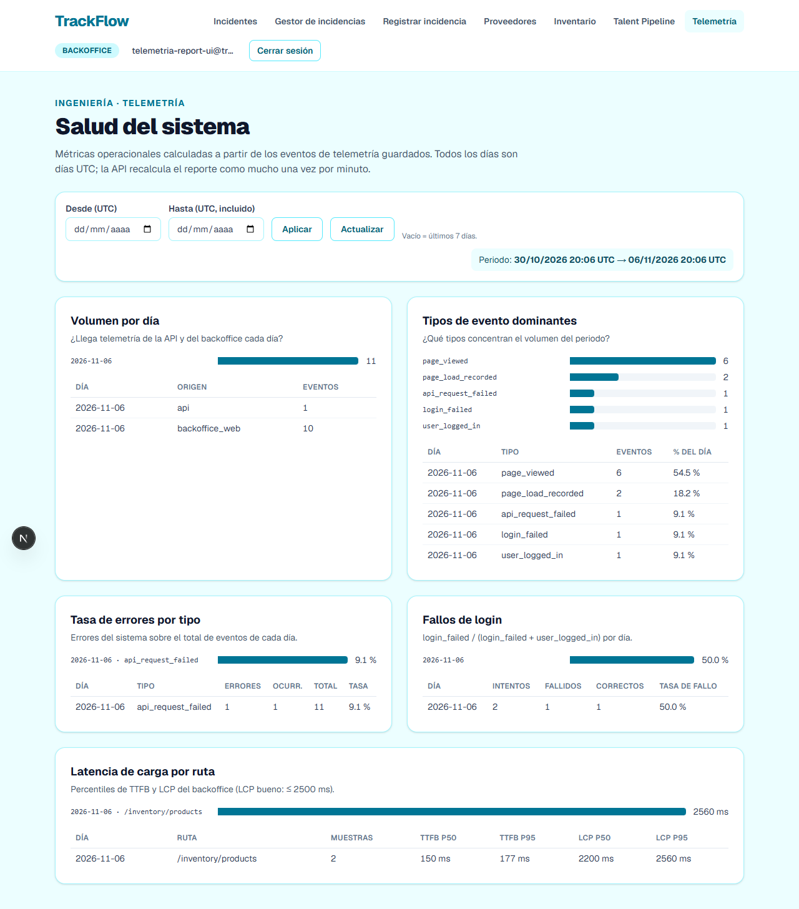

# Hito 17 — Telemetría: pipeline de análisis y reporte operacional

Este documento explica, desde cero, cómo se ha pasado de **tener eventos guardados** (hito 16) a
**tener visibilidad técnica sobre el sistema**: un pipeline en Python que calcula métricas
operacionales con Pandas a partir de `telemetry_events`, un endpoint `GET /telemetry/report` que las
sirve como JSON con caché, y una página del backoffice que las dibuja. Está pensado para que alguien
que nunca ha escrito un pipeline de análisis termine sabiendo por qué cada paso va en el orden en que
va, qué se filtra en SQL y qué en Pandas, y por qué el endpoint no calcula nada.

Los entregables formales son:

- [services/telemetry/analysis.py](services/telemetry/analysis.py): cinco funciones de métrica
  independientes y `build_report()`, que las junta.
- [services/routers/telemetry.py](services/routers/telemetry.py): `GET /telemetry/report` con
  `start_date` / `end_date` opcionales (por defecto, los últimos 7 días) y caché en memoria de 60 s.
- [services/api/routes/auth.py](services/api/routes/auth.py): emite `user_logged_in`, el denominador
  de la métrica de autenticación (actividad adicional).
- [uis/backoffice/app/(protected)/telemetry/](uis/backoffice/app/(protected)/telemetry/telemetry-client.tsx):
  el dashboard técnico `/telemetry` (actividad adicional).
- Tests: [tests/telemetry/test_analysis.py](tests/telemetry/test_analysis.py),
  [tests/telemetry/test_telemetry_report.py](tests/telemetry/test_telemetry_report.py),
  [tests/telemetry/test_auth_failure_rate.py](tests/telemetry/test_auth_failure_rate.py),
  [uis/backoffice/\_\_tests\_\_/telemetry-report.test.ts](uis/backoffice/__tests__/telemetry-report.test.ts)
  y la suite de navegador [tests/ui/telemetry-report.mjs](tests/ui/telemetry-report.mjs).

Commits, uno por fase:

| Commit | Fase |
|---|---|
| `e9023a2` | Fase 1 — pipeline de análisis con Pandas |
| `dd76b9c` | Fase 2 — endpoint `GET /telemetry/report` con caché |
| `d2ea9f2` | Actividad adicional — `user_logged_in` y `auth_failure_rate` |
| `5e9b03b` | Actividad adicional — dashboard `/telemetry` |

---

## Índice

1. [El encargo](#1-el-encargo)
2. [Conceptos básicos](#2-conceptos-básicos)
3. [Fase 1 — El pipeline de análisis](#3-fase-1--el-pipeline-de-análisis)
4. [Fase 2 — El endpoint de reporte](#4-fase-2--el-endpoint-de-reporte)
5. [Actividad adicional — Métrica de autenticación](#5-actividad-adicional--métrica-de-autenticación)
6. [Actividad adicional — Dashboard visual](#6-actividad-adicional--dashboard-visual)
7. [Problemas que aparecieron y cómo se resolvieron](#7-problemas-que-aparecieron-y-cómo-se-resolvieron)
8. [Cómo se comprobó](#8-cómo-se-comprobó)
9. [Cómo arrancarlo y probarlo](#9-cómo-arrancarlo-y-probarlo)
10. [Decisiones discutibles (y cómo defenderlas)](#10-decisiones-discutibles-y-cómo-defenderlas)
11. [Lo que queda pendiente](#11-lo-que-queda-pendiente)
12. [Archivos creados y modificados](#12-archivos-creados-y-modificados)
13. [Checklist de evaluación](#13-checklist-de-evaluación)
14. [Glosario](#14-glosario)

---

## 1. El encargo

El tech lead lo resumió así: *"Tenemos datos. Ahora necesito visibilidad técnica sobre el sistema"*.
Con dos reglas no negociables:

1. **No calcular nada dentro del endpoint en cada request.** El pipeline va aparte; el endpoint lo
   llama, con caché.
2. **Convertir los timestamps a `datetime` antes de cualquier agrupación.** Si no, los grupos salen
   mal sin ningún error visible.

Y una aclaración: **esto no es el reporte del CEO**. Nada de conversión ni ingresos (eso es el hito de
Data Pipelines). La pregunta es *qué tan sano está el sistema*: volumen de eventos, tasa de errores,
latencia, qué tipos de evento dominan. Siempre **con dimensión temporal**: nunca un número global
sin contexto.

---

## 2. Conceptos básicos

### La fórmula de toda métrica

```
MÉTRICA = AGREGACIÓN(columna) agrupada por DIMENSIÓN
```

"Errores por día y tipo" es `count(eventos de error)` agrupado por `(día, event_type)`. "LCP p95 por
ruta" es `quantile(0.95)(lcp_ms)` agrupado por `(día, page_route)`. Si una métrica no tiene
dimensión, no responde a ninguna pregunta: "hubo 412 errores" no dice si van a más o a menos.

### Los cinco pasos, en este orden

| Paso | Dónde | Qué hace |
|---|---|---|
| 1. Cargar | SQL | Solo las filas de la ventana (`timestamp >= :start AND timestamp < :end`) y de los tipos necesarios (`event_type IN (...)`), y solo las columnas que se usan. **Nunca la tabla entera.** |
| 2. Refinar | Pandas | Extraer campos de `tags`, descartar filas con la dimensión nula, construir flags (`is_error`, `failed`). |
| 3. Convertir tipos | Pandas | `pd.to_datetime(df["timestamp"], utc=True)` y `df["date"] = df["timestamp"].dt.date`. |
| 4. Agrupar | Pandas | `groupby()` por la dimensión de la pregunta. |
| 5. Agregar | Pandas | `.agg()`, `.count()`, `.sum()`, `.mean()`, `median`, `quantile`. **Sin bucles.** |

Y al final, `reset_index().to_dict(orient="records")`: una lista de dicts que JSON entiende.

### Por qué convertir el timestamp antes de agrupar

Un timestamp que llega como texto *parece* una fecha, pero para Pandas es un string. Agrupar strings
agrupa **textos iguales**, no **instantes iguales**: `"2026-11-04T23:30:00+01:00"` y
`"2026-11-04T22:30:00Z"` son el mismo instante y caerían en grupos distintos; y si se agrupa por
`timestamp` directamente, cada milisegundo es un grupo. Nada lanza un error: simplemente los números
salen mal. Por eso `_with_dates()` convierte siempre (con `utc=True`, para que todo esté en la misma
zona) **antes** del `groupby`, y el día se saca del `datetime`, no cortando el string.

En este proyecto, además, el tipo de la columna depende de la base de datos: PostgreSQL devuelve
`datetime` con zona y SQLite (los tests) devuelve texto. La conversión hace que las dos den lo mismo.

### Qué filtro va en cada capa

| Criterio | Capa | Por qué |
|---|---|---|
| Ventana de fechas | SQL | Usa el índice `ix_telemetry_events_timestamp`; no trae a memoria lo que no hace falta |
| `event_type` | SQL | Usa `ix_telemetry_events_event_type`. Una tasa carga numerador y denominador **en la misma consulta** |
| Campos dentro de `tags` | Pandas | Se extraen tras cargar; las filas con la dimensión nula se descartan |
| Flags derivados | Pandas | Columnas nuevas y después `.agg()` |

La ventana **se aplica una vez, en SQL**. Ninguna función vuelve a filtrar "últimos 7 días" en Pandas
ni decide su propia ventana: la recibe.

### Funciones puras

Cada métrica es `métrica(start, end, session=None) -> list[dict]`. No llama a `now()`, no escribe
nada, no guarda estado: con los mismos `start` y `end` (y los mismos datos) devuelve lo mismo. Eso es
lo que permite cachear el resultado con tranquilidad y probarla con datos inventados.

### Caché con TTL

Un **TTL** (*time to live*) es cuánto vive una entrada. Con 60 s, la primera petición calcula y guarda;
las siguientes con los mismos parámetros, durante 60 s, reciben lo guardado sin tocar la base de
datos. A cambio, el reporte puede ir hasta 60 s por detrás de los eventos, que para una vista de salud
es irrelevante.

---

## 3. Fase 1 — El pipeline de análisis

### De módulo a paquete

El enunciado pide `services/telemetry/analysis.py`, pero `services/telemetry.py` ya existía (la
ingesta del hito 16). Python no puede tener a la vez un módulo `telemetry.py` y un paquete
`telemetry/` en la misma carpeta, así que el módulo se movió con `git mv` a
`services/telemetry/__init__.py`. Todo el código que hacía `from services import telemetry` o
`services.telemetry.X` sigue funcionando igual. El único cambio fue la ruta de `event-schemas.json`
(un nivel más: `parents[2]`).

### Las cinco métricas

Se eligieron a partir de los eventos **que de verdad se capturan** (no del catálogo entero:
`api_latency_recorded`, por ejemplo, está en el catálogo pero todavía no se emite).

| Clave | Pregunta técnica | Carga (SQL) | Dimensión | Agregación |
|---|---|---|---|---|
| `events_per_day` | ¿Llega telemetría de la API y del backoffice cada día? | `timestamp, source` | día × origen | `count` |
| `events_by_type` | ¿Qué tipos dominan? ¿Cambió de golpe la mezcla? | `timestamp, event_type` | día × tipo | `count` y `share` del día |
| `error_rate_by_type` | ¿Qué se está rompiendo y cuánto pesa? | `timestamp, event_type, tags→occurrences` | día × tipo de error | `count`, `sum(occurrences)`, `errors / total_events` |
| `page_load_latency` | ¿Qué pantallas van lentas y desde cuándo? | `timestamp, tags`, `event_type IN ('page_load_recorded')` | día × ruta | `median` y `quantile(0.95)` de TTFB y LCP |
| `auth_failure_rate` | ¿Cuántos intentos de login fallan? | `timestamp, event_type, tags`, `event_type IN ('login_failed', 'user_logged_in')` | día | `count`, `sum(failed)`, `failed / attempts` |

Las cuatro primeras cubren volumen, composición, errores y latencia; la quinta es la actividad
adicional. Ninguna mide negocio: no hay pedidos por cliente, ni unidades, ni almacenes comparados.

### Qué es un "error" aquí

`ERROR_EVENT_TYPES` son **errores del sistema**: algo se rompió.

| Evento | Qué significa |
|---|---|
| `api_error_occurred` | Excepción no controlada en la API |
| `api_request_failed` | El navegador no obtuvo respuesta válida (red, timeout, 5xx) |
| `database_connection_failed` | La API no pudo hablar con Supabase |
| `frontend_error_captured` | Error de JavaScript no controlado en el backoffice |
| `password_reset_email_failed` | Falló el proveedor de correo |

Lo que **no** es un error del sistema: `outbound_order_rejected` (sin stock), `order_validation_failed`
(formulario mal rellenado)… Son la API haciendo bien su trabajo. Meterlos inflaría la tasa con
comportamiento correcto. `login_failed` tiene su propia métrica.

La tasa es `errors / total_events` del mismo día: por eso esta métrica carga **todos** los tipos de la
ventana (el denominador), aunque solo trae tres columnas. De `tags` solo se trae `occurrences`,
extraído en la propia consulta (`tags['occurrences']`, que SQLAlchemy traduce a `->>` en PostgreSQL y
a `JSON_EXTRACT` en SQLite): es la optimización opcional que permite el enunciado, para no traer el
JSONB entero de cada evento de la semana.

`errors` y `occurrences` son cosas distintas: el navegador **deduplica** los errores de JavaScript
repetidos y manda uno con `occurrences: 4`. `errors` cuenta eventos (y es lo que entra en la tasa,
para que numerador y denominador estén en la misma unidad); `occurrences` cuenta los fallos reales.

### Latencia: percentiles, no medias

Para tiempos de carga se usan la mediana (p50) y el percentil 95, no la media: cinco cargas de 10 s
entre cien de 200 ms hunden la experiencia de esos usuarios y apenas mueven la media. `ttfb_ms` es lo
que tarda el primer byte (servidor + red), lo más cercano a "latencia de la API" que se captura hoy;
`lcp_ms` es cuándo se ve el contenido (umbral "bueno" de Core Web Vitals: 2500 ms). Los LCP nulos
(la pestaña se cerró antes de medirlo) no cuentan en sus percentiles, pero la muestra sí cuenta para
TTFB. Las filas sin `page_route` se descartan antes de agrupar.

### El recorrido de una métrica, paso a paso

`auth_failure_rate`, entera:

```python
df = _load(session, start, end, [TABLE.c.timestamp, TABLE.c.event_type, TABLE.c.tags],
           event_types=(LOGIN_FAILED_EVENT, LOGIN_SUCCEEDED_EVENT))   # 1. SQL: ventana + IN (...)
df = _extract_tags(df, "auth_method")                                  # 2. refinar: campo de tags
df = df[(df["event_type"] == LOGIN_FAILED_EVENT) | (df["auth_method"] == "password_json")].copy()
df["failed"] = df["event_type"] == LOGIN_FAILED_EVENT                  #    flags
df["succeeded"] = ~df["failed"]
df = _with_dates(df)                                                   # 3. to_datetime(utc=True)
result = df.groupby("date").agg(attempts=("event_type", "count"),      # 4. agrupar
                                failed=("failed", "sum"),              # 5. agregar
                                succeeded=("succeeded", "sum"))
result["failure_rate"] = (result["failed"] / result["attempts"]).round(4)
return _records(result)                                                # lista de dicts
```

`_records()` hace el `reset_index().to_dict(orient="records")` y deja el resultado listo para JSON:
fechas como `"2026-11-06"` y `NaN` como `null` (un `NaN` en JSON es inválido y rompería el
navegador).

### `build_report()`

Abre **una** sesión, llama a cada función de `METRICS` con la misma ventana y devuelve
`{"period": {"from", "to"}, "metrics": {...}}`. No cachea: eso es del endpoint.

---

## 4. Fase 2 — El endpoint de reporte

```
GET /telemetry/report?start_date=2026-11-01T00:00:00Z&end_date=2026-11-08T00:00:00Z
Authorization: Bearer <token>
```

```json
{
  "period": { "from": "2026-11-01T00:00:00Z", "to": "2026-11-08T00:00:00Z" },
  "metrics": {
    "events_per_day":     [{ "date": "2026-11-06", "source": "backoffice_web", "events": 18 }],
    "events_by_type":     [{ "date": "2026-11-06", "event_type": "page_viewed", "events": 7, "share": 0.3684 }],
    "error_rate_by_type": [{ "date": "2026-11-06", "event_type": "frontend_error_captured", "errors": 1,
                             "occurrences": 1, "total_events": 19, "error_rate": 0.0526 }],
    "page_load_latency":  [{ "date": "2026-11-06", "page_route": "/inventory/orders/outbound", "samples": 1,
                             "ttfb_p50_ms": 91.0, "ttfb_p95_ms": 91.0, "lcp_p50_ms": 2804.0, "lcp_p95_ms": 2804.0 }],
    "auth_failure_rate":  [{ "date": "2026-11-06", "attempts": 1, "failed": 1, "succeeded": 0, "failure_rate": 1.0 }]
  }
}
```

(Fragmento real del Supabase del proyecto, ejecutado en solo lectura.)

### El periodo se resuelve una vez

`resolve_period()` es el único sitio que decide la ventana:

- `end_date` por defecto **ahora** (UTC); `start_date` por defecto `end_date − 7 días`.
- Fechas sin zona horaria se interpretan como UTC; con zona, se pasan a UTC.
- `start` es inclusivo y `end` exclusivo: dos semanas contiguas nunca cuentan el mismo evento.
- 422 si no son ISO 8601, si `start >= end` o si la ventana pasa de 90 días (cargaría demasiadas
  filas en memoria de una vez).

Después pasa `start` y `end` a `analysis.build_report`; las funciones no tienen ventana propia.

### La caché

Se reutiliza `response_cache` (el `TTLCache` del hito de caching, `services/api/cache.py`) con
`get_or_set(clave, 60, calcular)`:

- **La clave son los parámetros tal como se pidieron**, normalizados a UTC: `?start_date=…T01:00+01:00`
  y `?start_date=…T00:00Z` comparten entrada.
- **Sin parámetros la clave es fija** (`/telemetry/report`). Si la clave fuera el periodo *resuelto*,
  cada petición tendría un "ahora" distinto y la caché no acertaría nunca: el caso más común (abrir el
  dashboard) recalcularía siempre. Con la clave fija, durante 60 s se sirve el reporte calculado en la
  primera petición, y su `period.to` dice exactamente hasta qué instante cubre.
- **Un error no se cachea**: si Supabase falla, 503, y la siguiente petición vuelve a intentarlo.
- No se invalida al ingerir eventos: el TTL es el retraso máximo aceptado, y se evita que cada lote
  del backoffice (cada 10 s) tire el reporte.

En el log de la API se ve: `MISS /telemetry/report` + `telemetry_report computed from=… to=…` la
primera vez, y `HIT /telemetry/report` las siguientes.

### Otras decisiones del endpoint

- **Requiere JWT** (`get_current_user`): son datos internos de operación.
- **Ruta síncrona** (`def`, no `async def`): FastAPI la ejecuta en el threadpool, así la consulta a
  Supabase no bloquea el bucle de eventos.
- El router **no importa Pandas ni hace consultas**: un test lo comprueba.

---

## 5. Actividad adicional — Métrica de autenticación

El enunciado propone `user_login_failed / (user_login_failed + user_login_succeeded)`. En este
proyecto los eventos se llaman `login_failed` y `user_logged_in` (taxonomía `entidad_acción` del plan).

El problema: `login_failed` se capturaba desde el hito 15, pero **`user_logged_in` estaba en el
catálogo como pendiente (⏳) y nadie lo emitía**. Sin éxitos, la tasa siempre valdría 100 %. Se
instrumentó donde decía el plan: `_issue_token()` en `services/api/routes/auth.py` emite
`user_logged_in` con `auth_method` (`password_json` en `/auth/login`, `oauth2_form` en `/auth/token`,
el de Swagger) y `user_role`. El plan pasa ese evento a ✅.

Dos detalles de la fórmula:

- Los dos tipos se cargan en **una sola consulta** con `event_type IN ('login_failed', 'user_logged_in')`,
  y la razón se calcula en Pandas.
- **Solo cuentan los éxitos de `password_json`**. `login_failed` lo emite el formulario del backoffice,
  que llama a `/auth/login`. Un login por Swagger no tiene fallo equivalente medido: contarlo en el
  denominador bajaría la tasa con intentos de los que nunca se ven los fallos. Es el ejemplo de
  "predicado opcional sobre `tags`" del enunciado: se filtra en Pandas tras extraer el campo.

Los fallos no se emiten desde la API a propósito: el navegador ve también la red caída y los 5xx
(`failure_reason: network_error | server_error`), que la API nunca llega a ver.

---

## 6. Actividad adicional — Dashboard visual

`/telemetry` en el backoffice (enlace "Telemetría" en la cabecera):

- **El periodo** (`from → to`, en UTC) arriba a la derecha, para que quede claro qué cubren los
  números.
- Filtro **Desde / Hasta** (días UTC; "Hasta" es inclusivo en pantalla y se convierte en
  `end_date` = 00:00 UTC del día siguiente). Vacío = últimos 7 días. Botón **Actualizar**.
- **Una sección por métrica**: barras horizontales de una sola serie con el valor escrito al lado
  (no depende del color; `title` da el detalle al pasar el ratón) y debajo la tabla con todas las
  filas que devuelve la API.
- Sin librerías nuevas: el backoffice no tenía ninguna de gráficos, y barras con Tailwind bastan.
- El frontend no calcula métricas: solo suma filas para las barras de resumen (eventos por día y
  tipos del periodo), con funciones puras probadas en Jest.



*(La captura se genera con `TELEMETRY_REPORT_SCREENSHOT=<ruta.png> node tests/ui/run.mjs telemetry-report`;
la suite no escribe nada en el repositorio por defecto.)*

---

## 7. Problemas que aparecieron y cómo se resolvieron

### 7.1 `services/telemetry.py` ya existía

Ver [De módulo a paquete](#de-módulo-a-paquete). Un test del hito 16 que lee el código fuente para
comprobar que nunca hay `UPDATE`/`DELETE` apuntaba a la ruta antigua; ahora vigila
`services/telemetry/__init__.py` **y** `analysis.py`.

### 7.2 La caché nunca acertaba con el periodo por defecto

El primer diseño usaba como clave el periodo resuelto. Con `end = now()`, cada petición era distinta.
Se cambió a la clave por parámetros pedidos (ver [La caché](#la-caché)), y un test lo fija:
`test_the_default_period_is_also_cached`.

### 7.3 `user_logged_in` no se emitía

Ver [sección 5](#5-actividad-adicional--métrica-de-autenticación).

### 7.4 Un `monkeypatch.undo()` deshacía demasiado

En el test de "un error no se cachea", `monkeypatch.undo()` restauraba también el `open_session` que
el fixture global apunta a SQLite, así que la segunda petición iba a una base sin tabla y daba 503.
El síntoma parecía "el error se cacheó", pero el log mostraba `MISS` dos veces: la caché funcionaba.
Se sustituyó el `undo()` por volver a poner la función original.

### 7.5 `NaN` en el JSON

Una ruta cuyas cargas no tienen LCP da `NaN` en sus percentiles. `json.dumps` lo escribe como `NaN`,
que **no es JSON válido** y `JSON.parse` del navegador rechaza. `_records()` convierte `NaN` en `None`
(`null`), y un test serializa todas las métricas con `allow_nan=False`.

### 7.6 Pandas 3

`uv add pandas` instaló la 3.1. Su tipo de texto por defecto y el copy-on-write obligan a no modificar
vistas: por eso `_with_dates()` trabaja sobre una copia y los filtros terminan en `.copy()` antes de
añadir columnas.

---

## 8. Cómo se comprobó

| Comprobación | Resultado |
|---|---|
| `uv run pytest` (toda la suite) | **998 passed** |
| `tests/telemetry/test_analysis.py` | 17 tests: ventana `[start, end)`, agrupación por día UTC, cada métrica con datos conocidos, filtros en el SQL emitido, sin `SELECT *`, determinismo, JSON sin NaN, sin bucles (análisis del AST: ni `for` ni `while` en `analysis.py`) |
| `tests/telemetry/test_telemetry_report.py` | 12 tests: 401 sin sesión, estructura, 7 días por defecto, fechas sin zona/con offset, 422, caché (acierto en 59 s, fallo a los 61 s, periodo por defecto cacheado, claves equivalentes), 503 no cacheado, el router no calcula |
| `tests/telemetry/test_auth_failure_rate.py` | 4 tests: `user_logged_in` con método y rol, Swagger = `oauth2_form`, contraseña errónea no emite, reporte combinado 2 fallos + 1 éxito = 0,6667 |
| `npx jest` (backoffice) | **188 passed**; `tsc --noEmit` y `eslint` limpios |
| `node tests/ui/run.mjs telemetry-report` | **8/8**: Chrome real, API con SQLite desechable, periodo visible, cinco secciones, cifras del pipeline |
| `node tests/ui/run.mjs telemetry` (hitos 15/16) | **20/20**: el nuevo `user_logged_in` no rompe nada |
| `build_report` contra el Supabase real (solo lectura) | Correcto en PostgreSQL, incluida la extracción `tags->>'occurrences'` |

---

## 9. Cómo arrancarlo y probarlo

### Arrancar

Con Docker (API en :8000 y backoffice en :3001):

```sh
docker compose up --build -V     # -V: pandas es una dependencia nueva
```

O en local:

```sh
uv sync                                              # instala pandas
uv run uvicorn services.api.main:app --reload --port 8000
npm run dev --prefix uis/backoffice                  # http://localhost:3001/telemetry
```

### Probar el endpoint

```sh
# 1. Token
TOKEN=$(curl -s -X POST http://localhost:8000/auth/login \
  -H "Content-Type: application/json" \
  -d '{"email":"<tu-email>","password":"<tu-contraseña>"}' | python -c "import sys,json;print(json.load(sys.stdin)['access_token'])")

# 2. Últimos 7 días
curl -s http://localhost:8000/telemetry/report -H "Authorization: Bearer $TOKEN"

# 3. Periodo concreto
curl -s "http://localhost:8000/telemetry/report?start_date=2026-11-01T00:00:00Z&end_date=2026-11-08T00:00:00Z" \
  -H "Authorization: Bearer $TOKEN"
```

También desde Swagger: `http://localhost:8000/docs` → **Authorize** → `GET /telemetry/report`.
Repetir la misma petición antes de 60 s muestra `HIT /telemetry/report` en el log de la API.

### Tests

```sh
uv run pytest tests/telemetry
npm test --prefix uis/backoffice
node tests/ui/run.mjs telemetry-report
```

---

## 10. Decisiones discutibles (y cómo defenderlas)

| Decisión | Alternativa | Por qué así |
|---|---|---|
| Tasa de error sobre **todos** los eventos del día | Sobre peticiones a la API | No se captura el total de peticiones (`api_latency_recorded` no se emite). Todos los eventos son la mejor aproximación de actividad que hay; se documenta y se sustituye cuando exista el denominador real |
| Solo errores del sistema | Incluir rechazos de negocio | Un rechazo por falta de stock es la API funcionando bien |
| `occurrences` extraído en SQL | Cargar `tags` entero | Esta métrica lee todos los eventos de la ventana; traer el JSONB de cada uno sería el mayor coste de memoria del reporte |
| Clave de caché fija sin parámetros | Redondear "ahora" al minuto | Igual de efectiva y más simple; el `period.to` devuelto es exacto |
| No invalidar al ingerir | Invalidar con cada lote | Los lotes llegan cada 10 s: la caché no serviría de nada |
| Ventana máxima de 90 días | Sin límite | "Nunca cargues toda la tabla en memoria" |
| Endpoint con JWT | Público | Datos internos; el dashboard ya tiene el token |
| Barras con CSS | Librería de gráficos | No había ninguna; el enunciado pide funcional y legible |

---

## 11. Lo que queda pendiente

- **Latencia real de la API**: emitir `api_latency_recorded` (agregado por ventana de 60 s en el
  middleware) daría p50/p95 por ruta y el denominador correcto para la tasa de errores de la API.
- Los días sin eventos no aparecen en las listas (no hay fila con 0). Un dashboard que dibuje series
  temporales debería rellenarlos.
- La caché es por proceso: con varios workers de uvicorn cada uno calcula el suyo.
- Restringir `/telemetry/report` a administradores si el reporte crece en detalle.

---

## 12. Archivos creados y modificados

| Archivo | Cambio |
|---|---|
| `services/telemetry.py` → `services/telemetry/__init__.py` | Movido (paquete); ruta de `event-schemas.json` |
| `services/telemetry/analysis.py` | **Nuevo**: pipeline |
| `services/routers/telemetry.py` | `GET /telemetry/report`, `resolve_period`, caché |
| `services/api/routes/auth.py` | Emite `user_logged_in` |
| `services/database.py` | Docstring |
| `pyproject.toml`, `uv.lock`, `services/requirements.txt` | `pandas` |
| `TELEMETRY_PLAN.md` | `user_logged_in` ✅ |
| `tests/telemetry/test_analysis.py`, `test_telemetry_report.py`, `test_auth_failure_rate.py` | **Nuevos** |
| `tests/telemetry/test_telemetry_storage.py`, `tests/test_api_characterization.py` | Rutas actualizadas |
| `uis/backoffice/app/(protected)/telemetry/page.tsx`, `telemetry-client.tsx` | **Nuevos**: dashboard |
| `uis/backoffice/app/lib/telemetry-report.ts`, `__tests__/telemetry-report.test.ts` | **Nuevos** |
| `uis/backoffice/app/ui/backoffice-header.tsx` | Enlace "Telemetría" |
| `tests/ui/telemetry-report.mjs`, `tests/ui/run.mjs` | **Nueva** suite de navegador |

---

## 13. Checklist de evaluación

| Criterio | Dónde se cumple |
|---|---|
| `services/telemetry/analysis.py` con ≥ 3 funciones independientes | Cinco: `events_per_day`, `events_by_type`, `error_rate_by_type`, `page_load_latency`, `auth_failure_rate` |
| Orden cargar → refinar → convertir → agrupar → agregar | Cada función, con `_load`, `_extract_tags`, `_with_dates`, `groupby`, `.agg` |
| `to_datetime(utc=True)` antes de cualquier `groupby` temporal | `_with_dates()`; `test_events_are_grouped_by_utc_day_not_by_raw_timestamp` |
| Sin bucles | `test_metrics_use_no_loops` (AST) |
| Lista de dicts serializable | `_records()`; `test_every_metric_is_deterministic_and_json_serializable` |
| `start_date` / `end_date` opcionales, 7 días por defecto | `resolve_period()`; `test_default_period_is_the_last_seven_days_in_utc` |
| `{ "period": {...}, "metrics": {...} }` | `TelemetryReport`; `test_report_structure_with_explicit_period` |
| Caché en memoria con TTL de 60 s | `response_cache.get_or_set(..., 60, ...)`; tests de caché |
| Métricas técnicas, no de negocio | Volumen, composición, errores, latencia, login |
| Con dimensión de agrupamiento | Todas por día (y origen, tipo o ruta) |
| Extra: `auth_failure_rate` con `IN (...)` en SQL | `auth_failure_rate()` + `user_logged_in` |
| Extra: dashboard con el periodo visible | `/telemetry`; `tests/ui/telemetry-report.mjs` |

---

## 14. Glosario

| Término | Significado |
|---|---|
| **Pipeline de análisis** | Secuencia fija de pasos que convierte datos crudos en métricas |
| **Métrica operacional** | Mide cómo se comporta el sistema (volumen, errores, latencia), no el negocio |
| **Dimensión** | La columna por la que se agrupa: día, tipo, ruta |
| **`groupby` / `agg`** | Agrupar filas por dimensión y resumir cada grupo |
| **Percentil 95 (p95)** | El valor por debajo del que queda el 95 % de las muestras |
| **TTFB** | *Time To First Byte*: hasta que llega el primer byte de la respuesta |
| **LCP** | *Largest Contentful Paint*: cuándo se pinta el contenido principal |
| **TTL** | Tiempo que vive una entrada de caché |
| **Función pura** | Sin efectos secundarios: mismas entradas, misma salida |
| **Push-down** | Mover un filtro o extracción a SQL para no traer datos de más |
| **Ventana semiabierta `[start, end)`** | Incluye el inicio y excluye el fin |
